# Beonic Insights 3.0 (i3) Widget Examples
This document contains example widget definitions using the Beonic Insights 3.0 widget definition language. Each widget defines a query against the Beonic data platform and visualization settings to present the retrieved tabular data.
## UserProfileCampaigns
#### Postcode Clicks
Count the number of regos that clicked a campaign
```json
{
  "keyAliases": {
    "country": [
      "Australia"
    ],
    "state": [
      "victoria"
    ],
    "campaignEventType": [
      "CLICKED"
    ]
  },
  "columnNames": [
    "Postcode",
    "Clicked",
    "Postcode Click Ratio"
  ],
  "rowSets": [
    {
      "columns": [
        {
          "dimension": {
            "key": "postcode"
          }
        },
        {
          "numericExpression": {
            "metric": "UserProfileCampaigns",
            "value": {
              "counter": "total"
            }
          },
          "sortSpecification": {
            "ascending": false,
            "priority": 1
          }
        },
        {
          "numericExpression": {
            "$divide": [
              {
                "metric": "UserProfileCampaigns",
                "value": {
                  "counter": "total"
                }
              },
              {
                "metric": "UserProfileCampaigns",
                "value": {
                  "counter": "total"
                },
                "aggregateAcross": [
                  {
                    "key": "postcode"
                  }
                ]
              }
            ]
          },
          "unit": "percentage",
          "decimalPlaces": 2
        }
      ]
    }
  ],
  "visualisation": {
    "type": "Table",
    "title": "Postcode Clicks",
    "description": {
      "html": "Count the number of regos that clicked a campaign"
    },
    "imageFile": "",
    "tableSettings": {
      "columnSettings": {},
      "paginate": false,
      "scrollOverflow": true
    }
  }
}
```


**Visualization Preview:** This is a tabular data visualization showing "Postcode Clicks" performance metrics. The table displays three columns:

1. **Postcode** - Geographic postal codes (3181, 3141, 3182, etc.)
2. **Clicked** - Number of clicks received from each postcode
3. **Postcode Click Ratio** - Click rate percentage for each area

**Key Insights:**
- Postcode 3181 is the top performer with 240 clicks and the highest click ratio at 26.55%
- Postcode 3141 follows with 161 clicks (17.81% ratio)
- Performance drops significantly after the top two, with remaining postcodes showing much lower engagement
- The data reveals clear geographic performance disparities, with some areas generating 10x+ more clicks than others
- This information is valuable for targeted marketing and resource allocation decisions based on geographic response rates

The visualization effectively ranks postcodes by engagement, helping identify high-performing geographic segments for campaign optimization.
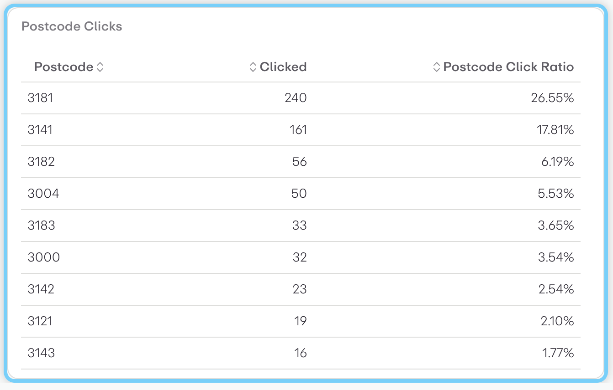

#### campaigns
Widget showing campaign event types. Displayed as a Table.
```json
{
  "columnNames": [
    "Campaign",
    "Count"
  ],
  "keyAliases": {
    "c0": {
      "entity": "Campaign",
      "ids": [
        "9641",
        "9642",
        "9643"
      ]
    }
  },
  "rowSets": [
    {
      "columns": [
        {
          "dimension": {
            "key": "campaignEventType"
          }
        },
        {
          "numericExpression": {
            "metric": "UserProfileCampaigns",
            "value": {
              "counter": "total"
            }
          },
          "sortSpecification": {
            "ascending": false,
            "priority": 1
          }
        }
      ]
    }
  ],
  "visualisation": {
    "description": {
      "html": ""
    },
    "type": "Table",
    "title": "campaigns",
    "tableSettings": {
      "paginate": false,
      "scrollOverflow": true
    }
  }
}
```

#### Profiles by Campaign x Event-Type
Count profiles that had an event on a campaign
```json
{
  "keyAliases": {
    "campaignEventType": [
      "BOUNCED",
      "CLICKED",
      "DELIVERED",
      "OPENED",
      "SPAM",
      "UNSUBSCRIBED",
      "FAILED"
    ]
  },
  "columnNames": [
    "Campaign",
    {
      "name": "event",
      "dimension": {
        "key": "campaignEventType"
      }
    }
  ],
  "rowSets": [
    {
      "columns": [
        {
          "dimension": {
            "key": "campaign"
          }
        },
        {
          "numericExpression": {
            "metric": "UserProfileCampaigns",
            "value": {
              "counter": "total"
            }
          },
          "sortSpecification": {
            "ascending": false,
            "priority": 1
          }
        }
      ]
    }
  ],
  "visualisation": {
    "description": {
      "html": "Count profiles that had an event on a campaign"
    },
    "type": "Table",
    "title": "Profiles by Campaign x Event-Type",
    "tableSettings": {
      "paginate": false,
      "scrollOverflow": true
    }
  }
}
```

#### Campaign Postcodes
Campaigns and postcodes of the registrations engaging with them
```json
{
  "columnNames": [
    "Campaign",
    "Postcode",
    "Count"
  ],
  "keyAliases": {
    "c0": {
      "entity": "Campaign",
      "ids": [
        "9641",
        "9642",
        "9643"
      ]
    }
  },
  "rowSets": [
    {
      "columns": [
        {
          "dimension": {
            "key": "campaign"
          },
          "sortSpecification": {
            "ascending": true,
            "priority": 1
          }
        },
        {
          "dimension": {
            "key": "postcode"
          },
          "sortSpecification": {
            "ascending": true,
            "priority": 2
          }
        },
        {
          "numericExpression": {
            "metric": "UserProfileCampaigns",
            "value": {
              "counter": "total"
            }
          }
        }
      ]
    }
  ],
  "visualisation": {
    "description": {
      "html": "Campaigns and postcodes of the registrations engaging with them"
    },
    "type": "Table",
    "title": "Campaign Postcodes",
    "tableSettings": {
      "paginate": false,
      "scrollOverflow": true
    }
  }
}
```

#### campaign events
Count campaign events
```json
{
  "keyAliases": {
    "c0": {
      "entity": "Campaign",
      "ids": [
        "9641",
        "9642",
        "9643"
      ]
    }
  },
  "columnNames": [
    "total"
  ],
  "rowSets": [
    {
      "columns": [
        {
          "numericExpression": {
            "metric": "UserProfileCampaigns",
            "value": {
              "counter": "total"
            }
          }
        }
      ]
    }
  ],
  "visualisation": {
    "description": {
      "html": "Count campaign events"
    },
    "type": "Number",
    "title": "campaign events"
  }
}
```

#### Weekly Campaign events
Creates a table of Campaigns by week and campaign event type.
```json
{
  "columnNames": [
    "Date",
    "EventType",
    "Count"
  ],
  "rowSets": [
    {
      "columns": [
        {
          "dimension": {
            "timeBasedDimension": "Weekly"
          }
        },
        {
          "dimension": {
            "key": "campaignEventType"
          }
        },
        {
          "numericExpression": {
            "metric": "UserProfileCampaigns",
            "value": {
              "counter": "total"
            }
          }
        }
      ]
    }
  ],
  "visualisation": {
    "description": {
      "html": "Creates a table of Campaigns by week and campaign event type."
    },
    "type": "Table",
    "title": "Weekly Campaign events",
    "tableSettings": {
      "paginate": false,
      "scrollOverflow": true
    }
  }
}
```


**Visualization Preview:** This is a **table visualization** showing weekly email campaign performance data.

**Data displayed:**
- Time period: Three dates (01/09/2025, 08/09/2025, 15/09/2025)
- Event types: OPENED, UNSUBSCRIBED, CLICKED, SPAM
- Count values for each event type by date

**Key insights:**
- **08/09/2025** was the most active campaign date with 590 opens, 24 unsubscribes, 2 clicks, and 2 spam reports
- **01/09/2025** shows zero activity across all metrics
- **15/09/2025** shows only 271 opens with no other events recorded
- The data suggests declining engagement from 08/09 to 15/09, with very low click-through rates (2 clicks from 590 opens = 0.34% CTR)

This tabular format provides a clear breakdown of email campaign metrics over time, allowing for easy comparison of performance across different dates and event types.
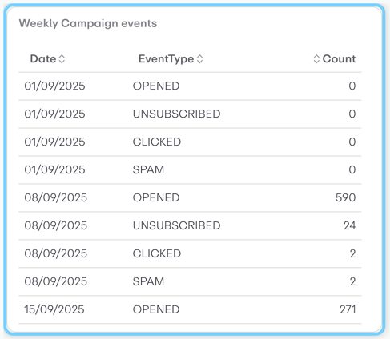

#### Auto Triggered by Venue and Zone
Count the regos that triggered a campaign in a zone
```json
{
  "columnNames": [
    "Venue",
    "Zone",
    "Count"
  ],
  "keyAliases": {},
  "rowSets": [
    {
      "columns": [
        {
          "dimension": {
            "key": "venueId"
          }
        },
        {
          "dimension": {
            "key": "zoneId",
            "missing": true
          }
        },
        {
          "numericExpression": {
            "metric": "UserProfileCampaigns",
            "value": {
              "counter": "total"
            }
          },
          "sortSpecification": {
            "ascending": false,
            "priority": 1
          }
        }
      ]
    }
  ],
  "visualisation": {
    "description": {
      "html": "Count the regos that triggered a campaign in a zone"
    },
    "type": "Table",
    "title": "Auto Triggered by Venue and Zone",
    "tableSettings": {
      "paginate": false,
      "scrollOverflow": true
    }
  }
}
```

#### campaigns
Widget showing campaigns. Displayed as a Table.
```json
{
  "columnNames": [
    "Campaign",
    "Count"
  ],
  "keyAliases": {
    "c0": {
      "entity": "Campaign",
      "ids": [
        "9641",
        "9642",
        "9643"
      ]
    }
  },
  "rowSets": [
    {
      "columns": [
        {
          "dimension": {
            "key": "campaign"
          }
        },
        {
          "numericExpression": {
            "metric": "UserProfileCampaigns",
            "value": {
              "counter": "total"
            }
          },
          "sortSpecification": {
            "ascending": false,
            "priority": 1
          }
        }
      ]
    }
  ],
  "visualisation": {
    "description": {
      "html": ""
    },
    "type": "Table",
    "title": "campaigns",
    "tableSettings": {
      "paginate": false,
      "scrollOverflow": true
    }
  }
}
```

#### Gender Composition
Percentages of Males and Females
```json
{
  "keyAliases": {
    "c0": {
      "entity": "Campaign",
      "ids": [
        "9641",
        "9642",
        "9643"
      ]
    }
  },
  "columnNames": [
    "gender",
    "percentage"
  ],
  "rowSets": [
    {
      "columns": [
        {
          "dimension": {
            "key": "gender"
          }
        },
        {
          "numericExpression": {
            "$divide": [
              {
                "metric": "UserProfileCampaigns",
                "value": {
                  "counter": "total"
                }
              },
              {
                "metric": "UserProfileCampaigns",
                "value": {
                  "counter": "total"
                },
                "aggregateAcross": [
                  {
                    "key": "gender"
                  }
                ]
              }
            ]
          },
          "unit": "percentage",
          "decimalPlaces": 2
        }
      ]
    }
  ],
  "visualisation": {
    "description": {
      "html": "Percentages of Males and Females"
    },
    "type": "MultiNumber",
    "title": "Gender Composition"
  }
}
```


## UserProfileClicks
#### Campaign Clickers by Gender (postcodes 5000,5082,5085,5066,5067)
Shows clicks  broken down by campaign gender. Displayed as a Table.
```json
{
  "columnNames": [
    "Campaign",
    "Postcode",
    "Count"
  ],
  "keyAliases": {
    "postcode": [
      "5000",
      "5082",
      "5085",
      "5066",
      "5067"
    ]
  },
  "rowSets": [
    {
      "columns": [
        {
          "dimension": {
            "key": "campaign"
          },
          "sortSpecification": {
            "ascending": false,
            "priority": 1
          }
        },
        {
          "dimension": {
            "key": "gender"
          }
        },
        {
          "numericExpression": {
            "metric": "UserProfileClicks",
            "value": {
              "counter": "total"
            }
          },
          "sortSpecification": {
            "ascending": false,
            "priority": 2
          }
        }
      ]
    }
  ],
  "visualisation": {
    "description": {
      "html": ""
    },
    "type": "Table",
    "title": "Campaign Clickers by Gender (postcodes 5000,5082,5085,5066,5067)",
    "tableSettings": {
      "paginate": false,
      "scrollOverflow": true
    }
  }
}
```

#### Campaign Clicks
Shows clicks  broken down by campaign. Displayed as a Table.
```json
{
  "columnNames": [
    "Campaign",
    "Count"
  ],
  "rowSets": [
    {
      "columns": [
        {
          "dimension": {
            "key": "campaign"
          }
        },
        {
          "numericExpression": {
            "metric": "UserProfileClicks",
            "value": {
              "counter": "total"
            }
          },
          "sortSpecification": {
            "ascending": false,
            "priority": 1
          }
        }
      ]
    }
  ],
  "visualisation": {
    "description": {
      "html": ""
    },
    "type": "Table",
    "title": "Campaign Clicks",
    "tableSettings": {
      "paginate": false,
      "scrollOverflow": true
    }
  }
}
```

#### Auto Campaign Clicks by PageType
Shows clicks  broken down by pageType. Displayed as a Table.
```json
{
  "columnNames": [
    "Venue",
    "Count"
  ],
  "rowSets": [
    {
      "columns": [
        {
          "dimension": {
            "key": "pageType"
          }
        },
        {
          "numericExpression": {
            "metric": "UserProfileClicks",
            "value": {
              "counter": "total"
            }
          },
          "sortSpecification": {
            "ascending": false,
            "priority": 1
          }
        }
      ]
    }
  ],
  "visualisation": {
    "description": {
      "html": ""
    },
    "type": "Table",
    "title": "Auto Campaign Clicks by PageType",
    "tableSettings": {
      "paginate": false,
      "scrollOverflow": true
    }
  }
}
```

#### Clicks by Portal
Shows clicks  broken down by portal. Displayed as a Table.
```json
{
  "columnNames": [
    "Portal",
    "Count"
  ],
  "rowSets": [
    {
      "columns": [
        {
          "dimension": {
            "key": "portal"
          }
        },
        {
          "numericExpression": {
            "metric": "UserProfileClicks",
            "value": {
              "counter": "total"
            }
          },
          "sortSpecification": {
            "ascending": false,
            "priority": 1
          }
        }
      ]
    }
  ],
  "visualisation": {
    "description": {
      "html": ""
    },
    "type": "Table",
    "title": "Clicks by Portal",
    "tableSettings": {
      "paginate": false,
      "scrollOverflow": true
    }
  }
}
```

#### Clicks by URL
Shows clicks  broken down by url. Displayed as a Table.
```json
{
  "columnNames": [
    "URL",
    "Count"
  ],
  "rowSets": [
    {
      "columns": [
        {
          "dimension": {
            "key": "url"
          },
          "sortSpecification": {
            "ascending": true,
            "priority": 1
          }
        },
        {
          "numericExpression": {
            "metric": "UserProfileClicks",
            "value": {
              "counter": "total"
            }
          }
        }
      ]
    }
  ],
  "visualisation": {
    "description": {
      "html": ""
    },
    "type": "Table",
    "title": "Clicks by URL",
    "tableSettings": {
      "paginate": false,
      "scrollOverflow": true
    }
  }
}
```

#### Auto Campaign Clicks by Venue
Shows clicks  broken down by venue. Displayed as a Table.
```json
{
  "columnNames": [
    "Venue",
    "Count"
  ],
  "rowSets": [
    {
      "columns": [
        {
          "dimension": {
            "key": "venueId"
          }
        },
        {
          "numericExpression": {
            "metric": "UserProfileClicks",
            "value": {
              "counter": "total"
            }
          },
          "sortSpecification": {
            "ascending": false,
            "priority": 1
          }
        }
      ]
    }
  ],
  "visualisation": {
    "description": {
      "html": ""
    },
    "type": "Table",
    "title": "Auto Campaign Clicks by Venue",
    "tableSettings": {
      "paginate": false,
      "scrollOverflow": true
    }
  }
}
```

#### Day Of Week Clicks
Creates a table of Clicks by day of week.
```json
{
  "columnNames": [
    "Date",
    "Count"
  ],
  "rowSets": [
    {
      "columns": [
        {
          "dimension": {
            "timeBasedDimension": "DayOfWeek"
          }
        },
        {
          "numericExpression": {
            "metric": "UserProfileClicks",
            "value": {
              "counter": "total"
            }
          }
        }
      ]
    }
  ],
  "visualisation": {
    "description": {
      "html": "Creates a table of Clicks by day of week."
    },
    "type": "Table",
    "title": "Day Of Week Clicks",
    "tableSettings": {
      "paginate": false,
      "scrollOverflow": true
    }
  }
}
```


**Visualization Preview:** This is a **table visualization** showing "Day Of Week Clicks" data with two columns: Date (days of the week) and Count (number of clicks).

**Data displayed:**
- Monday: 3 clicks
- Tuesday: 0 clicks  
- Wednesday: 224 clicks
- Thursday: 8 clicks
- Friday: 2 clicks
- Saturday: 1 click
- Sunday: 4 clicks

**Key insights:**
- **Wednesday dominates** with 224 clicks (94% of total activity)
- **Tuesday shows zero engagement**
- All other days have consistently low activity (1-8 clicks)
- This suggests a highly concentrated traffic pattern or possibly a specific campaign/event occurring on Wednesdays
- The extreme disparity indicates unusual user behavior that warrants investigation

The visualization effectively highlights the stark contrast between Wednesday's performance and all other days of the week.
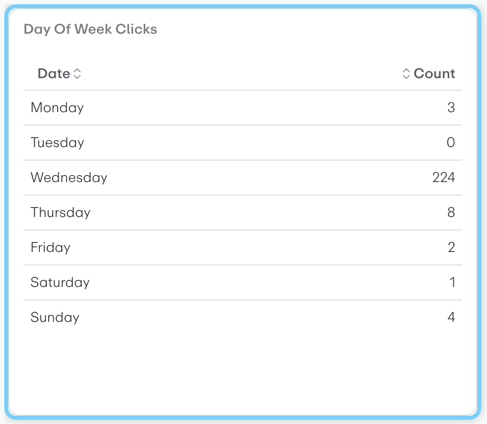


## UserProfileSignups
#### Females
Count female signups
```json
{
  "keyAliases": {
    "gender": [
      "FEMALE"
    ]
  },
  "columnNames": [
    "Females"
  ],
  "rowSets": [
    {
      "columns": [
        {
          "numericExpression": {
            "metric": "UserProfileSignups",
            "value": {
              "counter": "total"
            }
          }
        }
      ]
    }
  ],
  "visualisation": {
    "description": {
      "html": "Count female signups"
    },
    "type": "Number",
    "title": "Females"
  }
}
```


**Visualization Preview:** This is a simple metric card or KPI widget displaying a single data point. The visualization shows:

**Type**: Basic numerical display/metric card
**Data**: Count of females = 3
**Representation**: Large number format with category label

**Insights**: This appears to be part of a demographic breakdown, showing there are 3 females in the measured population or dataset. As a standalone metric, it provides a quick reference for gender distribution, likely complementing other demographic widgets to give a complete picture of the population being analyzed.
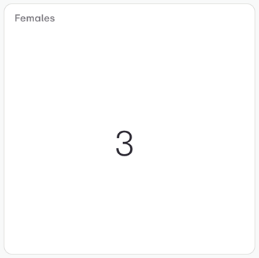

#### Friendly labels
User profiles friendly labels for enum/boolean values
```json
{
  "columnNames": [
    "gender",
    "country",
    "verifiedEmail",
    "language",
    "locale",
    "locale code",
    "source",
    "count"
  ],
  "rowSets": [
    {
      "columns": [
        {
          "dimension": {
            "key": "gender",
            "displayAs": "short"
          }
        },
        {
          "dimension": {
            "key": "country"
          }
        },
        {
          "dimension": {
            "key": "verifiedEmail"
          }
        },
        {
          "dimension": {
            "key": "language"
          }
        },
        {
          "dimension": {
            "key": "locale"
          }
        },
        {
          "dimension": {
            "key": "locale",
            "displayAs": "short"
          }
        },
        {
          "dimension": {
            "key": "source"
          }
        },
        {
          "numericExpression": {
            "metric": "UserProfileSignups",
            "value": {
              "counter": "total"
            }
          }
        }
      ]
    }
  ],
  "visualisation": {
    "imageFile": "",
    "description": {
      "html": "User profiles friendly labels for enum/boolean values"
    },
    "tableSettings": {
      "columnSettings": {},
      "paginate": true,
      "scrollOverflow": true
    },
    "title": "Friendly labels",
    "type": "Table"
  }
}
```

#### 15-Minutely Signups
Creates a table of registration signups by Day Date Hour:15-Minute
```json
{
  "columnNames": [
    "15 Minute",
    "Signups"
  ],
  "rowSets": [
    {
      "columns": [
        {
          "dimension": {
            "timeBasedDimension": "FifteenMinutely"
          }
        },
        {
          "numericExpression": {
            "metric": "UserProfileSignups",
            "value": {
              "counter": "total"
            }
          }
        }
      ]
    }
  ],
  "visualisation": {
    "description": {
      "html": "Creates a table of registration signups by Day Date Hour:15-Minute"
    },
    "type": "Table",
    "title": "15-Minutely Signups",
    "tableSettings": {
      "paginate": false,
      "scrollOverflow": true
    }
  }
}
```


**Visualization Preview:** This is a **time-series table visualization** showing 15-minute interval signup data for Saturday, September 13, 2025.

**Data Display:**
- Left column: 15-minute time slots from 10:30 AM to 4:45 PM
- Right column: Number of signups per time slot (ranging from 0-9)

**Key Insights:**
- **Peak activity**: 12:30 PM with 9 signups
- **Multiple busy periods**: 11:15-11:45 AM (5-6 signups) and 1:00 PM (8 signups)
- **Low activity periods**: 10:45 AM, 3:45 PM, and 4:15 PM with 0 signups
- **Overall pattern**: Higher signup concentration during late morning through early afternoon hours
- **Total visible signups**: Approximately 80+ signups across the displayed timeframe

This visualization helps identify optimal timing patterns and capacity planning for signup-related activities or events.
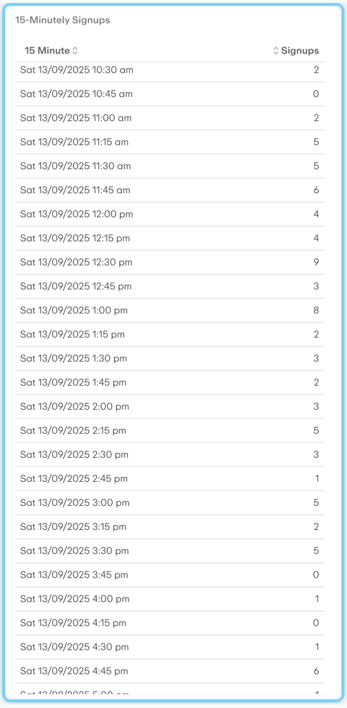

#### 5-Minutely Signups
Creates a table of registration signups by Day Date Hour:5-Minute
```json
{
  "columnNames": [
    "5 Minute",
    "Signups"
  ],
  "rowSets": [
    {
      "columns": [
        {
          "dimension": {
            "timeBasedDimension": "FiveMinutely"
          }
        },
        {
          "numericExpression": {
            "metric": "UserProfileSignups",
            "value": {
              "counter": "total"
            }
          }
        }
      ]
    }
  ],
  "visualisation": {
    "description": {
      "html": "Creates a table of registration signups by Day Date Hour:5-Minute"
    },
    "type": "Table",
    "title": "5-Minutely Signups",
    "tableSettings": {
      "paginate": false,
      "scrollOverflow": true
    }
  }
}
```


**Visualization Preview:** This is a **time-series data table** showing 5-minute interval signup data for Saturday, September 13, 2025.

**Data Display:**
- Lists consecutive 5-minute time slots from 12:00 PM to 2:05 PM
- Shows signup counts for each interval (all showing 0 signups except one)
- Single data point: 1 signup at 1:35 PM

**Key Insights:**
- Extremely low signup activity during this 2+ hour period
- Only one conversion occurred at 1:35 PM
- Suggests either low traffic, poor conversion rates, or this may be outside peak user activity hours
- The granular 5-minute tracking allows for precise identification of when engagement occurs

This visualization is useful for identifying specific time periods when user activity spikes and optimizing marketing efforts or user experience accordingly.
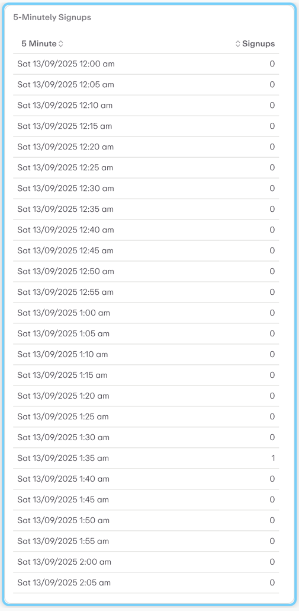

#### Signups by Part of Week
Count registrations by the part of the week (weekday/weekend) they signed-up (local time).
```json
{
  "columnNames": [
    "Week Part",
    "Signups"
  ],
  "rowSets": [
    {
      "columns": [
        {
          "dimension": {
            "timeBasedDimension": "DayOfWeekType"
          }
        },
        {
          "numericExpression": {
            "metric": "UserProfileSignups",
            "value": {
              "counter": "total"
            }
          }
        }
      ]
    }
  ],
  "visualisation": {
    "description": {
      "html": "Count registrations by the part of the week (weekday/weekend) they signed-up (local time)."
    },
    "type": "Table",
    "title": "Signups by Part of Week",
    "tableSettings": {
      "paginate": false,
      "scrollOverflow": true
    }
  }
}
```


**Visualization Preview:** This is a simple data table visualization showing "Signups by Part of Week." 

**Data displayed:**
- Weekday signups: 14,076
- Weekend signups: 6,941

**Key insights:**
- Weekdays generate significantly more signups than weekends (approximately 2:1 ratio)
- Total signups across the week: 21,017
- Weekdays account for about 67% of all signups, while weekends represent 33%

This suggests user engagement or marketing activities are more effective during weekdays, which could inform timing strategies for campaigns or product launches.
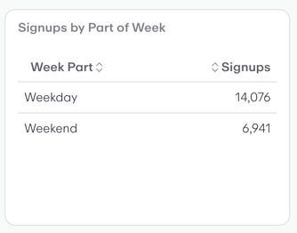

#### Signups by Day of Week
Count registrations by the day of the week they signed-up (local time).
```json
{
  "columnNames": [
    "Day",
    "Signups"
  ],
  "rowSets": [
    {
      "columns": [
        {
          "dimension": {
            "timeBasedDimension": "DayOfWeek"
          }
        },
        {
          "numericExpression": {
            "metric": "UserProfileSignups",
            "value": {
              "counter": "total"
            }
          }
        }
      ]
    }
  ],
  "visualisation": {
    "description": {
      "html": "Count registrations by the day of the week they signed-up (local time)."
    },
    "type": "Table",
    "title": "Signups by Day of Week",
    "tableSettings": {
      "paginate": false,
      "scrollOverflow": true
    }
  }
}
```


**Visualization Preview:** This is a table visualization showing "Signups by Day of Week" data. It displays signup counts for each day of the week in a simple two-column format with days listed vertically and corresponding signup numbers on the right.

**Key insights:**
- Thursday has the highest signup activity (4,348)
- Tuesday shows the lowest signup activity (2,213)
- There's a clear pattern with mid-to-late week performing better (Wednesday-Friday range from 2,517 to 4,348)
- Weekend activity (Saturday: 3,437, Sunday: 2,857) falls in the middle range
- The data suggests user engagement peaks on Thursday, possibly indicating optimal timing for marketing campaigns or product launches

The visualization effectively presents weekly signup patterns in a clean, sortable table format that makes it easy to identify performance trends across different days.
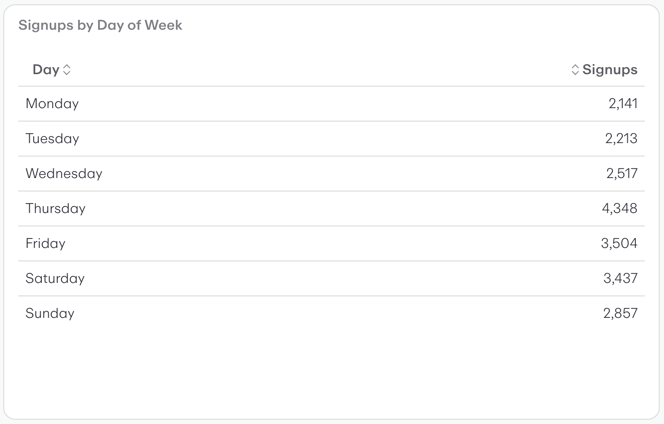

#### Daily Signups
Creates a table of registration signups by day.
```json
{
  "columnNames": [
    "Date",
    "Signups"
  ],
  "rowSets": [
    {
      "columns": [
        {
          "dimension": {
            "timeBasedDimension": "Daily"
          }
        },
        {
          "numericExpression": {
            "metric": "UserProfileSignups",
            "value": {
              "counter": "total"
            }
          }
        }
      ]
    }
  ],
  "visualisation": {
    "description": {
      "html": "Creates a table of registration signups by day."
    },
    "type": "Table",
    "title": "Daily Signups",
    "tableSettings": {
      "paginate": false,
      "scrollOverflow": true
    }
  }
}
```


**Visualization Preview:** This is a **table visualization** showing daily signup data over a one-week period in September 2025.

**Data displayed:**
- Date range: Monday, September 8th through Sunday, September 14th, 2025
- Daily signup counts ranging from 102 to 141

**Key insights:**
- **Friday (12/09) had the highest signups** with 141 users
- **Sunday (14/09) had the lowest signups** with 102 users
- **Weekday pattern**: Generally higher signup activity during weekdays (115-141) compared to weekend (102-108)
- **Weekly total**: Approximately 838 signups across the 7-day period
- **Average**: About 120 signups per day

The visualization effectively shows signup trends throughout the week, highlighting that business days tend to drive higher user registration activity compared to weekends.
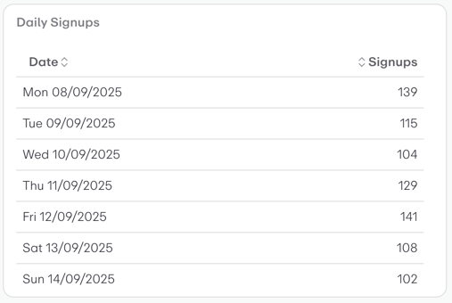

#### Signups by Hour of the Day
Count registrations by the hour of the day they signed-up (local time).
```json
{
  "columnNames": [
    "Hour",
    "Signups"
  ],
  "rowSets": [
    {
      "columns": [
        {
          "dimension": {
            "timeBasedDimension": "HourOfDay"
          }
        },
        {
          "numericExpression": {
            "metric": "UserProfileSignups",
            "value": {
              "counter": "total"
            }
          }
        }
      ]
    }
  ],
  "visualisation": {
    "description": {
      "html": "Count registrations by the hour of the day they signed-up (local time)."
    },
    "type": "Table",
    "title": "Signups by Hour of the Day",
    "tableSettings": {
      "paginate": false,
      "scrollOverflow": true
    }
  }
}
```


**Visualization Preview:** This is a two-column data table showing "Signups by Hour of the Day." 

**Data displayed:**
- Left column: Hours (12 am through 4 pm shown)
- Right column: Number of signups for each hour

**Key insights:**
- **Peak activity**: Highest signups occur during business hours, with 1 pm showing the maximum (597 signups)
- **Low activity**: Overnight hours (2-5 am) show minimal signups (8-16 signups)
- **Growth pattern**: Signups steadily increase from early morning (30 at 6 am) through midday, peaking in early afternoon
- **Business hours dominance**: The pattern clearly reflects typical waking/working hours, with dramatic increases starting around 7-8 am

This visualization effectively shows user signup behavior follows predictable daily patterns, which could inform marketing timing and resource allocation decisions.
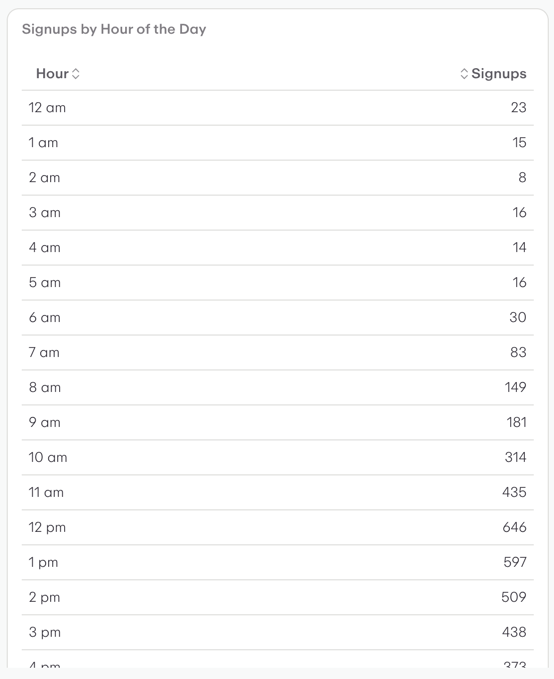

#### Hourly Signups
Creates a table of registration signups by Day Date Hour
```json
{
  "columnNames": [
    "Hour",
    "Signups"
  ],
  "rowSets": [
    {
      "columns": [
        {
          "dimension": {
            "timeBasedDimension": "Hourly"
          }
        },
        {
          "numericExpression": {
            "metric": "UserProfileSignups",
            "value": {
              "counter": "total"
            }
          }
        }
      ]
    }
  ],
  "visualisation": {
    "description": {
      "html": "Creates a table of registration signups by Day Date Hour"
    },
    "type": "Table",
    "title": "Hourly Signups",
    "tableSettings": {
      "paginate": false,
      "scrollOverflow": true
    }
  }
}
```


**Visualization Preview:** This is a **tabular data visualization** showing "Hourly Signups" for Saturday, September 13, 2025.

**Data Type:** Time series data displaying signup counts aggregated by hour over a 24-hour period.

**Key Insights:**
- **Peak activity period:** 11 AM - 1 PM, with the highest signup volume at 12 PM (20 signups)
- **Secondary peak:** 11 AM (18 signups) and 1 PM (15 signups)
- **Low activity periods:** Early morning (12 AM - 9 AM) and late evening (7 PM - 11 PM) with mostly 0-1 signups
- **Total pattern:** Clear daytime preference for signups, following typical business/daylight hours
- **Gradual decline:** Afternoon signups steadily decrease from 2 PM (12) through 6 PM (4)

This visualization effectively shows user engagement patterns throughout the day, indicating when users are most likely to sign up for the service.
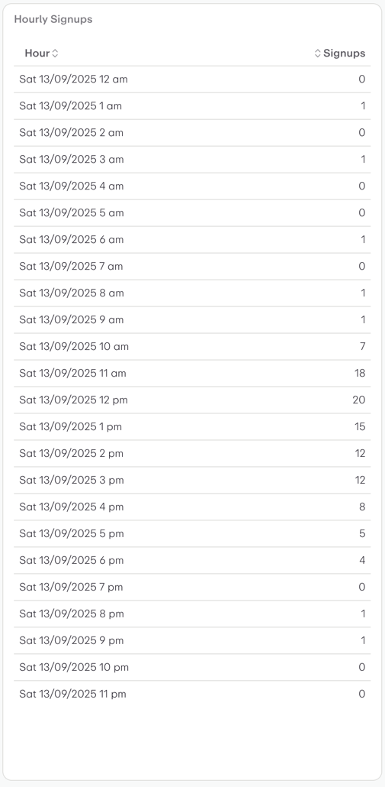

#### Minutely Signups
Creates a table of registration signups by Day Date Hour:Minute
```json
{
  "columnNames": [
    "Minute",
    "Signups"
  ],
  "rowSets": [
    {
      "columns": [
        {
          "dimension": {
            "timeBasedDimension": "Minutely"
          }
        },
        {
          "numericExpression": {
            "metric": "UserProfileSignups",
            "value": {
              "counter": "total"
            }
          }
        }
      ]
    }
  ],
  "visualisation": {
    "description": {
      "html": "Creates a table of registration signups by Day Date Hour:Minute"
    },
    "type": "Table",
    "title": "Minutely Signups",
    "tableSettings": {
      "paginate": false,
      "scrollOverflow": true
    }
  }
}
```


**Visualization Preview:** This is a **time series table** showing "Minutely Signups" data from Beonic Insights. 

**Data Display:**
- Time period: Saturday 13/09/2025, from 12:54 PM to approximately 1:20 PM
- Granularity: Minute-by-minute breakdown
- Metric: Number of user signups per minute

**Key Insights:**
- Most minutes show **0 signups**, indicating sporadic user registration activity
- Peak activity occurs at **1:08 PM with 2 signups** and **1:13 PM with 2 signups**
- Several minutes show **1 signup**: 12:57 PM, 1:00 PM, 1:02 PM, 1:07 PM, and 1:10 PM
- **Total observable signups**: 10 signups over the ~26-minute period
- The data suggests **low but consistent signup activity** with occasional minor spikes

This visualization is useful for monitoring real-time user acquisition patterns and identifying peak signup periods at a granular level.
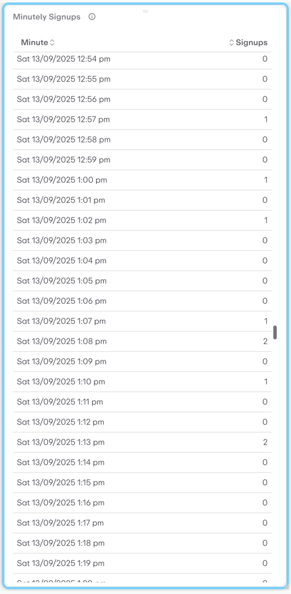

#### Signups by Month of the Year
Count registrations by the month of the year they signed-up (local time).
```json
{
  "columnNames": [
    "Month",
    "Signups"
  ],
  "rowSets": [
    {
      "columns": [
        {
          "dimension": {
            "timeBasedDimension": "MonthOfYear"
          }
        },
        {
          "numericExpression": {
            "metric": "UserProfileSignups",
            "value": {
              "counter": "total"
            }
          }
        }
      ]
    }
  ],
  "visualisation": {
    "description": {
      "html": "Count registrations by the month of the year they signed-up (local time)."
    },
    "type": "Table",
    "title": "Signups by Month of the Year",
    "tableSettings": {
      "paginate": false,
      "scrollOverflow": true
    }
  }
}
```


**Visualization Preview:** This is a data table visualization showing "Signups by Month of the Year" with two columns: Month and Signups.

**Data displayed:**
- Monthly signup counts from January through September
- Values range from 472 (February, lowest) to 1,125 (May, highest)

**Key insights:**
- **Peak signup periods:** March (1,123) and May (1,125) show the highest user acquisition
- **Lowest activity:** February (472) and July (492) have significantly fewer signups
- **Seasonal pattern:** There appears to be stronger signup activity in spring months (March-May) compared to winter/summer periods
- **Summer decline:** July shows a notable drop after June's moderate performance (853)

The table format allows for easy comparison of exact values across months, making it simple to identify trends and outliers in user acquisition patterns.
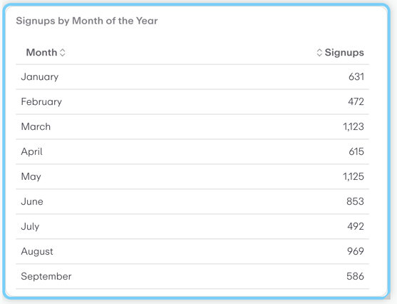

#### Monthly Signups
Creates a table of registration signups by Month Year.
```json
{
  "columnNames": [
    "Month",
    "Signups"
  ],
  "rowSets": [
    {
      "columns": [
        {
          "dimension": {
            "timeBasedDimension": "Monthly"
          }
        },
        {
          "numericExpression": {
            "metric": "UserProfileSignups",
            "value": {
              "counter": "total"
            }
          }
        }
      ]
    }
  ],
  "visualisation": {
    "description": {
      "html": "Creates a table of registration signups by Month Year."
    },
    "type": "Table",
    "title": "Monthly Signups",
    "tableSettings": {
      "paginate": true,
      "scrollOverflow": true
    }
  }
}
```


**Visualization Preview:** This is a tabular data visualization showing "Monthly Signups" data in a simple two-column format.

**Data displayed:**
- Time period: January 2024 through July 2024 (7 months)
- Monthly signup numbers ranging from approximately 3,970 to 6,092

**Key insights:**
- March 2024 had the highest signups (6,092), representing a notable peak
- April 2024 shows the lowest signups (3,970), indicating a significant drop after March
- Overall trend shows fluctuation rather than consistent growth, with signup numbers varying by about 2,100 between the highest and lowest months
- Recent months (May-July 2024) show relatively stable performance around 4,100 signups

The visualization uses a clean, minimalist table design that makes it easy to compare monthly performance and identify patterns in user acquisition over this 7-month period.
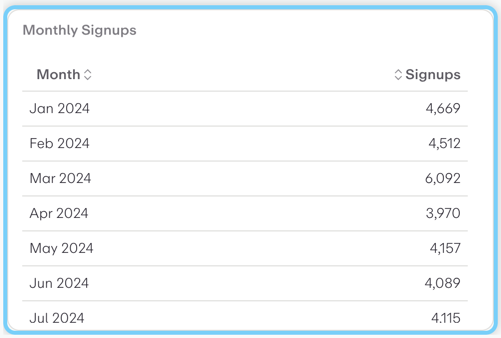

#### Weekly Signups
Creates a table of registration signups by Week Date
```json
{
  "columnNames": [
    "Week",
    "Signups"
  ],
  "rowSets": [
    {
      "columns": [
        {
          "dimension": {
            "timeBasedDimension": "Weekly"
          }
        },
        {
          "numericExpression": {
            "metric": "UserProfileSignups",
            "value": {
              "counter": "total"
            }
          }
        }
      ]
    }
  ],
  "visualisation": {
    "description": {
      "html": "Creates a table of registration signups by Week Date"
    },
    "type": "Table",
    "title": "Weekly Signups",
    "tableSettings": {
      "paginate": false,
      "scrollOverflow": true
    }
  }
}
```


**Visualization Preview:** This is a **table visualization** showing weekly signup data over time from January to March 2025.

**Data displayed:**
- Weekly time periods (starting dates)
- Corresponding signup numbers for each week
- Total of 14 weeks of data

**Key insights:**
- Signups fluctuate significantly week-to-week, ranging from a low of 207 (31/03/2025) to a high of 1,337 (20/01/2025)
- Most weeks show healthy signup numbers between 800-1,200
- Notable drop-off in the final week (207 signups), which could indicate incomplete data for that period
- Generally strong performance in January-February with some volatility in March

The visualization provides a clear chronological view of signup trends, making it easy to identify patterns and anomalies in user acquisition over the 3-month period.
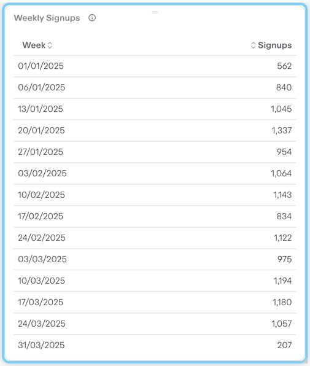

#### Yearly Signups
Creates a table of registration signups by Year.
```json
{
  "columnNames": [
    "Year",
    "Signups"
  ],
  "rowSets": [
    {
      "columns": [
        {
          "dimension": {
            "timeBasedDimension": "Yearly"
          }
        },
        {
          "numericExpression": {
            "metric": "UserProfileSignups",
            "value": {
              "counter": "total"
            }
          }
        }
      ]
    }
  ],
  "visualisation": {
    "description": {
      "html": "Creates a table of registration signups by Year."
    },
    "type": "Table",
    "title": "Yearly Signups",
    "tableSettings": {
      "paginate": true,
      "scrollOverflow": true
    }
  }
}
```


**Visualization Preview:** This is a simple data table visualization showing "Yearly Signups" over a three-year period. The table displays:

**Data Structure:**
- Two columns: Year and Signups
- Three years of data (2023-2025)

**Key Data Points:**
- 2023: 15,254 signups
- 2024: 22,232 signups (peak year)
- 2025: 6,280 signups

**Insights:**
- Signups increased by 46% from 2023 to 2024
- Dramatic 72% decline in 2025 signups compared to 2024
- 2024 represents the highest signup volume in the dataset

This tabular format provides a clear numerical comparison of signup trends, though the significant drop in 2025 may warrant further investigation (could be incomplete year data or actual performance decline).
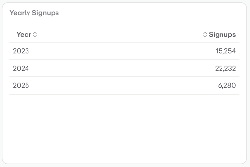


## UserProfileVisits
#### Gender Visitors
Count visits to a venue by visitor's gender
```json
{
  "columnNames": [
    "Venue",
    {
      "name": "gender",
      "dimension": {
        "key": "gender",
        "missing": true
      }
    }
  ],
  "keyAliases": {
    "rg": "venueId.registrationGroup"
  },
  "rowSets": [
    {
      "columns": [
        {
          "dimension": {
            "key": "venueId"
          },
          "sortSpecification": {
            "ascending": true,
            "priority": 1
          }
        },
        {
          "numericExpression": {
            "metric": "UserProfileVisits",
            "value": {
              "counter": "total"
            }
          }
        }
      ]
    }
  ],
  "visualisation": {
    "description": {
      "html": "Count visits to a venue by visitor's gender"
    },
    "type": "Table",
    "title": "Gender Visitors",
    "tableSettings": {
      "paginate": false,
      "scrollOverflow": true
    }
  }
}
```


**Visualization Preview:** This is a data table visualization showing gender demographics of visitors across two venues. The table displays visitor counts broken down by three gender categories (Female, Male, Other) for Chevron Renaissance and MacArthur Central.

**Key insights:**
- **Chevron Renaissance** has higher overall traffic (135,797 total visitors) with a slight male majority (70,143 vs 65,511 females)
- **MacArthur Central** has lower traffic (125,434 total visitors) but also shows male majority (63,645 vs 57,107 females)
- **"Other" category representation** varies significantly between venues - minimal at Chevron Renaissance (143) but substantial at MacArthur Central (4,682)
- Both venues show relatively balanced gender distribution, with males having a slight edge of approximately 51-52% at each location

The visualization effectively presents demographic segmentation data in a clean, comparative table format that allows for easy cross-venue analysis.
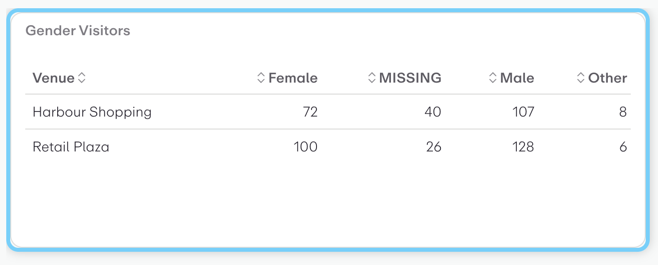

#### Postcode Numeric Histogram Table (inline buckets)
Creates a histogram of user postcodes. The histogram's postcode buckets and counts are visualised as a table. The buckets are defined using inline buckets, covering various regions in South Australia and Victoria.
```json
{
  "columnNames": [
    "postcodeNumeric",
    "count"
  ],
  "rowSets": [
    {
      "columns": [
        {
          "sortSpecification": {
            "ascending": true,
            "priority": 1
          },
          "dimension": {
            "histogram": {
              "buckets": [
                {
                  "key": "SA - Adelaide Metro (5000-5099)",
                  "from": 5000,
                  "to": 5099
                },
                {
                  "key": "SA - Adelaide Hills/Eastern (5100-5199)",
                  "from": 5100,
                  "to": 5199
                },
                {
                  "key": "SA - Southern Adelaide (5200-5299)",
                  "from": 5200,
                  "to": 5299
                },
                {
                  "key": "SA - Barossa/Northern (5300-5399)",
                  "from": 5300,
                  "to": 5399
                },
                {
                  "key": "SA - Riverland/Murray (5400-5499)",
                  "from": 5400,
                  "to": 5499
                },
                {
                  "key": "SA - Mid North/Yorke Peninsula (5500-5599)",
                  "from": 5500,
                  "to": 5599
                },
                {
                  "key": "SA - Eyre Peninsula/West Coast (5600-5699)",
                  "from": 5600,
                  "to": 5699
                },
                {
                  "key": "SA - Far North/Outback (5700-5799)",
                  "from": 5700,
                  "to": 5799
                }
              ]
            }
          }
        },
        {
          "numericExpression": {
            "metric": "UserProfilesNow",
            "value": {
              "histogram": "postcodeNumeric"
            }
          }
        }
      ]
    }
  ],
  "visualisation": {
    "description": {
      "html": "Creates a histogram of user postcodes. The histogram's postcode buckets and counts are visualised as a table. The buckets are defined using inline buckets, covering various regions in South Australia and Victoria."
    },
    "type": "Table",
    "title": "Postcode Numeric Histogram Table (inline buckets)",
    "tableSettings": {
      "paginate": false,
      "scrollOverflow": true
    }
  }
}
```


**Visualization Preview:** This is a **histogram table** showing the distribution of postcode numeric values organized into inline buckets (100-unit ranges from 5000-5799).

**Data Display:**
- Each row represents a postcode range (e.g., 5000-5099, 5100-5199)
- The count column shows frequency of postcodes within each range
- Total of 8 postcode ranges covering 800 possible postcode values

**Key Insights:**
- **Highly skewed distribution**: The 5000-5099 range dominates with 51,670 entries (72% of total)
- **Steep decline**: Sharp drop-off after the first range, with 5100-5199 having only 12,322 entries
- **Geographic clustering**: Suggests significant population/address concentration in the 5000-5099 postcode area
- **Sparse coverage**: Higher postcode ranges (5400+) show much lower frequencies, indicating less dense areas

This pattern typically indicates a major metropolitan area in the 5000-5099 range with surrounding suburban/rural areas in higher postcode ranges.
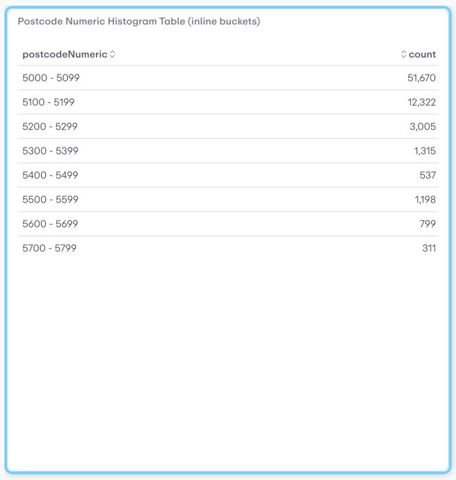

#### visits
Count visits to a venue by visitor's postcode (only top 5 South Australia postcodes)
```json
{
  "columnNames": [
    "Venue",
    "postcode",
    "Count"
  ],
  "keyAliases": {
    "postcode": [
      "5000",
      "5006",
      "5009",
      "5011",
      "5013",
      "5031",
      "5033",
      "5034",
      "5045",
      "5082",
      "5085",
      "5065",
      "5066",
      "5067",
      "5069",
      "5074",
      "5081",
      "5082",
      "5089"
    ]
  },
  "rowSets": [
    {
      "columns": [
        {
          "dimension": {
            "key": "venueId"
          },
          "sortSpecification": {
            "ascending": true,
            "priority": 1
          }
        },
        {
          "dimension": {
            "key": "postcode"
          },
          "sortSpecification": {
            "ascending": true,
            "priority": 2
          }
        },
        {
          "numericExpression": {
            "metric": "UserProfileVisits",
            "value": {
              "counter": "total"
            }
          }
        }
      ]
    }
  ],
  "visualisation": {
    "description": {
      "html": "Count visits to a venue by visitor's postcode (only top 5 South Australia postcodes)"
    },
    "type": "Table",
    "title": "visits",
    "tableSettings": {
      "paginate": false,
      "scrollOverflow": true
    }
  }
}
```


**Visualization Preview:** This is a tabular data visualization showing visitor counts by venue and postcode. The table displays:

**Data Structure:**
- **Venue**: Two locations (Adelaide Central Plaza and Port Adelaide Plaza)
- **Postcode**: Various postal codes (5000, 5066, 5067, 5082, 5085)
- **Count**: Number of visits per venue-postcode combination

**Key Insights:**
- Adelaide Central Plaza dominates visitor traffic with 38,390 total visits across all postcodes
- Postcode 5000 generates the highest traffic overall (29,967 visits), with Adelaide Central Plaza capturing the majority (28,858 vs 1,109 for Port Adelaide Plaza)
- Port Adelaide Plaza has significantly lower visitor counts, with only 1,142 total visits
- Adelaide Central Plaza shows more geographically diverse visitor origins across multiple postcodes
- The data suggests strong location-based preferences, with visitors predominantly choosing the venue closest to postcode 5000

This visualization effectively compares venue performance across different geographic catchment areas, helping identify market penetration and location effectiveness.
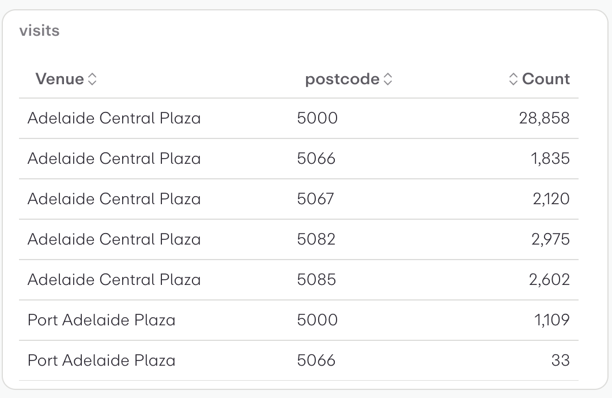

#### visits
Shows visits  broken down by venue. Displayed as a Table.
```json
{
  "columnNames": [
    "Venue",
    "Count"
  ],
  "rowSets": [
    {
      "columns": [
        {
          "dimension": {
            "key": "venueId"
          },
          "sortSpecification": {
            "ascending": true,
            "priority": 1
          }
        },
        {
          "numericExpression": {
            "metric": "UserProfileVisits",
            "value": {
              "counter": "total"
            }
          }
        }
      ]
    }
  ],
  "visualisation": {
    "description": {
      "html": ""
    },
    "type": "Table",
    "title": "visits",
    "tableSettings": {
      "paginate": false,
      "scrollOverflow": true
    }
  }
}
```


**Visualization Preview:** This is a tabular data visualization showing venue visit counts. The widget displays:

**Data Type**: Visit frequency data for two Adelaide shopping venues
- Adelaide Central Plaza: 180,566 visits
- Port Adelaide Plaza: 61,005 visits

**Key Insights**: 
- Adelaide Central Plaza receives nearly 3x more visits than Port Adelaide Plaza
- Central Plaza is clearly the more popular/busier venue with significantly higher foot traffic
- The data suggests a substantial difference in venue size, location attractiveness, or accessibility between these two shopping destinations

The visualization uses a simple two-column table format (Venue | Count) making it easy to compare the relative performance of these retail locations.
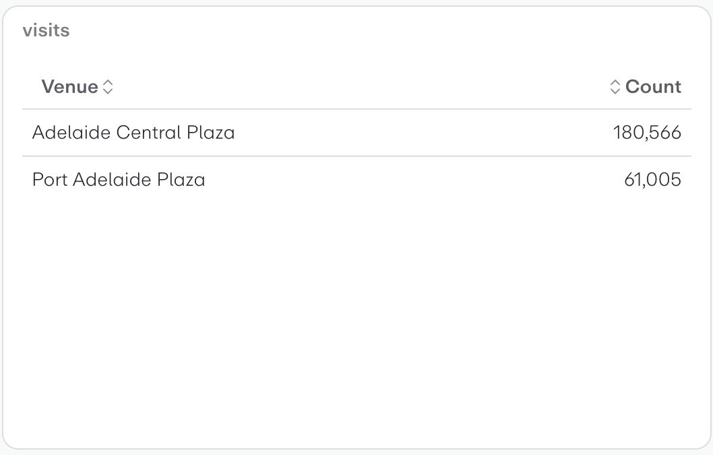

#### Primary Zone Visits
Zone visit counts
```json
{
  "columnNames": [
    "Primary Zone",
    "Count"
  ],
  "rowSets": [
    {
      "columns": [
        {
          "dimension": {
            "key": "zoneId",
            "missing": true
          },
          "sortSpecification": {
            "ascending": true,
            "priority": 1
          }
        },
        {
          "numericExpression": {
            "metric": "UserProfileVisits",
            "value": {
              "counter": "total"
            }
          }
        }
      ]
    }
  ],
  "visualisation": {
    "description": {
      "html": "Zone visit counts"
    },
    "type": "Table",
    "title": "Primary Zone Visits",
    "tableSettings": {
      "paginate": false,
      "scrollOverflow": true
    }
  }
}
```

#### Primary Zone Visits
Zone visit counts
```json
{
  "columnNames": [
    "Primary Zone",
    "Count"
  ],
  "rowSets": [
    {
      "columns": [
        {
          "dimension": {
            "key": "zoneId"
          },
          "sortSpecification": {
            "ascending": true,
            "priority": 1
          }
        },
        {
          "numericExpression": {
            "metric": "UserProfileVisits",
            "value": {
              "counter": "total"
            }
          }
        }
      ]
    }
  ],
  "visualisation": {
    "description": {
      "html": "Zone visit counts"
    },
    "type": "Table",
    "title": "Primary Zone Visits",
    "tableSettings": {
      "paginate": false,
      "scrollOverflow": true
    }
  }
}
```

#### Vists by Age Range (inline buckets)
Creates a histogram of user visit by age range. The histogram's buckets and counts are visualised as a bar chart. The buckets are default (yearly) age ranges.
```json
{
  "columnNames": [
    "age range",
    "venue",
    "count"
  ],
  "rowSets": [
    {
      "columns": [
        {
          "dimension": {
            "histogram": {
              "buckets": [
                {
                  "to": 20
                },
                {
                  "from": 20,
                  "to": 40
                },
                {
                  "from": 40
                }
              ]
            }
          }
        },
        {
          "dimension": {
            "key": "venueId"
          }
        },
        {
          "numericExpression": {
            "metric": "UserProfileVisits",
            "value": {
              "histogram": "ageInYears"
            }
          }
        }
      ]
    }
  ],
  "visualisation": {
    "description": {
      "html": "Creates a histogram of user visit by age range. The histogram's buckets and counts are visualised as a bar chart. The buckets are default (yearly) age ranges."
    },
    "type": "Table",
    "title": "Vists by Age Range (inline buckets)",
    "tableSettings": {
      "paginate": false,
      "scrollOverflow": true
    }
  }
}
```

#### Visit Duration (minutes) Histogram Bar Chart
Creates a histogram of user visit durations. The histogram's duration buckets and counts are visualised as a bar chart. The buckets are default dwell times for visits and sessions.
```json
{
  "columnNames": [
    "visit duration",
    "count"
  ],
  "rowSets": [
    {
      "columns": [
        {
          "dimension": {
            "histogram": {
              "metric": "UserProfileVisits",
              "histogram": "duration"
            }
          }
        },
        {
          "numericExpression": {
            "metric": "UserProfileVisits",
            "value": {
              "histogram": "duration"
            }
          }
        }
      ]
    }
  ],
  "visualisation": {
    "description": {
      "html": "Creates a histogram of user visit durations. The histogram's duration buckets and counts are visualised as a bar chart. The buckets are default dwell times for visits and sessions."
    },
    "type": "BarChart",
    "title": "Visit Duration (minutes) Histogram Bar Chart",
    "barChartSettings": {
      "showBarValues": false,
      "columnSettings": {
        "Total Visits": {
          "axis": "left",
          "type": null,
          "showOnChart": true,
          "showOnTooltip": true
        }
      },
      "tooltip": {
        "show": true
      },
      "layout": "vertical",
      "xAxis": {
        "axisLine": {
          "show": false
        },
        "inverse": false,
        "showName": false,
        "splitNumber": 5
      },
      "gridLines": "auto",
      "timeseriesResolutions": false,
      "enableChartSwitching": false,
      "yAxis": {
        "axisLine": {
          "show": false
        },
        "inverse": false,
        "showName": false,
        "splitNumber": 5
      },
      "showLegend": true,
      "hideAxis": false,
      "stackType": "no-stack"
    }
  }
}
```


**Visualization Preview:** This is a histogram bar chart showing the distribution of website visit durations measured in minutes. The chart displays visitor counts (y-axis, ranging from 0 to 40k) across different time duration bins (x-axis).

**Key insights:**
- The highest engagement occurs in the 61-120 minute range (~37k visits), indicating strong user retention
- The 31-60 minute range also shows high engagement (~35k visits)
- Medium engagement levels are seen in 6-15 minutes (~32k) and 16-30 minutes (~28k) ranges
- There's a significant drop-off for longer sessions, with only ~14k visits lasting 121-180 minutes
- Very few visitors stay for extremely short (0-5 minutes) or very long sessions (181+ minutes)

The distribution suggests the website successfully retains users for substantial periods, with peak engagement occurring in the 1-2 hour range, indicating quality content or engaging user experience.


#### Visit Time of Day Histogram Line Chart
Creates a histogram of user visits by time of day. The histogram's hour of day buckets and counts are visualised as a line chart. The default buckets are the hours of the day.
```json
{
  "columnNames": [
    "hour",
    "visits"
  ],
  "rowSets": [
    {
      "columns": [
        {
          "dimension": {
            "histogram": {
              "metric": "UserProfileVisits",
              "histogram": "hourAndMinuteOfDay"
            }
          }
        },
        {
          "numericExpression": {
            "metric": "UserProfileVisits",
            "value": {
              "histogram": "hourAndMinuteOfDay"
            }
          }
        }
      ]
    }
  ],
  "visualisation": {
    "description": {
      "html": "Creates a histogram of user visits by time of day. The histogram's hour of day buckets and counts are visualised as a line chart. The default buckets are the hours of the day."
    },
    "type": "LineChart",
    "title": "Visit Time of Day Histogram Line Chart",
    "lineChartSettings": {
      "showLegend": true,
      "hideAxis": false,
      "gridLines": "auto",
      "stackType": "no-stack",
      "xAxis": {
        "axisLine": {
          "show": false
        },
        "inverse": false,
        "showName": false,
        "splitNumber": 5
      },
      "yAxis": {
        "axisLine": {
          "show": false
        },
        "inverse": false,
        "showName": false,
        "splitNumber": 5
      },
      "enableChartSwitching": false,
      "timeseriesResolutions": false,
      "columnSettings": {},
      "tooltip": {
        "show": true
      }
    }
  }
}
```


**Visualization Preview:** This is a line chart showing website visits over time periods. The visualization displays:

**Chart Type**: Single-line graph with time intervals on the x-axis and visit counts on the y-axis (scaled in thousands)

**Data Pattern**: 
- Visits start near zero (0-500 time period)
- Gradual increase begins around 400-500
- Steep growth from 800-1200, reaching peak performance
- Peak visits of ~6.5k during 1500-1600 period  
- Sharp decline after 1700, dropping to ~2.5k by 2000-2100
- Nearly returns to baseline by the end

**Key Insights**:
- Clear bell-curve distribution with sustained high activity from 1200-1600
- Peak traffic period represents a 6.5x increase from baseline
- The pattern suggests time-based user behavior (possibly daily/hourly traffic cycles)
- Significant traffic concentration during the middle periods, indicating predictable usage patterns

This visualization effectively shows traffic flow patterns that could inform resource allocation and user engagement strategies.


#### Primary Zone Visit Duration (minutes) Histogram Bar Chart
Creates a histogram of user visits to the primary zone, visualised as a bar chart. The histogram's duration buckets and counts are displayed in the chart. The buckets are the default dwell times for visits and sessions.
```json
{
  "columnNames": [
    "primary zone visit duration",
    "count"
  ],
  "rowSets": [
    {
      "columns": [
        {
          "dimension": {
            "histogram": {
              "metric": "UserProfileVisits",
              "histogram": "primaryZoneDuration"
            }
          }
        },
        {
          "numericExpression": {
            "metric": "UserProfileVisits",
            "value": {
              "histogram": "primaryZoneDuration"
            }
          }
        }
      ]
    }
  ],
  "visualisation": {
    "description": {
      "html": "Creates a histogram of user visits to the primary zone, visualised as a bar chart. The histogram's duration buckets and counts are displayed in the chart. The buckets are the default dwell times for visits and sessions."
    },
    "type": "BarChart",
    "title": "Primary Zone Visit Duration (minutes) Histogram Bar Chart",
    "barChartSettings": {
      "showBarValues": false,
      "columnSettings": {
        "Total Visits": {
          "axis": "left",
          "type": null,
          "showOnChart": true,
          "showOnTooltip": true
        }
      },
      "tooltip": {
        "show": true
      },
      "layout": "vertical",
      "xAxis": {
        "axisLine": {
          "show": false
        },
        "inverse": false,
        "showName": false,
        "splitNumber": 5
      },
      "gridLines": "auto",
      "timeseriesResolutions": false,
      "enableChartSwitching": false,
      "yAxis": {
        "axisLine": {
          "show": false
        },
        "inverse": false,
        "showName": false,
        "splitNumber": 5
      },
      "showLegend": true,
      "hideAxis": false,
      "stackType": "no-stack"
    }
  }
}
```


**Visualization Preview:** This is a histogram bar chart showing the distribution of Primary Zone visit durations in minutes. The chart displays visitor counts across different time intervals:

**Chart Type**: Histogram with 8 duration bins ranging from 0-5 minutes to 301+ minutes

**Key Data Points**:
- Peak activity: 6-15 minutes (~12k visits)
- Second highest: 16-30 minutes (~10k visits) 
- Third highest: 31-60 minutes (~9k visits)
- Shorter visits (0-5 min): ~4.5k visits
- Longer visits show declining frequency: 61-120 min (~6.5k), 121-180 min (~1.5k)
- Very few extended visits in 181-300 min and 301+ categories

**Key Insights**:
- Most visitors spend 6-60 minutes in the primary zone, indicating moderate engagement
- The distribution shows a right-skewed pattern typical of dwell time data
- Very short visits (0-5 min) are less common than moderate durations, suggesting the space successfully retains initial visitors
- Extended stays beyond 2 hours are rare, indicating natural visit completion patterns


#### Monthly Visits
Creates a table of Visits by month.
```json
{
  "columnNames": [
    "Date",
    "Count"
  ],
  "rowSets": [
    {
      "columns": [
        {
          "dimension": {
            "timeBasedDimension": "Monthly"
          }
        },
        {
          "numericExpression": {
            "metric": "UserProfileVisits",
            "value": {
              "counter": "total"
            }
          }
        }
      ]
    }
  ],
  "visualisation": {
    "description": {
      "html": "Creates a table of Visits by month."
    },
    "type": "Table",
    "title": "Monthly Visits",
    "tableSettings": {
      "paginate": false,
      "scrollOverflow": true
    }
  }
}
```


**Visualization Preview:** This is a **tabular data visualization** showing monthly website visits from January to September 2025.

**Data Display:**
- Two columns: Date (month/year) and Count (number of visits)
- 9 months of chronological data
- Visit counts ranging from 195 to 341

**Key Insights:**
- **Growth trend**: Steady increase from Jan (195) to May (341), representing a 75% growth over 5 months
- **Peak performance**: May 2025 had the highest visits (341)
- **Summer decline**: Notable drop in June-July (302→229), followed by partial recovery in August (305)
- **Recent dip**: September shows another decline to 249 visits

The data suggests seasonal patterns with strong spring growth, summer volatility, and potential seasonal slowdowns in July and September.
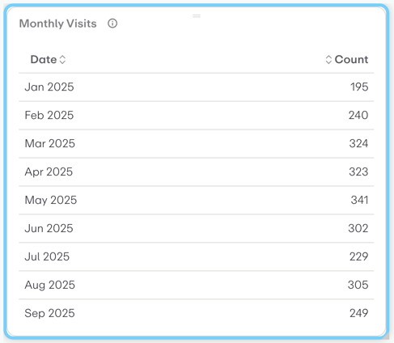


## UserProfileWiFiSessions
#### OS Category (Android & Apple)
OS categories
```json
{
  "columnNames": [
    "Venue",
    {
      "name": "osCategory",
      "dimension": {
        "key": "osCategory"
      }
    }
  ],
  "keyAliases": {
    "osCategory": [
      "Android",
      "IOS_OSX"
    ]
  },
  "rowSets": [
    {
      "columns": [
        {
          "dimension": {
            "key": "venueId"
          },
          "sortSpecification": {
            "ascending": true,
            "priority": 1
          }
        },
        {
          "numericExpression": {
            "metric": "UserProfileWiFiSessions",
            "value": {
              "counter": "total"
            }
          }
        }
      ]
    }
  ],
  "visualisation": {
    "description": {
      "html": "OS categories"
    },
    "type": "Table",
    "title": "OS Category (Android & Apple)",
    "tableSettings": {
      "paginate": false,
      "scrollOverflow": true
    }
  }
}
```


**Visualization Preview:** This is a **cross-tabulation table** (pivot table) showing mobile device usage data across two shopping venues.

**Data displayed:**
- **Venues:** Harbour Shopping and Retail Plaza
- **OS Categories:** Android vs iOS/OSX device counts
- **Values:** Raw counts of devices detected at each location

**Key insights:**
- **Harbour Shopping** shows higher Android usage (797) compared to iOS/OSX (629)
- **Retail Plaza** demonstrates nearly equal usage between platforms (608 Android vs 603 iOS/OSX)
- **Android dominance** at Harbour Shopping suggests different demographic or customer preferences between venues
- **Total traffic** appears higher at Harbour Shopping (1,426 total) versus Retail Plaza (1,211 total)

This type of venue analytics helps retailers understand their customer base's technology preferences and relative foot traffic patterns across locations.
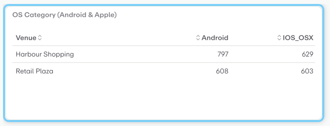

#### Sessions
Shows sessions  broken down by venue. Displayed as a Table.
```json
{
  "columnNames": [
    "Venue",
    "Count"
  ],
  "rowSets": [
    {
      "columns": [
        {
          "dimension": {
            "key": "venueId"
          },
          "sortSpecification": {
            "ascending": true,
            "priority": 1
          }
        },
        {
          "numericExpression": {
            "metric": "UserProfileWiFiSessions",
            "value": {
              "counter": "total"
            }
          }
        }
      ]
    }
  ],
  "visualisation": {
    "description": {
      "html": ""
    },
    "type": "Table",
    "title": "Sessions",
    "tableSettings": {
      "paginate": false,
      "scrollOverflow": true
    }
  }
}
```


**Visualization Preview:** This is a **table visualization** showing session data by venue. 

**Data displayed:**
- Two venues: "Harbour Shopping" and "Retail Plaza"
- Session counts: 1,505 and 1,503 respectively

**Key insights:**
- The venues have nearly identical session volumes, with only a 2-session difference
- Harbour Shopping has a slight edge with 1,505 sessions
- This suggests balanced foot traffic distribution between these two retail locations
- The minimal difference indicates comparable customer engagement at both venues

The visualization uses a simple tabular format that makes it easy to compare performance metrics between the two locations.
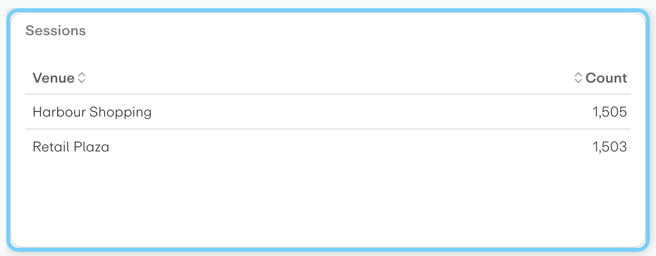

#### Day of Week WiFi Sessions
Creates a table of WiFiSesions by day of week.
```json
{
  "columnNames": [
    "Date",
    "Count"
  ],
  "rowSets": [
    {
      "columns": [
        {
          "dimension": {
            "timeBasedDimension": "DayOfWeek"
          }
        },
        {
          "numericExpression": {
            "metric": "UserProfileWiFiSessions",
            "value": {
              "counter": "total"
            }
          }
        }
      ]
    }
  ],
  "visualisation": {
    "description": {
      "html": "Creates a table of WiFiSesions by day of week."
    },
    "type": "Table",
    "title": "Day of Week WiFi Sessions",
    "tableSettings": {
      "paginate": false,
      "scrollOverflow": true
    }
  }
}
```


**Visualization Preview:** This is a **data table visualization** showing WiFi session counts by day of the week.

**Data displayed:**
- 7 rows representing each day of the week
- Session counts ranging from 112 (Saturday, lowest) to 221 (Wednesday, highest)
- Total of 1,211 WiFi sessions across the week

**Key insights:**
- **Wednesday has peak usage** (221 sessions)
- **Weekend shows lowest activity** - Saturday (112) and Friday (121) have the fewest sessions
- **Mid-week dominance** - Tuesday through Thursday show consistently higher usage (175-221 sessions)
- **Sunday rebounds** with 203 sessions, suggesting different usage patterns than typical weekend days

The visualization effectively shows weekly WiFi usage patterns, indicating this is likely a business or educational environment with higher weekday activity.
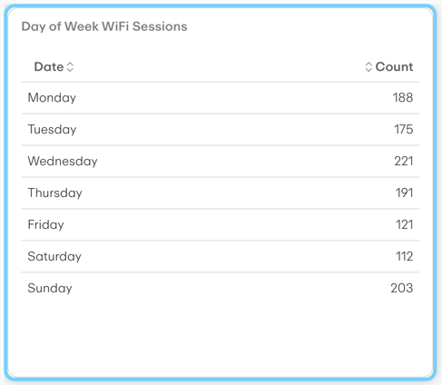

#### WiFi Session Data Usage (MB) Histogram Bar Chart
Creates a histogram of user WiFi session dataUsage, visualised as a bar chart. The histogram's data usage buckets and counts are displayed in the chart. The buckets are the default dwell times for visits and sessions.
```json
{
  "columnNames": [
    "session data usage",
    "sessions"
  ],
  "rowSets": [
    {
      "columns": [
        {
          "dimension": {
            "histogram": {
              "metric": "UserProfileWiFiSessions",
              "histogram": "dataUsage"
            }
          }
        },
        {
          "numericExpression": {
            "metric": "UserProfileWiFiSessions",
            "value": {
              "histogram": "dataUsage"
            }
          }
        }
      ]
    }
  ],
  "visualisation": {
    "description": {
      "html": "Creates a histogram of user WiFi session dataUsage, visualised as a bar chart. The histogram's data usage buckets and counts are displayed in the chart. The buckets are the default dwell times for visits and sessions."
    },
    "type": "BarChart",
    "title": "WiFi Session Data Usage (MB) Histogram Bar Chart",
    "barChartSettings": {
      "showBarValues": false,
      "columnSettings": {
        "Total Visits": {
          "axis": "left",
          "type": null,
          "showOnChart": true,
          "showOnTooltip": true
        }
      },
      "tooltip": {
        "show": true
      },
      "layout": "vertical",
      "xAxis": {
        "axisLine": {
          "show": false
        },
        "inverse": false,
        "showName": false,
        "splitNumber": 5
      },
      "gridLines": "auto",
      "timeseriesResolutions": false,
      "enableChartSwitching": false,
      "yAxis": {
        "axisLine": {
          "show": false
        },
        "inverse": false,
        "showName": false,
        "splitNumber": 5
      },
      "showLegend": true,
      "hideAxis": false,
      "stackType": "no-stack"
    }
  }
}
```


**Visualization Preview:** This is a histogram bar chart showing the distribution of WiFi session data usage measured in megabytes (MB). 

**Data Representation:**
- X-axis: Data usage ranges in MB (0-4, 5-9, 10-19, 20-39, 40-79, 80-159, 160-319, 320-639, 640-1279, 1280+ MB)
- Y-axis: Number of sessions (ranging from 0 to 21k)
- Blue bars represent the frequency of sessions within each data usage range

**Key Insights:**
- **Bimodal distribution**: The highest frequency (~19k sessions) occurs in the lowest usage range (0-4 MB), indicating many brief or low-data sessions
- **Secondary peak**: Sessions using 40-79 MB and 80-159 MB also show high frequencies (~17k sessions each)
- **Long tail**: Usage drops significantly for higher data consumption ranges, with very few sessions exceeding 640 MB
- This pattern suggests a mix of light browsing/basic usage sessions and moderate data consumption, with heavy data users being relatively rare

The visualization effectively shows that most WiFi sessions consume minimal data, with a smaller subset of users accounting for moderate data usage.


#### WiFi Session Duration (minutes) Histogram Bar Chart
Creates a histogram of user WiFi session durations, visualised as a bar chart. The histogram's duration buckets and counts are displayed in the chart. The buckets are the default dwell times for visits and sessions.
```json
{
  "columnNames": [
    "session duration",
    "sessions"
  ],
  "rowSets": [
    {
      "columns": [
        {
          "dimension": {
            "histogram": {
              "metric": "UserProfileWiFiSessions",
              "histogram": "duration"
            }
          }
        },
        {
          "numericExpression": {
            "metric": "UserProfileWiFiSessions",
            "value": {
              "histogram": "duration"
            }
          }
        }
      ]
    }
  ],
  "visualisation": {
    "description": {
      "html": "Creates a histogram of user WiFi session durations, visualised as a bar chart. The histogram's duration buckets and counts are displayed in the chart. The buckets are the default dwell times for visits and sessions."
    },
    "type": "BarChart",
    "title": "WiFi Session Duration (minutes) Histogram Bar Chart",
    "barChartSettings": {
      "showBarValues": false,
      "columnSettings": {
        "Total Visits": {
          "axis": "left",
          "type": null,
          "showOnChart": true,
          "showOnTooltip": true
        }
      },
      "tooltip": {
        "show": true
      },
      "layout": "vertical",
      "xAxis": {
        "axisLine": {
          "show": false
        },
        "inverse": false,
        "showName": false,
        "splitNumber": 5
      },
      "gridLines": "auto",
      "timeseriesResolutions": false,
      "enableChartSwitching": false,
      "yAxis": {
        "axisLine": {
          "show": false
        },
        "inverse": false,
        "showName": false,
        "splitNumber": 5
      },
      "showLegend": true,
      "hideAxis": false,
      "stackType": "no-stack"
    }
  }
}
```


**Visualization Preview:** This is a histogram bar chart showing the distribution of WiFi session durations measured in minutes. The chart displays 8 duration ranges from "0-5" minutes to "301+" minutes on the x-axis, with the number of sessions (in thousands) on the y-axis.

**Key insights:**
- **Peak usage**: The highest frequency occurs in the 16-30 minute range (~27k sessions), followed by 6-15 minutes (~24k sessions)
- **Usage pattern**: Most WiFi sessions are relatively short, with about 80% falling within the first four categories (0-60 minutes)
- **Long tail distribution**: Very few users have extended sessions, with dramatic drops after 60 minutes
- **Short sessions**: A significant portion (~11k) are very brief (0-5 minutes), suggesting quick connectivity checks or failed connections

The data reveals typical WiFi usage behavior where most users connect for moderate durations (6-30 minutes), likely for specific tasks, with relatively few engaging in extended browsing sessions.
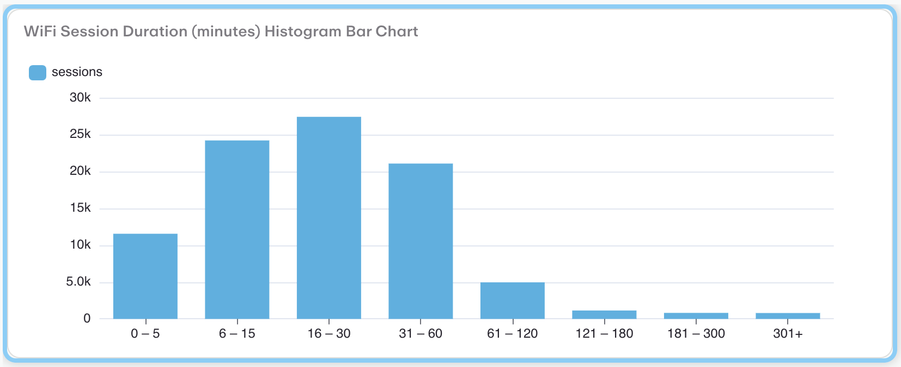

#### WiFi Session Time of Day Histogram Line Chart
Creates a histogram of user WiFi Sessions by time of day. The histogram's hour of day buckets and counts are visualised as a line chart. The default buckets are the hours of the day.
```json
{
  "columnNames": [
    "hour",
    "sessions"
  ],
  "rowSets": [
    {
      "columns": [
        {
          "dimension": {
            "histogram": {
              "metric": "UserProfileWiFiSessions",
              "histogram": "hourAndMinuteOfDay"
            }
          }
        },
        {
          "numericExpression": {
            "metric": "UserProfileWiFiSessions",
            "value": {
              "histogram": "hourAndMinuteOfDay"
            }
          }
        }
      ]
    }
  ],
  "visualisation": {
    "description": {
      "html": "Creates a histogram of user WiFi Sessions by time of day. The histogram's hour of day buckets and counts are visualised as a line chart. The default buckets are the hours of the day."
    },
    "type": "LineChart",
    "title": "WiFi Session Time of Day Histogram Line Chart",
    "lineChartSettings": {
      "showLegend": true,
      "hideAxis": false,
      "gridLines": "auto",
      "stackType": "no-stack",
      "xAxis": {
        "axisLine": {
          "show": false
        },
        "inverse": false,
        "showName": false,
        "splitNumber": 5
      },
      "yAxis": {
        "axisLine": {
          "show": false
        },
        "inverse": false,
        "showName": false,
        "splitNumber": 5
      },
      "enableChartSwitching": false,
      "timeseriesResolutions": false,
      "columnSettings": {},
      "tooltip": {
        "show": true
      }
    }
  }
}
```


**Visualization Preview:** This is a line chart displaying WiFi session frequency throughout the day, showing time periods on the x-axis (from 0-100 to 2100-2200) and number of sessions on the y-axis (ranging from 0 to 15k).

**Key Insights:**
- **Peak usage period**: Sessions peak between 1200-1600 (noon to 4 PM) at approximately 14,000 sessions
- **Usage pattern**: Shows a typical daily activity curve with very low overnight usage (0-600), gradual morning increase starting around 700, sustained high usage during midday/afternoon, then sharp decline after 1600
- **Off-peak hours**: Minimal activity during early morning (0-600) and late evening (2100-2200)
- **Business hours correlation**: The pattern suggests this could be workplace or public space WiFi usage, aligning with typical business/activity hours

The visualization effectively shows clear daily usage patterns with a pronounced midday peak and minimal overnight activity.


#### Monthly WiFi Session Data Usage (MB) Histogram Horizontal Stacked Bar Chart
Creates a monthly histogram of user WiFi session dataUsage, visualised as a horizontal, stacked bar chart. The histogram's data usage buckets and counts are displayed in the chart for each month. The buckets are the default data-usage (MB) ranges for sessions. The data is filtered by the venue's registration group to optimise query performance.
```json
{
  "visualisation": {
    "description": {
      "html": "Creates a monthly histogram of user WiFi session dataUsage, visualised as a horizontal, stacked bar chart. The histogram's data usage buckets and counts are displayed in the chart for each month. The buckets are the default data-usage (MB) ranges for sessions. The data is filtered by the venue's registration group to optimise query performance."
    },
    "barChartSettings": {
      "showBarValues": false,
      "tooltip": {
        "show": true
      },
      "layout": "horizontal",
      "xAxis": {
        "axisLine": {
          "show": false
        },
        "inverse": false,
        "showName": false,
        "splitNumber": 5
      },
      "gridLines": "auto",
      "timeseriesResolutions": false,
      "enableChartSwitching": false,
      "yAxis": {
        "axisLine": {
          "show": false
        },
        "inverse": false,
        "showName": false,
        "splitNumber": 5
      },
      "showLegend": true,
      "hideAxis": false,
      "stackType": "stack"
    },
    "title": "Monthly WiFi Session Data Usage (MB) Histogram Horizontal Stacked Bar Chart",
    "type": "BarChart"
  },
  "columnNames": [
    "time",
    {
      "name": "sessions",
      "dimension": {
        "histogram": {
          "histogram": "dataUsage",
          "metric": "UserProfileWiFiSessions"
        }
      }
    }
  ],
  "rowSets": [
    {
      "columns": [
        {
          "dimension": {
            "timeBasedDimension": "Monthly"
          }
        },
        {
          "numericExpression": {
            "metric": "UserProfileWiFiSessions",
            "value": {
              "histogram": "dataUsage"
            }
          }
        }
      ]
    }
  ],
  "keyAliases": {
    "rg": "venueId.registrationGroup"
  }
}
```


**Visualization Preview:** This is a horizontal stacked bar chart showing monthly WiFi session data usage distribution across different usage ranges (measured in MB) from 2024 through December.

**Data Representation:**
- Each bar represents a month's total WiFi sessions
- Bars are segmented by 9 usage categories ranging from 0-4 MB (lightest blue) to 1280+ MB (darkest blue)
- The width of each colored segment indicates the relative proportion of sessions in that usage range

**Key Insights:**
- **Low usage dominance**: The majority of sessions across all months fall into the lower usage categories (0-79 MB), particularly the 0-4 MB and 5-9 MB ranges
- **Consistent patterns**: Usage distribution remains relatively stable month-to-month, suggesting consistent user behavior patterns
- **Heavy users are minimal**: Very few sessions exceed 640 MB, with the 1280+ MB category representing a tiny fraction
- **Gradual decline**: There's a clear pattern where higher usage categories represent progressively smaller portions of total sessions
- **Seasonal stability**: No dramatic seasonal variations in usage patterns are evident across the months shown

This visualization effectively shows that most WiFi sessions involve light data usage, which is typical for basic browsing, email, and social media activities.
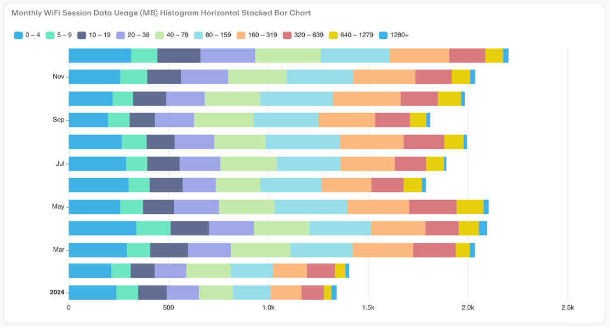

#### Monthly WiFi Sessions Horizontal Bar Chart
Counts monthly WiFi sessions, visualised as a horizontal bar chart. The data is filtered by the venue's registration group to optimise query performance.
```json
{
  "visualisation": {
    "description": {
      "html": "Counts monthly WiFi sessions, visualised as a horizontal bar chart. The data is filtered by the venue's registration group to optimise query performance."
    },
    "barChartSettings": {
      "showBarValues": false,
      "tooltip": {
        "show": true
      },
      "layout": "horizontal",
      "xAxis": {
        "splitNumber": 5
      },
      "gridLines": "auto",
      "yAxis": {
        "splitNumber": 5
      },
      "showLegend": true
    },
    "title": "Monthly WiFi Sessions Horizontal Bar Chart",
    "type": "BarChart"
  },
  "columnNames": [
    "time",
    "sessions"
  ],
  "rowSets": [
    {
      "columns": [
        {
          "dimension": {
            "timeBasedDimension": "Monthly"
          }
        },
        {
          "numericExpression": {
            "metric": "UserProfileWiFiSessions",
            "value": {
              "counter": "total"
            }
          }
        }
      ]
    }
  ],
  "keyAliases": {
    "rg": "venueId.registrationGroup"
  }
}
```


**Visualization Preview:** This is a horizontal bar chart displaying monthly WiFi sessions data. The chart shows WiFi usage patterns across different months, with each blue bar representing the number of sessions for that period.

**Key insights:**
- **Peak usage**: December shows the highest WiFi sessions (~2,500), followed closely by April and May (~2,100 each)
- **Seasonal patterns**: Higher usage appears in winter months (Dec, Nov ~2,000) and spring months (Apr, May)
- **Lower usage periods**: January 2024 shows significantly lower sessions (~1,400), suggesting either a seasonal drop or data collection period
- **Consistent mid-range usage**: Summer and fall months (Jun-Oct) show relatively stable usage around 1,700-1,900 sessions

The visualization effectively shows WiFi usage trends over time, indicating potential seasonal variations in user behavior or facility usage patterns. The data suggests peak networking activity during certain months, which could inform capacity planning and network management decisions.
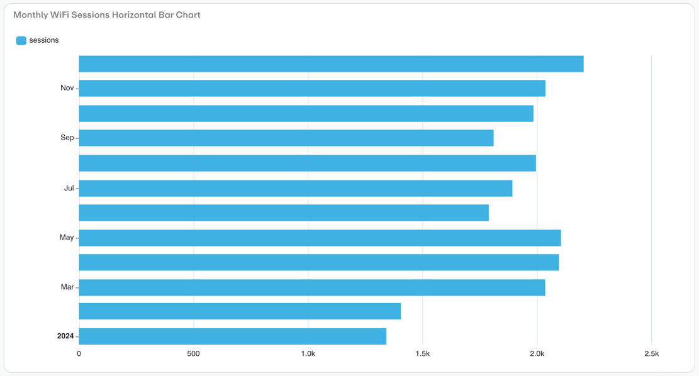

#### Yearly WiFi Sessions
Creates a table of WiFiSessions by year.
```json
{
  "columnNames": [
    "Date",
    "Count"
  ],
  "rowSets": [
    {
      "columns": [
        {
          "dimension": {
            "timeBasedDimension": "Yearly"
          }
        },
        {
          "numericExpression": {
            "metric": "UserProfileWiFiSessions",
            "value": {
              "counter": "total"
            }
          }
        }
      ]
    }
  ],
  "visualisation": {
    "description": {
      "html": "Creates a table of WiFiSessions by year."
    },
    "type": "Table",
    "title": "Yearly WiFi Sessions",
    "tableSettings": {
      "paginate": false,
      "scrollOverflow": true
    }
  }
}
```


**Visualization Preview:** This is a simple data table visualization showing "Yearly WiFi Sessions" data. 

**Visualization Type**: Tabular display with two columns (Date and Count)

**Data Displayed**: 
- 2024: 8,037 WiFi sessions
- 2025: 13,389 WiFi sessions

**Key Insights**:
- Shows a significant 66% increase in WiFi sessions from 2024 to 2025
- Growth of 5,352 additional sessions year-over-year
- Indicates growing WiFi usage/adoption over the two-year period

The visualization uses a clean, minimal table format to present this comparative annual data clearly and concisely.
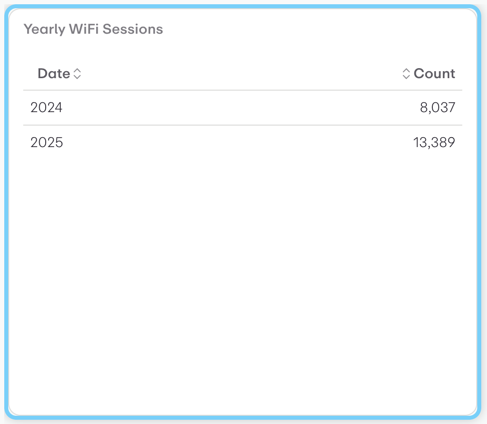


## UserProfilesNow
#### Age in Years
Age in Years
```json
{
  "columnNames": [
    "Age in Years",
    "Count"
  ],
  "rowSets": [
    {
      "columns": [
        {
          "dimension": {
            "key": "ageInYears"
          },
          "sortSpecification": {
            "ascending": true,
            "priority": 1
          }
        },
        {
          "numericExpression": {
            "metric": "UserProfilesNow",
            "value": {
              "counter": "total"
            }
          }
        }
      ]
    }
  ],
  "visualisation": {
    "description": {
      "html": "Age in Years"
    },
    "type": "BarChart",
    "title": "Age in Years",
    "tableSettings": {
      "paginate": true,
      "scrollOverflow": true
    }
  }
}
```


**Visualization Preview:** This is a histogram (bar chart) showing the distribution of ages in years across a population. 

**Chart Type**: Histogram with age ranges on the x-axis (0-92 years) and frequency counts on the y-axis (0-500).

**Data Displayed**: The distribution shows age frequencies across the entire lifespan, with each bar representing the count of individuals in specific age ranges.

**Key Insights**:
- **Peak at ~25 years**: The highest frequency (~480 individuals) occurs around age 25
- **Right-skewed distribution**: The data shows a typical population pyramid pattern with more younger individuals
- **Gradual decline**: Frequencies steadily decrease from the peak through middle age and beyond
- **Long tail**: The distribution extends to age 92 with very low frequencies in the elderly population
- **Age range**: The population spans from approximately 10 to 92 years old

This visualization suggests a relatively young population with the majority concentrated in the 20-40 age range, which could represent a workforce, student body, or similar demographic group.
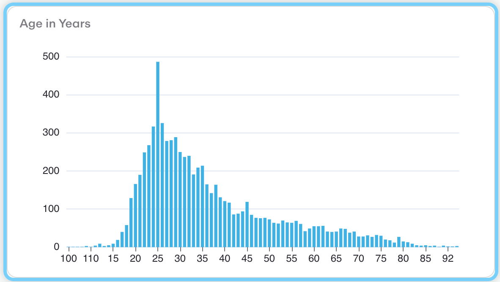

#### Country And State
Count registrations by country and state
```json
{
  "columnNames": [
    "Country",
    "State",
    "Count"
  ],
  "keyAliases": {
    "country": [
      "Australia",
      "United States"
    ]
  },
  "rowSets": [
    {
      "columns": [
        {
          "dimension": {
            "key": "country"
          },
          "sortSpecification": {
            "ascending": true,
            "priority": 1
          }
        },
        {
          "dimension": {
            "key": "state"
          },
          "sortSpecification": {
            "ascending": true,
            "priority": 2
          }
        },
        {
          "numericExpression": {
            "metric": "UserProfilesNow",
            "value": {
              "counter": "total"
            }
          }
        }
      ]
    }
  ],
  "visualisation": {
    "description": {
      "html": "Count registrations by country and state"
    },
    "type": "Table",
    "tableSettings": {
      "paginate": false,
      "scrollOverflow": true
    }
  }
}
```

#### Country Calling Codes
Count registrations by County Calling Code
```json
{
  "columnNames": [
    "Country",
    "Calling Code",
    "Count"
  ],
  "keyAliases2": {
    "country": [
      "Australia"
    ],
    "state": [
      "new south wales"
    ]
  },
  "rowSets": [
    {
      "columns": [
        {
          "dimension": {
            "key": "country"
          }
        },
        {
          "dimension": {
            "key": "countryCallingCode"
          }
        },
        {
          "numericExpression": {
            "metric": "UserProfilesNow",
            "value": {
              "counter": "total"
            }
          },
          "sortSpecification": {
            "ascending": false,
            "priority": 1
          }
        }
      ]
    }
  ],
  "visualisation": {
    "description": {
      "html": "Count registrations by County Calling Code"
    },
    "type": "Table",
    "title": "Country Calling Codes",
    "tableSettings": {
      "paginate": false,
      "scrollOverflow": true
    }
  }
}
```

#### Device Category (with missing)
Create a pie chart of WiFi client device categories. Includes a count of profiles missing a deviceCategory.
```json
{
  "columnNames": [
    "Device Category",
    "Count"
  ],
  "keyAliases": {
    "country": [
      "Australia",
      "United States"
    ]
  },
  "rowSets": [
    {
      "columns": [
        {
          "dimension": {
            "key": "deviceCategory",
            "missing": true
          }
        },
        {
          "numericExpression": {
            "metric": "UserProfilesNow",
            "value": {
              "counter": "total"
            }
          }
        }
      ]
    }
  ],
  "visualisation": {
    "description": {
      "html": "Create a pie chart of WiFi client device categories. Includes a count of profiles missing a deviceCategory."
    },
    "type": "PieChart",
    "title": "Device Category (with missing)",
    "pieChartSettings": {
      "label": {
        "show": true,
        "labelLine": true,
        "mode": "name"
      }
    }
  }
}
```


**Visualization Preview:** This is a pie chart titled "Device Category (with missing)" that shows the distribution of device types used to access a service or platform.

**Chart Type:** Pie chart with four segments

**Data Displayed:**
- Mobile (blue) - appears to be the largest segment, roughly 40-45%
- MISSING (teal/green) - second largest segment, approximately 35-40%
- Laptop (light green) - smaller segment, around 10-15%
- Tablet (purple) - smallest segment, roughly 5-10%

**Key Insights:**
1. **Mobile dominance:** Mobile devices represent the plurality of traffic/usage
2. **Significant data gap:** A substantial portion of device data is missing or unidentified, which could indicate tracking issues or privacy settings
3. **Desktop/laptop usage:** Laptops show moderate usage compared to mobile
4. **Limited tablet adoption:** Tablets have the smallest share among identified devices

The high percentage of "MISSING" data suggests potential issues with device detection or user privacy settings that prevent proper categorization.
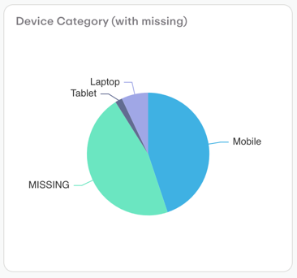

#### Email
Subscribed registrations with Email
```json
{
  "keyAliases": {
    "hasEmail": [
      "true"
    ],
    "status": [
      "subscribed"
    ]
  },
  "columnNames": [
    "Email"
  ],
  "rowSets": [
    {
      "columns": [
        {
          "numericExpression": {
            "metric": "UserProfilesNow",
            "value": {
              "counter": "total"
            }
          }
        }
      ]
    }
  ],
  "visualisation": {
    "description": {
      "html": "Subscribed registrations with Email"
    },
    "type": "Number",
    "title": "Email"
  }
}
```

#### ACP - Visitor AND Gender:MALE AND postcode:5000
Group registrations by Single Choice Extended Attribute answers
```json
{
  "columnNames": [
    "Count"
  ],
  "keyAliases": {
    "extendedAttribute:551": [
      "ACP - Visitor"
    ],
    "gender": [
      "MALE"
    ],
    "postcode": [
      "5000"
    ]
  },
  "rowSets": [
    {
      "columns": [
        {
          "numericExpression": {
            "metric": "UserProfilesNow",
            "value": {
              "counter": "total"
            }
          },
          "sortSpecification": {
            "ascending": false,
            "priority": 1
          }
        }
      ]
    }
  ],
  "visualisation": {
    "description": {
      "html": "Group registrations by Single Choice Extended Attribute answers"
    },
    "type": "Number",
    "title": "ACP - Visitor AND Gender:MALE AND postcode:5000",
    "tableSettings": {
      "paginate": false,
      "scrollOverflow": true
    }
  }
}
```

#### Single Choice Attribute
Group registrations by Single Choice Extended Attribute answers
```json
{
  "columnNames": [
    "Answer",
    "Gender",
    "Count"
  ],
  "keyAliases": {
    "extendedAttribute:551": [
      "ACP Local Resident"
    ]
  },
  "rowSets": [
    {
      "columns": [
        {
          "dimension": {
            "key": "extendedAttribute:551"
          }
        },
        {
          "dimension": {
            "key": "country"
          }
        },
        {
          "numericExpression": {
            "metric": "UserProfilesNow",
            "value": {
              "counter": "total"
            }
          },
          "sortSpecification": {
            "ascending": false,
            "priority": 1
          }
        }
      ]
    }
  ],
  "visualisation": {
    "description": {
      "html": "Group registrations by Single Choice Extended Attribute answers"
    },
    "type": "Table",
    "title": "Single Choice Attribute",
    "tableSettings": {
      "paginate": false,
      "scrollOverflow": true
    }
  }
}
```

#### Gender Distribution (columns, missing values)
Demo grouping gender into columns.  Missing values are included.
```json
{
  "visualisation": {
    "type": "Table",
    "title": "Gender Distribution (columns, missing values)",
    "description": {
      "html": "Demo grouping gender into columns.  Missing values are included."
    },
    "imageFile": "",
    "tableSettings": {
      "columnSettings": {},
      "paginate": false,
      "scrollOverflow": true
    }
  },
  "columnNames": [
    {
      "name": "gender",
      "dimension": {
        "key": "gender",
        "missing": true
      }
    }
  ],
  "rowSets": [
    {
      "columns": [
        {
          "numericExpression": {
            "metric": "UserProfilesNow",
            "value": {
              "counter": "total"
            }
          }
        }
      ]
    }
  ]
}
```


**Visualization Preview:** This is a horizontal bar chart showing gender distribution data across four categories: Female, Male, Missing, and Other.

**Data displayed:**
- Female: 33,266 (largest group)
- Male: 14,050 
- Missing: 5,317
- Other: 5,690

**Key insights:**
- Strong female majority, representing approximately 57% of the total population
- Significant gender imbalance with females outnumbering males by more than 2:1
- Notable data quality issue with 5,317 missing gender values
- The "Other" category (5,690) is slightly larger than the missing values, suggesting inclusive gender options in data collection

The visualization effectively highlights both the gender composition and data completeness, with the missing values prominently displayed as a separate category rather than being hidden.
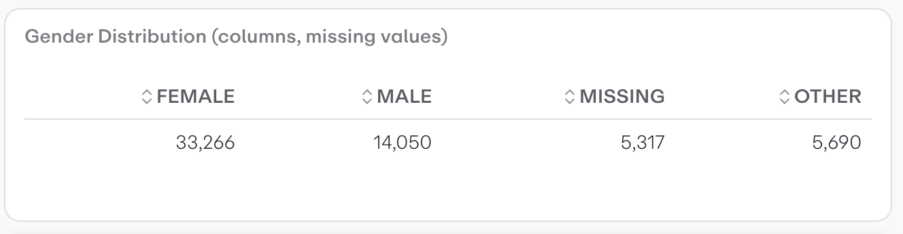

#### Gender Composition
Percentages of Males and Females
```json
{
  "keyAliases": {
    "gender": [
      "MALE",
      "FEMALE"
    ]
  },
  "columnNames": [
    "gender",
    "percentage"
  ],
  "rowSets": [
    {
      "columns": [
        {
          "dimension": {
            "key": "gender"
          }
        },
        {
          "numericExpression": {
            "$divide": [
              {
                "metric": "UserProfilesNow",
                "value": {
                  "counter": "total"
                }
              },
              {
                "metric": "UserProfilesNow",
                "value": {
                  "counter": "total"
                },
                "aggregateAcross": [
                  {
                    "key": "gender"
                  }
                ]
              }
            ]
          },
          "unit": "percentage",
          "decimalPlaces": 2
        }
      ]
    }
  ],
  "visualisation": {
    "description": {
      "html": "Percentages of Males and Females"
    },
    "type": "MultiNumber",
    "title": "Gender Composition"
  }
}
```

#### M
Count Male registrations
```json
{
  "keyAliases": {
    "gender": [
      "MALE"
    ]
  },
  "columnNames": [
    "Males"
  ],
  "rowSets": [
    {
      "columns": [
        {
          "numericExpression": {
            "metric": "UserProfilesNow",
            "value": {
              "counter": "total"
            }
          }
        }
      ]
    }
  ],
  "visualisation": {
    "description": {
      "html": "Count Male registrations"
    },
    "type": "Number",
    "title": "M"
  }
}
```

#### Gender Stats
Count registrations
```json
{
  "columnNames": [
    "gender",
    "count",
    "total",
    "percentage"
  ],
  "rowSets": [
    {
      "columns": [
        {
          "dimension": {
            "key": "gender"
          }
        },
        {
          "numericExpression": {
            "metric": "UserProfilesNow",
            "value": {
              "counter": "total"
            }
          }
        },
        {
          "numericExpression": {
            "metric": "UserProfilesNow",
            "value": {
              "counter": "total"
            },
            "aggregateAcross": [
              {
                "key": "gender"
              }
            ]
          }
        },
        {
          "numericExpression": {
            "$divide": [
              {
                "metric": "UserProfilesNow",
                "value": {
                  "counter": "total"
                }
              },
              {
                "metric": "UserProfilesNow",
                "value": {
                  "counter": "total"
                },
                "aggregateAcross": [
                  {
                    "key": "gender"
                  }
                ]
              }
            ]
          },
          "unit": "percentage",
          "decimalPlaces": 2
        }
      ]
    }
  ],
  "visualisation": {
    "description": {
      "html": "Count registrations"
    },
    "type": "Table",
    "title": "Gender Stats"
  }
}
```

#### Age In Years Histogram Columns (default buckets)
Creates a histogram of user ages.  The histogram's age buckets and counts are visualised as a single row table. Each bucket is a single column and the corresponding row value is the bucket count. The buckets are defaults derived from the histogram's metric and the histogram name.
```json
{
  "columnNames": [
    {
      "name": "age",
      "dimension": {
        "histogram": {
          "metric": "UserProfilesNow",
          "histogram": "ageInYears"
        }
      }
    }
  ],
  "rowSets": [
    {
      "columns": [
        {
          "numericExpression": {
            "metric": "UserProfilesNow",
            "value": {
              "histogram": "ageInYears"
            }
          }
        }
      ]
    }
  ],
  "visualisation": {
    "description": {
      "html": "Creates a histogram of user ages.  The histogram's age buckets and counts are visualised as a single row table. Each bucket is a single column and the corresponding row value is the bucket count. The buckets are defaults derived from the histogram's metric and the histogram name."
    },
    "type": "Table",
    "title": "Age In Years Histogram Columns (default buckets)",
    "tableSettings": {
      "paginate": false,
      "scrollOverflow": true
    }
  }
}
```


**Visualization Preview:** This is a horizontal histogram/bar chart showing age distribution across different age groups measured in years.

**Data Display:**
- Shows 8 age brackets from 0-14 years to 75+ years
- Each age group displays its corresponding population count
- Uses default bucket ranges in 10-year intervals (except the youngest and oldest groups)

**Key Insights:**
- **Peak demographic**: Ages 25-34 with 2,684 individuals (highest count)
- **Secondary peak**: Ages 15-24 with 1,415 individuals  
- **Clear decline**: Population decreases steadily after age 35
- **Very low representation**: Ages 0-14 (only 6 individuals) and 75+ (197 individuals)
- **Working-age concentration**: Most of the population falls between ages 15-54

The distribution suggests this dataset represents a working-age population with very few children and elderly individuals, possibly indicating a professional or employment-related dataset.
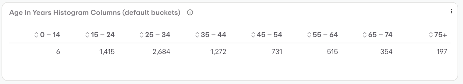

#### Age In Years Histogram Table (default buckets)
Creates a histogram of user ages.  The histogram's age buckets and counts are visualised as a table. The buckets are defaults derived from the histogram's metric and the histogram name.
```json
{
  "columnNames": [
    "ageInYears",
    "count"
  ],
  "rowSets": [
    {
      "columns": [
        {
          "dimension": {
            "histogram": {
              "metric": "UserProfilesNow",
              "histogram": "ageInYears"
            }
          }
        },
        {
          "numericExpression": {
            "metric": "UserProfilesNow",
            "value": {
              "histogram": "ageInYears"
            }
          }
        }
      ]
    }
  ],
  "visualisation": {
    "description": {
      "html": "Creates a histogram of user ages.  The histogram's age buckets and counts are visualised as a table. The buckets are defaults derived from the histogram's metric and the histogram name."
    },
    "type": "Table",
    "title": "Age In Years Histogram Table (default buckets)",
    "tableSettings": {
      "paginate": false,
      "scrollOverflow": true
    }
  }
}
```


**Visualization Preview:** This is a histogram table showing the age distribution of a population across predefined age brackets (inline buckets). The visualization displays:

**Chart Type:** Histogram table with age ranges as buckets

**Data Displayed:**
- Age ranges from 0-14 years up to 75+ years
- Count of individuals in each age bracket
- Total sample size of 6,690 people

**Key Insights:**
- **Peak demographic:** Ages 25-34 (2,589 people, ~39% of population)
- **Second largest group:** Ages 15-24 (1,138 people)
- **Population skew:** Heavily weighted toward younger adults, with counts declining steadily after age 34
- **Minimal representation:** No individuals under 15, very few over 75 (203 people)

This distribution suggests a young adult-focused dataset, possibly representing a workforce, student population, or user base of a service that primarily attracts people in their 20s and 30s.


#### Age In Years Histogram Table (inline buckets)
Creates a histogram of user ages. The histogram's age buckets and counts are visualised as a table. The buckets are defined using inline buckets. The first bucket is for ages up to 20, the second bucket is for ages from 20 to 40, and the third bucket is for ages over 40.
```json
{
  "columnNames": [
    "ageInYears",
    "count"
  ],
  "rowSets": [
    {
      "columns": [
        {
          "dimension": {
            "histogram": {
              "buckets": [
                {
                  "to": 20
                },
                {
                  "from": 20,
                  "to": 40
                },
                {
                  "from": 40
                }
              ]
            }
          }
        },
        {
          "numericExpression": {
            "metric": "UserProfilesNow",
            "value": {
              "histogram": "ageInYears"
            }
          }
        }
      ]
    }
  ],
  "visualisation": {
    "description": {
      "html": "Creates a histogram of user ages. The histogram's age buckets and counts are visualised as a table. The buckets are defined using inline buckets. The first bucket is for ages up to 20, the second bucket is for ages from 20 to 40, and the third bucket is for ages over 40."
    },
    "type": "Table",
    "title": "Age In Years Histogram Table (inline buckets)"
  }
}
```


**Visualization Preview:** This is a histogram table displaying age distribution data with inline bucket notation. The visualization shows:

**Chart Type:** Frequency distribution table (histogram in tabular form)

**Data Displayed:** 
- Age ranges in years across three buckets
- Count of individuals in each age group
- Total sample size of 7,455 individuals

**Key Insights:**
- The 20-40 age group dominates the dataset (4,812 people, ~65% of total)
- Middle-aged adults (40+) represent the second largest segment (2,377 people, ~32%)
- Young adults and minors (0-20) are the smallest group (266 people, ~4%)
- The distribution shows a concentration in the working-age population with relatively few younger individuals

The data suggests this might represent a workforce, customer base, or similar population where middle-aged adults are predominant.


#### 20 to 40 Years Old Count
Count of users aged between 20 and 40 years old.  This uses an inline bucket for the age range. The count is visualised as a number.
```json
{
  "columnNames": [
    "20 to 40"
  ],
  "rowSets": [
    {
      "columns": [
        {
          "numericExpression": {
            "metric": "UserProfilesNow",
            "value": {
              "histogram": "ageInYears",
              "bucket": {
                "from": 20,
                "to": 40
              }
            }
          }
        }
      ]
    }
  ],
  "visualisation": {
    "description": {
      "html": "Count of users aged between 20 and 40 years old.  This uses an inline bucket for the age range. The count is visualised as a number."
    },
    "type": "Number",
    "title": "20 to 40 Years Old Count"
  }
}
```


**Visualization Preview:** This is a **metric card** or **KPI widget** displaying a single key performance indicator.

**Data displayed:**
- Count of individuals aged 20 to 40 years old
- Value: 4,812 people

**Visualization type:**
Simple numerical display with large, prominent typography for easy readability

**Insights:**
- Provides a quick snapshot of the population segment between 20-40 years
- Likely part of a demographic dashboard for population analysis, marketing segmentation, or organizational planning
- The clean, minimalist design emphasizes the metric's importance as a key data point

This type of widget is commonly used in executive dashboards where stakeholders need immediate access to critical demographic counts without additional visual complexity.
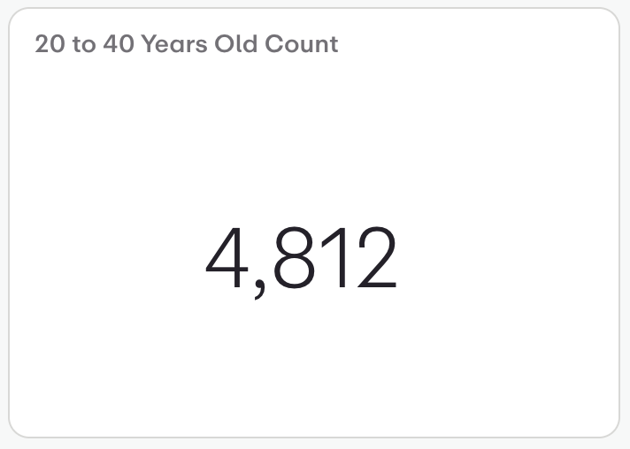

#### Country Calling Code Histogram Table (default buckets)
Creates a histogram of user country calling codes. The histogram's country calling code buckets and counts are visualised as a table.
```json
{
  "columnNames": [
    "countryCallingCodeNumeric",
    "count"
  ],
  "rowSets": [
    {
      "columns": [
        {
          "dimension": {
            "histogram": {
              "metric": "UserProfilesNow",
              "histogram": "countryCallingCodeNumeric"
            }
          }
        },
        {
          "numericExpression": {
            "metric": "UserProfilesNow",
            "value": {
              "histogram": "countryCallingCodeNumeric"
            }
          }
        }
      ]
    }
  ],
  "visualisation": {
    "description": {
      "html": "Creates a histogram of user country calling codes. The histogram's country calling code buckets and counts are visualised as a table."
    },
    "type": "Table",
    "title": "Country Calling Code Histogram Table (default buckets)",
    "tableSettings": {
      "paginate": false,
      "scrollOverflow": true
    }
  }
}
```


**Visualization Preview:** This is a histogram table showing the distribution of country calling codes by numeric ranges. The visualization displays:

**Chart Type**: Histogram table with frequency buckets

**Data Displayed**: 
- Country calling code ranges (e.g., 1-1, 20-29, 30-49, etc.)
- Count of countries/territories in each range

**Key Insights**:
- The 60-99 range dominates with 68,863 entries, representing the vast majority of calling codes
- The 30-49 range has the second-highest count at 1,661
- Other ranges have relatively small counts (30-136 entries each)
- The 1-1 range shows 0 entries
- This distribution suggests most countries use calling codes in the 60-99 numeric range

The table reveals a heavily skewed distribution where calling codes are concentrated in specific numeric ranges rather than being evenly distributed across all possible values.


#### Postcode Numeric Histogram Table (inline buckets)
Creates a histogram of user postcodes. The histogram's postcode buckets and counts are visualised as a table. The buckets are defined using inline buckets, covering various regions in South Australia and Victoria.
```json
{
  "columnNames": [
    "postcodeNumeric",
    "count"
  ],
  "rowSets": [
    {
      "columns": [
        {
          "dimension": {
            "histogram": {
              "buckets": [
                {
                  "key": "SA - Adelaide Metro (5000-5099)",
                  "from": 5000,
                  "to": 5099
                },
                {
                  "key": "SA - Adelaide Hills/Eastern (5100-5199)",
                  "from": 5100,
                  "to": 5199
                },
                {
                  "key": "SA - Southern Adelaide (5200-5299)",
                  "from": 5200,
                  "to": 5299
                },
                {
                  "key": "SA - Barossa/Northern (5300-5399)",
                  "from": 5300,
                  "to": 5399
                },
                {
                  "key": "SA - Riverland/Murray (5400-5499)",
                  "from": 5400,
                  "to": 5499
                },
                {
                  "key": "SA - Mid North/Yorke Peninsula (5500-5599)",
                  "from": 5500,
                  "to": 5599
                },
                {
                  "key": "SA - Eyre Peninsula/West Coast (5600-5699)",
                  "from": 5600,
                  "to": 5699
                },
                {
                  "key": "SA - Far North/Outback (5700-5799)",
                  "from": 5700,
                  "to": 5799
                },
                {
                  "key": "VIC - Melbourne CBD/Inner (3000-3099)",
                  "from": 3000,
                  "to": 3099
                },
                {
                  "key": "VIC - Melbourne Eastern (3100-3199)",
                  "from": 3100,
                  "to": 3199
                },
                {
                  "key": "VIC - Melbourne Western (3200-3299)",
                  "from": 3200,
                  "to": 3299
                },
                {
                  "key": "VIC - Melbourne Northern (3300-3399)",
                  "from": 3300,
                  "to": 3399
                },
                {
                  "key": "VIC - Geelong/Western Districts (3400-3499)",
                  "from": 3400,
                  "to": 3499
                },
                {
                  "key": "VIC - Central Highlands/Ballarat (3500-3599)",
                  "from": 3500,
                  "to": 3599
                },
                {
                  "key": "VIC - Gippsland/Eastern (3600-3699)",
                  "from": 3600,
                  "to": 3699
                },
                {
                  "key": "VIC - Murray River/North (3700-3799)",
                  "from": 3700,
                  "to": 3799
                },
                {
                  "key": "VIC - Wimmera/Mallee (3800-3899)",
                  "from": 3800,
                  "to": 3899
                },
                {
                  "key": "VIC - Far East/Alpine (3900-3999)",
                  "from": 3900,
                  "to": 3999
                },
                {
                  "key": "VIC - Special Addresses (8000-8999)",
                  "from": 8000,
                  "to": 8999
                }
              ]
            }
          }
        },
        {
          "numericExpression": {
            "metric": "UserProfilesNow",
            "value": {
              "histogram": "postcodeNumeric"
            }
          }
        }
      ]
    }
  ],
  "visualisation": {
    "description": {
      "html": "Creates a histogram of user postcodes. The histogram's postcode buckets and counts are visualised as a table. The buckets are defined using inline buckets, covering various regions in South Australia and Victoria."
    },
    "type": "Table",
    "title": "Postcode Numeric Histogram Table (inline buckets)",
    "tableSettings": {
      "paginate": false,
      "scrollOverflow": true
    }
  }
}
```


**Visualization Preview:** This is a **histogram table** showing the distribution of postcode numeric ranges and their corresponding frequencies.

**Data Displayed:**
- Postcode ranges in 100-unit intervals (5000-5099, 5100-5199, etc.)
- Count of occurrences for each range
- Covers postcodes from 5000 to 5699

**Key Insights:**
- **Heavily skewed distribution**: The 5000-5099 range dominates with 30,732 occurrences (about 77% of total data)
- **Sharp decline**: Frequency drops dramatically after the first range, with 5100-5199 having only 5,181 occurrences
- **Consistent low ranges**: Postcodes 5300+ show relatively low, stable frequencies (298-701 occurrences)
- **Total dataset**: Approximately 39,754 postcode entries

This suggests a geographic concentration in the 5000-5099 postcode area, likely indicating a major urban center or high-density region in what appears to be an Australian postal system (5000 series postcodes).


#### Age In Years Histogram x Signup Month Table
Creates a histogram of user ages for each signup month of the year. The data is presented as a table.  The x-axis are the (default) buckets of age in years, and the y-axis is the month of the year.
```json
{
  "columnNames": [
    "month",
    {
      "name": "age",
      "dimension": {
        "histogram": {
          "metric": "UserProfilesNow",
          "histogram": "ageInYears"
        }
      }
    }
  ],
  "rowSets": [
    {
      "columns": [
        {
          "dimension": {
            "timeBasedDimension": "MonthOfYear"
          }
        },
        {
          "numericExpression": {
            "metric": "UserProfilesNow",
            "value": {
              "histogram": "ageInYears"
            }
          }
        }
      ]
    }
  ],
  "visualisation": {
    "description": {
      "html": "Creates a histogram of user ages for each signup month of the year. The data is presented as a table.  The x-axis are the (default) buckets of age in years, and the y-axis is the month of the year."
    },
    "type": "Table",
    "title": "Age In Years Histogram x Signup Month Table"
  }
}
```


**Visualization Preview:** This is a cross-tabulation table (contingency table) showing the distribution of user signups by age group and month. 

**Data displayed:**
- Rows: 12 months (January-December)
- Columns: 7 age groups (0-14, 15-24, 25-34, 35-44, 45-54, 55-64, 65-74)
- Values: Number of signups in each age/month combination

**Key insights:**
1. **Seasonal patterns**: December shows the highest signup volumes across most age groups, while January has the lowest
2. **Age distribution**: The 25-34 age group has the highest signup numbers consistently across all months
3. **Demographic trends**: Younger adults (15-44) represent the majority of signups, with participation declining in older age groups
4. **Growth pattern**: There's a general upward trend from January to December, suggesting either business growth or seasonal effects

The table format allows for easy comparison across both dimensions and identification of peak periods and target demographics.
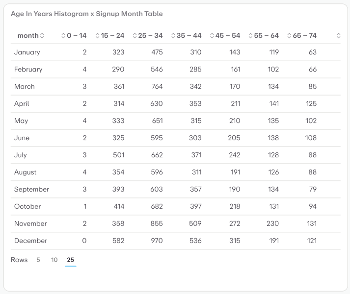

#### Year of Birth Histogram Table (inline buckets)
Creates a histogram of user year of birth. The histogram's buckets and counts are visualised as a table. The buckets are defined using inline buckets. The three buckets are for years up to 1975, from 1975 to 2000, and from 2000 onwards.
```json
{
  "columnNames": [
    "yearOfBirth",
    "count"
  ],
  "rowSets": [
    {
      "columns": [
        {
          "dimension": {
            "histogram": {
              "buckets": [
                {
                  "to": 1975
                },
                {
                  "from": 1975,
                  "to": 2000
                },
                {
                  "from": 2000
                }
              ]
            }
          }
        },
        {
          "numericExpression": {
            "metric": "UserProfilesNow",
            "value": {
              "histogram": "yearOfBirth"
            }
          }
        }
      ]
    }
  ],
  "visualisation": {
    "description": {
      "html": "Creates a histogram of user year of birth. The histogram's buckets and counts are visualised as a table. The buckets are defined using inline buckets. The three buckets are for years up to 1975, from 1975 to 2000, and from 2000 onwards."
    },
    "type": "Table",
    "title": "Year of Birth Histogram Table (inline buckets)"
  }
}
```


**Visualization Preview:** This is a histogram table showing the distribution of birth years across three time periods using inline buckets.

**Data Representation:**
- **Chart Type:** Histogram table with grouped time intervals
- **Variables:** Year of birth (categorical buckets) vs. count (frequency)
- **Time Periods:** 
  - 0-1975: 1,360 individuals
  - 1975-2000: 4,142 individuals  
  - 2000+: 1,953 individuals

**Key Insights:**
- The 1975-2000 generation represents the largest cohort, comprising over half the dataset (55.6%)
- There's a notable decline in the post-2000 group compared to the peak 1975-2000 period
- The pre-1975 group is the smallest, suggesting either an older demographic with lower representation or data collection focused on more recent births
- Total sample size: 7,455 individuals across all time periods

This visualization effectively shows generational distribution patterns in the dataset, with Generation X and Millennials (1975-2000) being the dominant demographic.
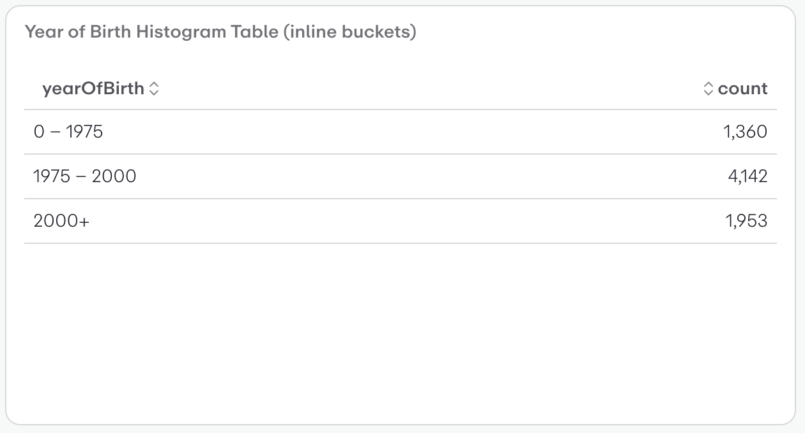

#### Non-English Languages
Top 5 non-english languages
```json
{
  "columnNames": [
    "Language",
    "Count"
  ],
  "keyAliases": {
    "language": [
      "zh",
      "de",
      "fr",
      "nl",
      "it"
    ]
  },
  "rowSets": [
    {
      "columns": [
        {
          "dimension": {
            "key": "language"
          }
        },
        {
          "numericExpression": {
            "metric": "UserProfilesNow",
            "value": {
              "counter": "total"
            }
          },
          "sortSpecification": {
            "ascending": false,
            "priority": 1
          }
        }
      ]
    }
  ],
  "visualisation": {
    "description": {
      "html": "Top 5 non-english languages"
    },
    "type": "PieChart",
    "title": "Non-English Languages"
  }
}
```


**Visualization Preview:** This is a pie chart visualization showing the distribution of "Non-En Languages" (Non-English Languages) with a total of 200 data points.

**Chart Type:** Pie chart with numerical labels

**Data Displayed:**
- Dutch: 49 (largest segment, highlighted with tooltip)
- Four other unnamed language segments with values: 178, 79, 49, and 38

**Key Insights:**
- Dutch represents approximately 25% of non-English language usage
- One segment (178) dominates with nearly 90% of the distribution
- The remaining three segments are relatively small and similar in size
- This appears to be analyzing language diversity in a multilingual context, possibly for website analytics or user demographics

The visualization effectively shows language distribution patterns, with one dominant non-English language and Dutch being a notable secondary language.
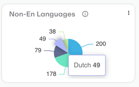

#### List Size
Subscribed and Unsubscribed users by Marketing List (and registration status is subscribed)
```json
{
  "columnNames": [
    "Status",
    "Count"
  ],
  "keyAliases": {
    "status": [
      "subscribed",
      "unsubscribed"
    ]
  },
  "rowSets": [
    {
      "columns": [
        {
          "dimension": {
            "key": "ml"
          }
        },
        {
          "numericExpression": {
            "metric": "UserProfilesNow",
            "value": {
              "counter": "total"
            }
          },
          "sortSpecification": {
            "ascending": false,
            "priority": 1
          }
        }
      ]
    }
  ],
  "visualisation": {
    "description": {
      "html": "Subscribed and Unsubscribed users by Marketing List (and registration status is subscribed)"
    },
    "type": "Table",
    "title": "List Size",
    "tableSettings": {
      "paginate": false,
      "scrollOverflow": true
    }
  }
}
```

#### Non-English Languages
Top 5 non-english locale
```json
{
  "columnNames": [
    "Locale",
    "Count"
  ],
  "keyAliases": {
    "language": [
      "zh",
      "de",
      "fr",
      "nl",
      "it"
    ]
  },
  "rowSets": [
    {
      "columns": [
        {
          "dimension": {
            "key": "locale"
          }
        },
        {
          "numericExpression": {
            "metric": "UserProfilesNow",
            "value": {
              "counter": "total"
            }
          },
          "sortSpecification": {
            "ascending": false,
            "priority": 1
          }
        }
      ]
    }
  ],
  "visualisation": {
    "description": {
      "html": "Top 5 non-english locale"
    },
    "type": "PieChart",
    "title": "Non-English Languages"
  }
}
```


**Visualization Preview:** This is a pie chart visualization titled "Non-En Locales" showing the distribution of different language locales or regions.

**Chart Type**: Pie chart with labeled segments and values

**Data Displayed**: 
- Total of 7 different non-English locales
- Values shown: 139, 138, 64, 43, 35, 5, 3, and 1
- Total appears to be 428 units

**Key Insights**:
- Two dominant locales account for the majority (~65%) with values of 139 and 138
- Highly skewed distribution - the top 2 locales represent nearly two-thirds of the total
- Long tail distribution with 5 smaller locales having significantly lower values (64 and below)
- The smallest locale has only 1 unit, showing extreme variance in locale representation

This visualization effectively shows market concentration in non-English locales, with clear dominance by two primary markets and several smaller, potentially emerging or niche markets.
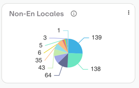

#### OS Category (with missing)
Create a pie chart of WiFi client operating-system (OS) categories. Includes a count of profiles missing an osCategory.
```json
{
  "columnNames": [
    "OS",
    "Count"
  ],
  "rowSets": [
    {
      "columns": [
        {
          "dimension": {
            "key": "osCategory",
            "missing": true
          }
        },
        {
          "numericExpression": {
            "metric": "UserProfilesNow",
            "value": {
              "counter": "total"
            }
          }
        }
      ]
    }
  ],
  "visualisation": {
    "description": {
      "html": "Create a pie chart of WiFi client operating-system (OS) categories. Includes a count of profiles missing an osCategory."
    },
    "type": "PieChart",
    "title": "OS Category (with missing)",
    "pieChartSettings": {
      "label": {
        "show": true,
        "labelLine": true,
        "mode": "name"
      }
    }
  }
}
```


**Visualization Preview:** This is a pie chart titled "OS Category (with missing)" that displays the distribution of operating systems in a dataset.

**Chart Type:** Pie chart with color-coded segments

**Data Displayed:** 
- MISSING (largest segment, approximately 60-70%)
- iOS_OSX (light blue segment)
- Windows (small gray segment)
- Android (small dark segment)
- Blackberry (smallest segment)

**Key Insights:**
- The majority of data points have missing OS information, indicating significant data quality issues
- Among the known OS categories, iOS_OSX appears to have the largest representation
- Windows, Android, and Blackberry have relatively small shares
- The high proportion of missing data suggests this dataset may need data cleaning or collection improvements before drawing meaningful conclusions about OS distribution
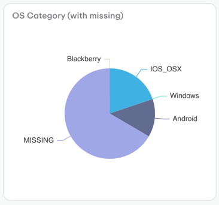

#### OS Category (Android & Apple)
OS categories
```json
{
  "columnNames": [
    "OS",
    "Count"
  ],
  "keyAliases": {
    "osCategory": [
      "Android",
      "IOS_OSX"
    ]
  },
  "rowSets": [
    {
      "columns": [
        {
          "dimension": {
            "key": "osCategory"
          },
          "sortSpecification": {
            "ascending": true,
            "priority": 1
          }
        },
        {
          "numericExpression": {
            "metric": "UserProfilesNow",
            "value": {
              "counter": "total"
            }
          }
        }
      ]
    }
  ],
  "visualisation": {
    "description": {
      "html": "OS categories"
    },
    "type": "Table",
    "title": "OS Category (Android & Apple)"
  }
}
```


**Visualization Preview:** This is a simple data table visualization showing OS (Operating System) category distribution between Android and Apple devices.

**Data displayed:**
- Android: 22,658 count
- iOS_OSX (Apple): 27,496 count
- Total dataset: 50,154 devices

**Key insights:**
- Apple devices (iOS/OSX) represent the majority at 54.8% of the dataset
- Android devices account for 45.2% of the total
- There's a relatively modest difference of 4,838 devices between the two platforms
- The distribution shows a fairly balanced but Apple-leaning user base

This table format provides a clear, straightforward comparison of mobile/desktop OS market share within this specific dataset.
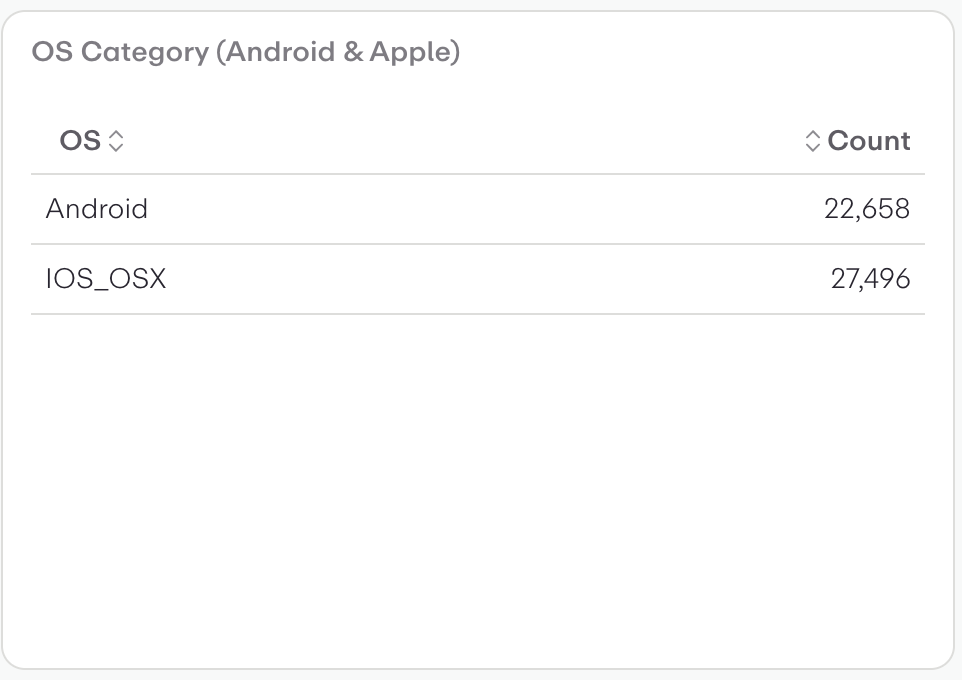

#### Postcodes
Postcode 
```json
{
  "columnNames": [
    "Postcode",
    "Count",
    "total",
    "ratio"
  ],
  "keyAliases": {
    "country": [
      "Australia"
    ],
    "postcode": [
      "5000",
      "5082",
      "5066",
      "5067",
      "5085",
      "5006",
      "5072",
      "5065",
      "5063",
      "5070",
      "5073",
      "5068",
      "5061",
      "5062",
      "5081",
      "5069",
      "5008",
      "5064",
      "5031",
      "5022"
    ]
  },
  "rowSets": [
    {
      "columns": [
        {
          "dimension": {
            "key": "postcode"
          }
        },
        {
          "numericExpression": {
            "metric": "UserProfilesNow",
            "value": {
              "counter": "total"
            },
            "aggregateAcross": [
              {
                "key": "postcode"
              }
            ]
          }
        },
        {
          "numericExpression": {
            "metric": "UserProfilesNow",
            "value": {
              "counter": "total"
            }
          },
          "sortSpecification": {
            "ascending": false,
            "priority": 1
          }
        },
        {
          "numericExpression": {
            "$divide": [
              {
                "metric": "UserProfilesNow",
                "value": {
                  "counter": "total"
                }
              },
              {
                "metric": "UserProfilesNow",
                "value": {
                  "counter": "total"
                },
                "aggregateAcross": [
                  {
                    "key": "postcode"
                  }
                ]
              }
            ]
          },
          "unit": "percentage",
          "decimalPlaces": 2
        }
      ]
    }
  ],
  "visualisation": {
    "description": {
      "html": "Postcode "
    },
    "type": "Table",
    "title": "Postcodes",
    "tableSettings": {
      "paginate": false,
      "scrollOverflow": true
    }
  }
}
```

#### Postcodes
Count registrations by Australian Postcodes
```json
{
  "columnNames": [
    "Postcode",
    "Count"
  ],
  "keyAliases": {
    "country": [
      "Australia"
    ]
  },
  "rowSets": [
    {
      "columns": [
        {
          "dimension": {
            "key": "postcode"
          }
        },
        {
          "numericExpression": {
            "metric": "UserProfilesNow",
            "value": {
              "counter": "total"
            }
          },
          "sortSpecification": {
            "ascending": false,
            "priority": 1
          }
        }
      ]
    }
  ],
  "visualisation": {
    "description": {
      "html": "Count registrations by Australian Postcodes"
    },
    "type": "Table",
    "title": "Postcodes",
    "tableSettings": {
      "paginate": false,
      "scrollOverflow": true
    }
  }
}
```

#### Single Choice Attribute
Group registrations by Single Choice Extended Attribute answers
```json
{
  "columnNames": [
    "Answer",
    "Count"
  ],
  "rowSets": [
    {
      "columns": [
        {
          "dimension": {
            "key": "extendedAttribute:551"
          }
        },
        {
          "numericExpression": {
            "metric": "UserProfilesNow",
            "value": {
              "counter": "total"
            }
          },
          "sortSpecification": {
            "ascending": false,
            "priority": 1
          }
        }
      ]
    }
  ],
  "visualisation": {
    "description": {
      "html": "Group registrations by Single Choice Extended Attribute answers"
    },
    "type": "Table",
    "title": "Single Choice Attribute",
    "tableSettings": {
      "paginate": false,
      "scrollOverflow": true
    }
  }
}
```

#### Registration Status
Registration Status
```json
{
  "columnNames": [
    "Status",
    "Count"
  ],
  "rowSets": [
    {
      "columns": [
        {
          "dimension": {
            "key": "status"
          }
        },
        {
          "numericExpression": {
            "metric": "UserProfilesNow",
            "value": {
              "counter": "total"
            }
          },
          "sortSpecification": {
            "ascending": false,
            "priority": 1
          }
        }
      ]
    }
  ],
  "visualisation": {
    "description": {
      "html": "Registration Status"
    },
    "type": "PieChart",
    "title": "Registration Status",
    "tableSettings": {
      "paginate": false,
      "scrollOverflow": true
    }
  }
}
```

#### Subscribers
Opted-in Subscribers by Marketing List (and registration status is subscribed)
```json
{
  "columnNames": [
    "Status",
    "Count"
  ],
  "keyAliases": {
    "status": [
      "subscribed"
    ]
  },
  "rowSets": [
    {
      "columns": [
        {
          "dimension": {
            "key": "mlSub"
          }
        },
        {
          "numericExpression": {
            "metric": "UserProfilesNow",
            "value": {
              "counter": "total"
            }
          },
          "sortSpecification": {
            "ascending": false,
            "priority": 1
          }
        }
      ]
    }
  ],
  "visualisation": {
    "description": {
      "html": "Opted-in Subscribers by Marketing List (and registration status is subscribed)"
    },
    "type": "Table",
    "title": "Subscribers",
    "tableSettings": {
      "paginate": false,
      "scrollOverflow": true
    }
  }
}
```

#### Suburbs
Count registrations by Australian Suburbs
```json
{
  "columnNames": [
    "Suburbs",
    "Count"
  ],
  "keyAliases": {
    "country": [
      "Australia"
    ]
  },
  "rowSets": [
    {
      "columns": [
        {
          "dimension": {
            "key": "suburb"
          },
          "sortSpecification": {
            "ascending": true,
            "priority": 1
          }
        },
        {
          "numericExpression": {
            "metric": "UserProfilesNow",
            "value": {
              "counter": "total"
            }
          }
        }
      ]
    }
  ],
  "visualisation": {
    "description": {
      "html": "Count registrations by Australian Suburbs"
    },
    "type": "PieChart",
    "title": "Suburbs",
    "tableSettings": {
      "paginate": false,
      "scrollOverflow": true
    }
  }
}
```

#### Year of Birth
Year of Birth
```json
{
  "columnNames": [
    "Year",
    "Count"
  ],
  "rowSets": [
    {
      "columns": [
        {
          "dimension": {
            "key": "yearOfBirth"
          },
          "sortSpecification": {
            "ascending": false,
            "priority": 1
          }
        },
        {
          "numericExpression": {
            "metric": "UserProfilesNow",
            "value": {
              "counter": "total"
            }
          }
        }
      ]
    }
  ],
  "visualisation": {
    "description": {
      "html": "Year of Birth"
    },
    "type": "Table",
    "title": "Year of Birth",
    "tableSettings": {
      "paginate": true,
      "scrollOverflow": true
    }
  }
}
```


**Visualization Preview:** This is a histogram/bar chart showing the distribution of birth years from 1915 to 2011. The visualization displays:

**Chart Type**: Histogram with vertical bars representing frequency counts by birth year

**Data Pattern**: 
- Peak concentration around 1999-2001 (approximately 500 individuals)
- Strong concentration from mid-1990s to early 2000s
- Gradual decline in frequency for earlier birth years
- Very low frequencies for births before 1950
- Sparse data for births before 1940

**Key Insights**:
- The dataset is heavily skewed toward people born in the late 1990s/early 2000s
- This suggests the population being analyzed is predominantly young (early 20s if measured recently)
- Could represent a student population, recent graduates, or users of a platform popular among younger demographics
- The distribution shows a clear generational bias rather than a representative age distribution across the full population

The visualization effectively shows age demographics concentrated in a specific generational cohort.
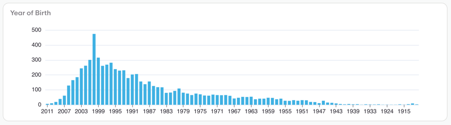


## UserProfilesRegistrationGroup
#### Table
A table
```json
{
  "visualisation": {
    "type": "Table",
    "title": "Table",
    "description": {
      "html": "A table"
    },
    "imageFile": "",
    "tableSettings": {
      "columnSettings": {},
      "paginate": false,
      "scrollOverflow": true
    }
  },
  "columnNames": [
    {
      "name": "AGE",
      "dimension": {
        "segment": "AGE"
      }
    }
  ],
  "rowSets": [
    {
      "columns": [
        {
          "numericExpression": {
            "metric": "UserProfilesRegistrationGroup",
            "value": {
              "counter": "total"
            }
          }
        }
      ]
    }
  ]
}
```


## templates
#### Aggregate acrosss columns example
Two rows, first row is the Sales and second is the Sales Percentage, where for each column we compute the daily percentage of Revenue / total_revenue_for_period
```json
{
  "visualisation": {
    "title": "Aggregate acrosss columns example",
    "description": "Two rows, first row is the Sales and second is the Sales Percentage, where for each column we compute the daily percentage of Revenue / total_revenue_for_period",
    "type": "Table",
    "tableSettings": {
      "scrollOverflow": true
    }
  },
  "columnNames": [
    "Metrics",
    {
      "name": "day",
      "dimension": {
        "timeBasedDimension": "Daily"
      }
    }
  ],
  "rowSets": [
    {
      "columns": [
        {
          "string": {
            "value": "Sales"
          }
        },
        {
          "numericExpression": {
            "metric": {
              "customMetricName": "Sales"
            },
            "value": {
              "counter": "Revenue"
            },
            "unit": "dollars"
          }
        }
      ]
    },
    {
      "columns": [
        {
          "string": {
            "value": "Sales Percentage"
          }
        },
        {
          "numericExpression": {
            "$divide": [
              {
                "metric": {
                  "customMetricName": "Sales"
                },
                "value": {
                  "counter": "Revenue"
                }
              },
              {
                "metric": {
                  "customMetricName": "Sales"
                },
                "value": {
                  "counter": "Revenue"
                },
                "aggregateAcross": [
                  {
                    "timeBasedDimension": "Daily"
                  }
                ]
              }
            ]
          },
          "unit": "percentage",
          "decimalPlaces": 2
        }
      ]
    }
  ]
}
```


**Visualization Preview:** This is a tabular data visualization displaying daily sales metrics for a one-week period (November 8-14, 2021). 

**Data displayed:**
- Daily sales figures ranging from 45,011 to 143,918
- Corresponding sales percentages (6.95% to 22.23%)

**Key insights:**
- Thursday (11/11/2021) shows peak performance with the highest sales (143,918) and largest percentage share (22.23%)
- Saturday is the second-highest performing day (123,794 sales, 19.12%)
- Monday shows the lowest performance (45,011 sales, 6.95%)
- The data suggests a mid-to-late week sales pattern with Thursday and Saturday as standout days

This appears to be a Beonic Insights business intelligence widget providing a clear breakdown of weekly sales performance for operational analysis.
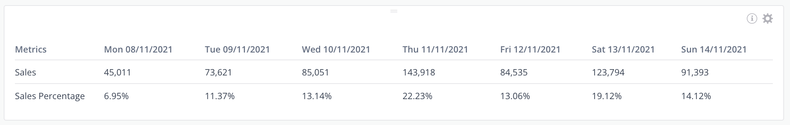

#### Aggregate acrosss rows example
for each row compute the daily percentage of Revenue / total_revenue_for_period
```json
{
  "visualisation": {
    "title": "Aggregate acrosss rows example",
    "description": "for each row compute the daily percentage of Revenue / total_revenue_for_period",
    "type": "Table"
  },
  "columnNames": [
    "Date",
    "Revenue %"
  ],
  "rowSets": [
    {
      "columns": [
        {
          "dimension": {
            "timeBasedDimension": "Daily"
          },
          "sortSpecification": {
            "ascending": true,
            "priority": 1
          }
        },
        {
          "numericExpression": {
            "$divide": [
              {
                "metric": {
                  "customMetricName": "Sales"
                },
                "value": {
                  "counter": "Revenue"
                }
              },
              {
                "metric": {
                  "customMetricName": "Sales"
                },
                "value": {
                  "counter": "Revenue"
                },
                "aggregateAcross": [
                  {
                    "timeBasedDimension": "Daily"
                  }
                ]
              }
            ]
          },
          "unit": "percentage",
          "decimalPlaces": 2
        }
      ]
    }
  ]
}
```


**Visualization Preview:** This is a simple data table visualization showing daily revenue percentages over a one-week period in November 2021.

**Data displayed:**
- Date range: Monday, November 8th through Sunday, November 14th, 2021
- Single metric: Revenue % for each day
- Shows 7 consecutive days of performance data

**Key insights:**
- Thursday (11/11/2021) had the highest revenue performance at 22.23%
- Monday (08/11/2021) had the lowest at 6.95%
- There's significant daily variation, with revenue percentages ranging from ~7% to ~22%
- Mid-week and weekend days generally performed better than the beginning of the week
- The data appears to show daily revenue as a percentage (likely of total weekly revenue or a target)

This tabular format provides a clear, precise view of daily performance metrics without visual embellishments, making it easy to compare exact values across the week.
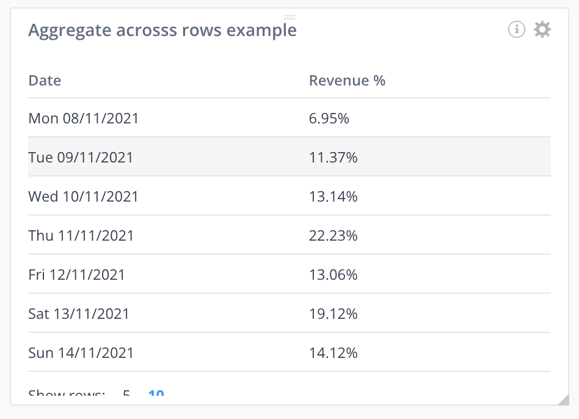

#### Traffic by Day
traffic by day for the period.
```json
{
  "visualisation": {
    "title": "Traffic by Day",
    "description": "traffic by day for the period.",
    "type": "BarChart",
    "lineChartSettings": {
      "gridLines": "always",
      "showLegend": true,
      "columnSettings": {
        "Traffic": {
          "axis": "left"
        }
      }
    }
  },
  "columnNames": [
    "date",
    "Traffic"
  ],
  "rowSets": [
    {
      "columns": [
        {
          "dimension": {
            "timeBasedDimension": "Daily"
          }
        },
        {
          "numericExpression": {
            "metric": "Visit",
            "value": {
              "counter": "total"
            },
            "unit": "number"
          }
        }
      ]
    }
  ]
}
```


**Visualization Preview:** This is a vertical bar chart titled "Traffic by Day" that displays daily website traffic over approximately one month (from day 17 of one month through day 13 of the following month, spanning late September into October 2025).

**Key Features:**
- Y-axis shows traffic volume (0-700)
- X-axis shows dates across the time period
- Blue bars represent daily traffic counts
- Interactive tooltip shows specific data (Friday 26/09/2025 with 582 traffic)

**Key Insights:**
- Traffic ranges from approximately 250 to over 600 daily visitors
- Highest peak occurs around day 18-19 (reaching ~630)
- Notable spike on September 26th (582 visitors)
- Traffic appears to have weekly patterns, with some days consistently lower (around 250-300)
- Generally maintains moderate levels (400-500) with periodic fluctuations
- Shows typical website traffic variability with both weekday/weekend patterns and other cyclical behavior

The visualization effectively shows traffic trends and helps identify high and low traffic periods for website performance analysis.
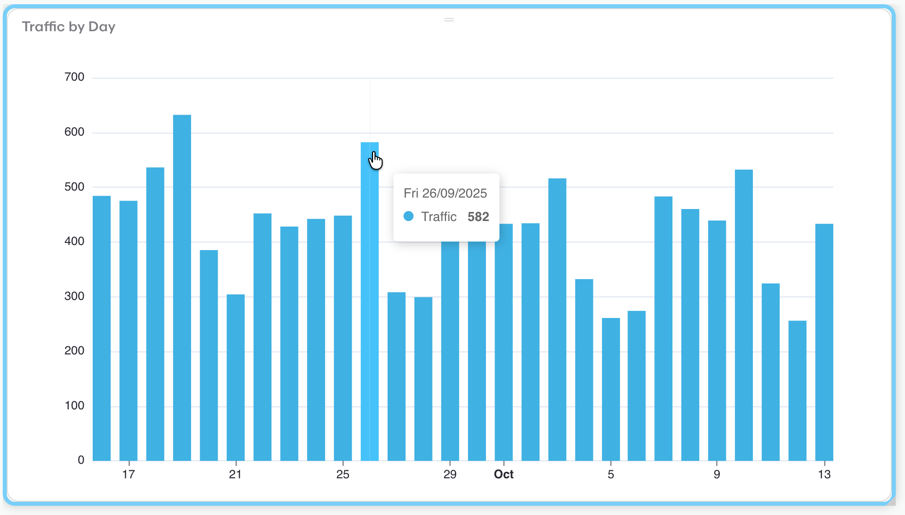

#### Columns Across
Widget showing columns across. Displayed as a Table.
```json
{
  "visualisation": {
    "title": "Columns Across",
    "description": "",
    "type": "Table"
  },
  "filterOverrides": null,
  "columnNames": [
    {
      "name": "Visits",
      "dimension": {
        "segment": "VISITOR_TYPE"
      }
    }
  ],
  "rowSets": [
    {
      "columns": [
        {
          "numericExpression": {
            "metric": "Visit",
            "value": {
              "counter": "total"
            }
          }
        }
      ]
    }
  ]
}
```


**Visualization Preview:** This is a simple comparison table widget showing user segmentation data across two categories:

**Visualization Type**: Two-column data table

**Data Displayed**: 
- New users: 5,594
- Returning users: 18,179

**Key Insights**:
- Returning users significantly outnumber new users by more than 3:1 ratio
- Total user base of 23,773 users
- Strong user retention indicated by the high proportion (76.5%) of returning users
- Suggests an established product/service with loyal user base rather than rapid new user acquisition phase

This widget provides a quick snapshot of user engagement patterns and audience composition.
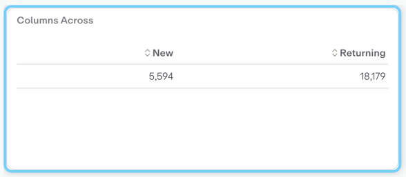

#### A Custom Metric Number
 
```json
{
  "visualisation": {
    "title": "A Custom Metric Number",
    "description": " ",
    "type": "Number"
  },
  "columnNames": [
    "Revenue"
  ],
  "rowSets": [
    {
      "columns": [
        {
          "numericExpression": {
            "metric": {
              "customMetricName": "Sales"
            },
            "value": {
              "counter": "Revenue"
            }
          },
          "unit": "dollars",
          "decimalPlaces": 2
        }
      ]
    }
  ]
}
```

#### Visits by Hour of Day and Day of Week
Creates a stacked bar chart showing the total number of visits by hour of day (x-axis) and day of week (y-axis).
```json
{
  "columnNames": [
    "hourOfDay",
    {
      "name": "day",
      "dimension": {
        "timeBasedDimension": "DayOfWeek",
        "format": "Short"
      }
    }
  ],
  "keyAliases": {
    "rg": "venueId.registrationGroup"
  },
  "rowSets": [
    {
      "columns": [
        {
          "dimension": {
            "timeBasedDimension": "HourOfDay"
          }
        },
        {
          "numericExpression": {
            "metric": "Visit",
            "value": {
              "counter": "total"
            }
          }
        }
      ]
    }
  ],
  "visualisation": {
    "description": {
      "html": "Creates a stacked bar chart showing the total number of visits by hour of day (x-axis) and day of week (y-axis)."
    },
    "barChartSettings": {
      "showBarValues": false,
      "tooltip": {
        "show": true
      },
      "layout": "vertical",
      "xAxis": {
        "axisLine": {
          "show": false
        },
        "inverse": false,
        "showName": false,
        "splitNumber": 5
      },
      "gridLines": "auto",
      "enableChartSwitching": false,
      "yAxis": {
        "axisLine": {
          "show": false
        },
        "inverse": false,
        "showName": false,
        "splitNumber": 5
      },
      "showLegend": true,
      "hideAxis": false,
      "stackType": "stack"
    },
    "title": "Visits by Hour of Day and Day of Week",
    "type": "BarChart"
  }
}
```


**Visualization Preview:** This is a stacked bar chart showing website visits by hour of day and day of week. 

**Data Representation:**
- X-axis: Hours of the day (12 AM to 11 PM)
- Y-axis: Number of visits (scale up to 1.2k)
- Color coding: Each day of the week (Monday through Sunday) represented by different colors
- Tooltip shows detailed breakdown for 5-6 PM time slot

**Key Insights:**
- **Peak traffic**: Occurs during business hours (9 AM - 5 PM), with highest volume around 1-2 PM
- **Daily patterns**: Weekdays (Mon-Fri) dominate traffic during business hours, while weekends show lower overall activity
- **Off-peak periods**: Minimal traffic during late night/early morning hours (12 AM - 6 AM)
- **Friday prominence**: Friday (green) shows notably high traffic, especially during midday hours
- **Weekend behavior**: Saturday and Sunday traffic is more evenly distributed but significantly lower than weekdays

This visualization effectively reveals typical business website usage patterns with clear weekday/weekend distinctions and standard business hour peak activity.
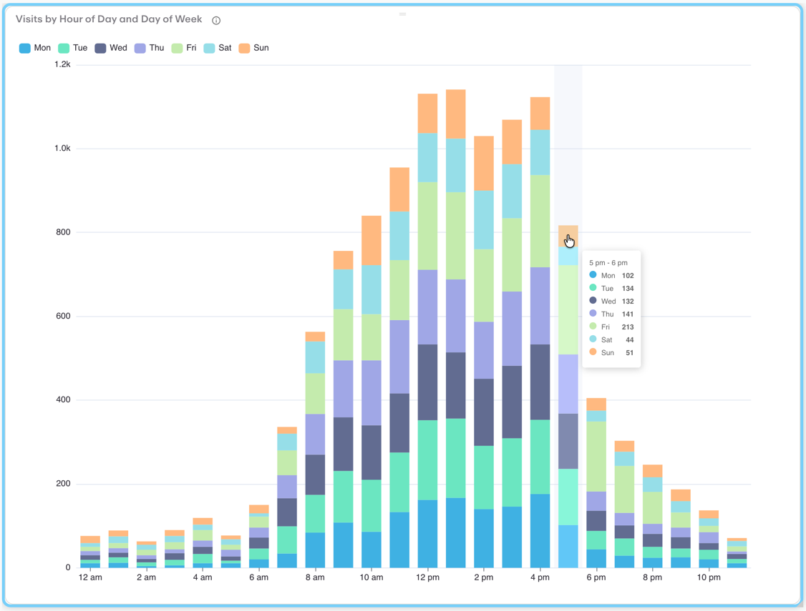

#### Weekend, Weekday
Using the DayOfWeekType time-based dimension
```json
{
  "visualisation": {
    "title": "Weekend, Weekday",
    "description": "Using the DayOfWeekType time-based dimension",
    "type": "Table"
  },
  "columnNames": [
    "Venue",
    "Weekend",
    "Weekday"
  ],
  "rowSets": [
    {
      "columns": [
        {
          "dimension": {
            "key": "venueId"
          }
        },
        {
          "numericExpression": {
            "metric": "Visit",
            "value": {
              "counter": "total"
            },
            "timeBasedDimension": {
              "dimension": "DayOfWeekType",
              "value": "weekday"
            }
          }
        },
        {
          "numericExpression": {
            "metric": "Visit",
            "value": {
              "counter": "total"
            },
            "timeBasedDimension": {
              "dimension": "DayOfWeekType",
              "value": "weekend"
            }
          }
        }
      ]
    }
  ]
}
```


**Visualization Preview:** This is a comparison table visualization showing venue performance data segmented by weekend vs. weekday periods.

**Data displayed:**
- Two venues: Retail Plaza and Harbour Shopping
- Metrics for Weekend and Weekday performance (likely visitor counts or foot traffic)

**Key insights:**
- Both venues show significantly higher activity on weekends compared to weekdays
- Harbour Shopping has slightly higher weekend traffic (9,386 vs 9,305) than Retail Plaza
- Harbour Shopping also outperforms Retail Plaza on weekdays (2,613 vs 2,469)
- The weekend-to-weekday ratio is substantial for both venues (approximately 3.8:1 for Retail Plaza and 3.6:1 for Harbour Shopping)

The visualization effectively highlights the stark difference between weekend and weekday performance patterns across both retail venues.
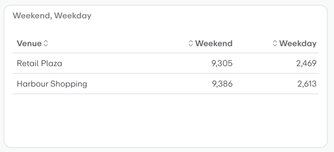

#### displayAs demo
Display the venue country code and country name
```json
{
  "visualisation": {
    "title": "displayAs demo",
    "description": "Display the venue country code and country name",
    "type": "Table",
    "tableSettings": {
      "scrollOverflow": true
    }
  },
  "columnNames": [
    "Location",
    "Location CountryCode",
    "Location Country Name",
    "Sales"
  ],
  "rowSets": [
    {
      "columns": [
        {
          "dimension": {
            "key": "venueId"
          }
        },
        {
          "dimension": {
            "key": "venueId",
            "displayAs": {
              "country": "IsoAlpha2"
            }
          }
        },
        {
          "dimension": {
            "key": "venueId",
            "displayAs": {
              "country": "Name"
            }
          }
        },
        {
          "description": "Sales",
          "numericExpression": {
            "metric": {
              "customMetricName": "Sales"
            },
            "value": {
              "counter": "Revenue"
            }
          },
          "unit": "dollars",
          "decimalPlaces": 2
        }
      ]
    }
  ]
}
```

#### A Number
 
```json
{
  "visualisation": {
    "title": "A Number",
    "description": " ",
    "type": "Number"
  },
  "columnNames": [
    "Dwell"
  ],
  "rowSets": [
    {
      "columns": [
        {
          "numericExpression": {
            "$divide": [
              {
                "metric": "Visit",
                "value": {
                  "counter": "dwell"
                }
              },
              {
                "metric": "Visit",
                "value": {
                  "counter": "total"
                }
              }
            ]
          }
        }
      ]
    }
  ]
}
```


**Visualization Preview:** This is a simple numeric display widget showing a single key performance indicator (KPI) value of 3,050. 

**Visualization Type:** Single-value metric display/KPI card

**Data Displayed:** A standalone numerical value of 3,050 (with comma formatting for readability)

**Insights Provided:** This represents a basic metric snapshot, likely used for dashboard monitoring of a key business indicator. The large, prominent display format suggests this is an important metric that stakeholders need to track at a glance. Without additional context labels, it could represent various measures such as total count, revenue, users, or other cumulative business metrics. The clean, minimal design emphasizes the focus on this single data point for quick interpretation.
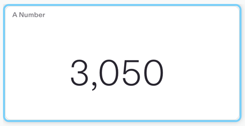

#### 10:30
 
```json
{
  "visualisation": {
    "title": "10:30",
    "description": " ",
    "type": "Number"
  },
  "columnNames": [
    "Duration"
  ],
  "rowSets": [
    {
      "columns": [
        {
          "numericExpression": 630,
          "decimalPlaces": 0,
          "unit": "duration"
        }
      ]
    }
  ]
}
```


**Visualization Preview:** This is a simple timer or time display widget showing "10m:30s" (10 minutes and 30 seconds). It appears to be a digital countdown timer or elapsed time counter with a clean, minimalist design featuring large, clear numerals on a light background with a blue border. The widget displays time in minutes and seconds format, likely used for tracking duration of an activity, meeting, or process. The timestamp "10:30" in the top-left corner suggests this may be a screenshot taken at that time.
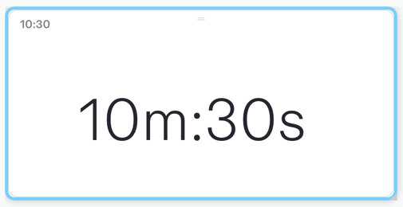

#### Trend LineChart
Widget showing lineChart.
```json
{
  "visualisation": {
    "title": "Trend LineChart",
    "description": "",
    "type": "LineChart"
  },
  "filterOverrides": null,
  "columnNames": [
    "timestamp",
    "dwell"
  ],
  "rowSets": [
    {
      "columns": [
        {
          "dimension": {
            "timeBasedDimension": "Daily"
          }
        },
        {
          "numericExpression": {
            "metric": "Visit",
            "value": {
              "counter": "dwell"
            }
          }
        }
      ]
    }
  ]
}
```


**Visualization Preview:** This is a **trend line chart** showing data over time from day 17 through day 13 (spanning late September into October).

**Data Representation:**
- Y-axis: Values ranging from 0 to 3.5M (in increments of 500k)
- X-axis: Time period with specific dates marked (17, 21, 25, 29, Oct, 5, 9, 13)
- Single blue line tracking a metric's performance over this timeframe

**Key Insights:**
- **Volatile pattern** with significant fluctuations throughout the period
- **Peak performance** around day 19 (reaching ~3.2M)
- **Major decline** occurs after October 1st, dropping to the lowest point (~1.5M) around day 7
- **Recent recovery** shown in the final data points, climbing back toward 2.5M
- **Overall trend** appears relatively stable despite the mid-period dip, with values generally oscillating between 2M-3M range

The visualization effectively shows both short-term volatility and longer-term trends in whatever metric is being tracked.
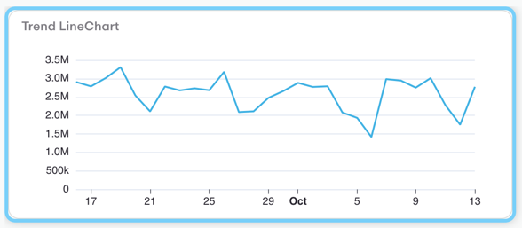

#### Total traffic
The total traffic for the period.
```json
{
  "visualisation": {
    "title": "Total traffic",
    "description": "The total traffic for the period.",
    "type": "Number"
  },
  "columnNames": [
    "Traffic",
    "delta",
    "versus"
  ],
  "rowSets": [
    {
      "columns": [
        {
          "numericExpression": {
            "metric": "counters",
            "value": {
              "counter": "entries"
            }
          }
        },
        {
          "unit": "percentage",
          "decimalPlaces": 2,
          "numericExpression": {
            "$divide": [
              {
                "$subtract": [
                  {
                    "metric": "counters",
                    "value": {
                      "counter": "entries"
                    }
                  },
                  {
                    "metric": "counters",
                    "value": {
                      "counter": "entries"
                    },
                    "dateRangeOverride": {
                      "localStartDate": {
                        "paramRef": "SecondaryStartDate"
                      },
                      "localEndDate": {
                        "paramRef": "SecondaryEndDate"
                      }
                    }
                  }
                ]
              },
              {
                "metric": "counters",
                "value": {
                  "counter": "entries"
                },
                "dateRangeOverride": {
                  "localStartDate": {
                    "paramRef": "SecondaryStartDate"
                  },
                  "localEndDate": {
                    "paramRef": "SecondaryEndDate"
                  }
                }
              }
            ]
          }
        },
        {
          "decimalPlaces": 2,
          "numericExpression": {
            "metric": "counters",
            "value": {
              "counter": "entries"
            },
            "dateRangeOverride": {
              "localStartDate": {
                "paramRef": "SecondaryStartDate"
              },
              "localEndDate": {
                "paramRef": "SecondaryEndDate"
              }
            }
          }
        }
      ]
    }
  ]
}
```


**Visualization Preview:** This is a **Key Performance Indicator (KPI) widget** displaying total traffic metrics.

**Data displayed:**
- Current period: 54,152 total traffic
- Comparison period: 112,701 total traffic  
- Period-over-period change: -51.95% (decrease)

**Key insights:**
- Traffic has declined significantly by more than half compared to the previous period
- The red downward arrow and negative percentage clearly indicate poor performance
- This represents a substantial drop that likely requires immediate attention and analysis

The visualization uses a clean, minimalist design typical of dashboard widgets, emphasizing the critical metric with clear visual indicators (red color, down arrow) to quickly communicate the negative trend.
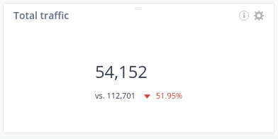

#### A Number
 
```json
{
  "visualisation": {
    "title": "A Number",
    "description": " ",
    "type": "Number"
  },
  "columnNames": [
    "Traffic"
  ],
  "rowSets": [
    {
      "columns": [
        {
          "numericExpression": {
            "metric": "Visit",
            "value": {
              "counter": "total"
            }
          }
        }
      ]
    }
  ]
}
```


**Visualization Preview:** This is a simple numeric display widget showing a single key performance indicator (KPI) value of 23,773. The visualization uses a clean, minimalist design with large, prominent text to highlight this metric. 

The widget appears to be displaying a count or cumulative measure, though without additional context labels it's unclear what specific metric this represents (could be users, transactions, revenue, etc.). This type of visualization is commonly used in dashboards to prominently feature important business metrics or KPIs that stakeholders need to monitor at a glance.

The simple format makes it easy to quickly assess performance against this key number, though it would benefit from additional context like a label, time period, or comparison values to provide more meaningful insights.


#### New vs Return Traffic
New versus Return Traffic for the period.
```json
{
  "visualisation": {
    "title": "New vs Return Traffic",
    "description": "New versus Return Traffic for the period.",
    "type": "PieChart",
    "pieChartSettings": {
      "donut": false,
      "legend": {
        "show": true
      },
      "label": {
        "show": true,
        "sunbeamLayout": false,
        "mode": "percent"
      }
    }
  },
  "filterOverrides": null,
  "columnNames": [
    "visitorType",
    "value"
  ],
  "rowSets": [
    {
      "columns": [
        {
          "dimension": {
            "segment": "VISITOR_TYPE"
          }
        },
        {
          "numericExpression": {
            "metric": "Visit",
            "value": {
              "counter": "total"
            }
          }
        }
      ]
    }
  ]
}
```


**Visualization Preview:** This is a pie chart visualization showing "New vs Return Traffic" distribution. 

**Chart Type:** Simple two-segment pie chart

**Data Displayed:**
- New visitors: 23.53% (blue segment)
- Returning visitors: 76.47% (green segment)

**Key Insights:**
- The majority of website traffic (over 3/4) comes from returning visitors
- Only about 1/4 of traffic consists of new visitors
- This indicates strong user retention and repeat engagement
- The site appears to have an established, loyal user base rather than being heavily dependent on acquiring new visitors

This traffic composition suggests a mature website with good user retention, though it may indicate limited growth in new user acquisition.


#### Pie Chart
Table
```json
{
  "visualisation": {
    "title": "Pie Chart",
    "description": "Table",
    "type": "PieChart",
    "tableSettings": {
      "label": {
        "show": true,
        "sunbeamLayout": false,
        "mode": "value"
      },
      "scrollOverflow": true,
      "legend": {
        "show": true
      }
    }
  },
  "columnNames": [
    "Location",
    "Traffic"
  ],
  "rowSets": [
    {
      "columns": [
        {
          "dimension": {
            "key": "venueId"
          }
        },
        {
          "description": "Traffic",
          "numericExpression": {
            "metric": "Visit",
            "value": {
              "counter": "total"
            }
          }
        }
      ]
    }
  ]
}
```


**Visualization Preview:** This is a simple pie chart visualization with two segments of nearly equal size. The chart displays:

**Chart Type:** Pie chart with two segments

**Data Displayed:** 
- Blue segment: 11,774
- Green segment: 11,999

**Key Insights:**
- The data shows an almost even split between two categories (50.4% vs 49.6%)
- Total combined value is 23,773
- The green segment slightly exceeds the blue segment by 225 units
- The visualization effectively shows a near-perfect binary distribution

The chart is clean and minimalist, using contrasting colors to clearly distinguish between the two data points. Without category labels, the focus is purely on the quantitative comparison between these two values.


#### Segmented Trend LineChart
Widget showing segment lineChart.
```json
{
  "visualisation": {
    "title": "Segmented Trend LineChart",
    "description": "",
    "type": "LineChart"
  },
  "filterOverrides": null,
  "columnNames": [
    "timestamp",
    {
      "name": "Visits",
      "dimension": {
        "segment": "VISITOR_TYPE"
      }
    }
  ],
  "rowSets": [
    {
      "columns": [
        {
          "dimension": {
            "timeBasedDimension": "Daily"
          }
        },
        {
          "numericExpression": {
            "metric": "Visit",
            "value": {
              "counter": "total"
            }
          }
        }
      ]
    }
  ]
}
```


**Visualization Preview:** This is a **Segmented Trend Line Chart** showing two data series tracked over time from day 17 through day 13 (likely spanning late September through mid-October).

**Data Representation:**
- **Green line**: Shows higher values ranging from approximately 400-900, with significant volatility including notable dips around days 20, 26, and a dramatic drop from ~800 to ~400 between days 6-8
- **Blue line**: Shows lower, more stable values ranging from approximately 50-250, with less dramatic fluctuations

**Key Insights:**
- The two metrics show different patterns - the green series is more volatile while the blue series remains relatively stable
- Both series experience their lowest points around days 8-10
- There's a sharp recovery in the green series after day 10, while the blue series shows a more gradual increase
- The data suggests two different performance indicators or segments being compared, with one showing much higher baseline values but greater instability

The chart effectively visualizes the comparative trends and highlights periods of significant change in both metrics.


#### Segment Rows
 
```json
{
  "visualisation": {
    "title": "Segment Rows",
    "description": " ",
    "type": "Table"
  },
  "filterOverrides": null,
  "columnNames": [
    "visitorType",
    "value"
  ],
  "rowSets": [
    {
      "columns": [
        {
          "dimension": {
            "segment": "VISITOR_TYPE"
          }
        },
        {
          "numericExpression": {
            "metric": "Visit",
            "value": {
              "counter": "total"
            }
          }
        }
      ]
    }
  ]
}
```


**Visualization Preview:** This is a **data table visualization** showing visitor segmentation by visitor type. 

**Data displayed:**
- **New visitors:** 5,594
- **Returning visitors:** 18,179

**Key insights:**
- Returning visitors significantly outnumber new visitors by more than 3:1 ratio
- Total traffic of 23,773 visitors is heavily skewed toward repeat users (76% returning vs 24% new)
- This suggests strong user retention and engagement, with the majority of traffic coming from an established audience rather than new user acquisition

The simple two-row format provides a clear breakdown of the fundamental visitor loyalty metric, making it easy to assess the balance between audience retention and growth.


