# Beonic Insights 3.0 (i3) Widget Examples
This document contains example widget definitions using the Beonic Insights 3.0 widget definition language. Each widget defines a query against the Beonic data platform and visualization settings to present the retrieved tabular data.
## UserProfileCampaigns
#### Postcode Clicks
Count the number of regos that clicked a campaign
```json
{
  "keyAliases": {
    "country": [
      "Australia"
    ],
    "state": [
      "victoria"
    ],
    "campaignEventType": [
      "CLICKED"
    ]
  },
  "columnNames": [
    "Postcode",
    "Clicked",
    "Postcode Click Ratio"
  ],
  "rowSets": [
    {
      "columns": [
        {
          "dimension": {
            "key": "postcode"
          }
        },
        {
          "numericExpression": {
            "metric": "UserProfileCampaigns",
            "value": {
              "counter": "total"
            }
          },
          "sortSpecification": {
            "ascending": false,
            "priority": 1
          }
        },
        {
          "numericExpression": {
            "$divide": [
              {
                "metric": "UserProfileCampaigns",
                "value": {
                  "counter": "total"
                }
              },
              {
                "metric": "UserProfileCampaigns",
                "value": {
                  "counter": "total"
                },
                "aggregateAcross": [
                  {
                    "key": "postcode"
                  }
                ]
              }
            ]
          },
          "unit": "percentage",
          "decimalPlaces": 2
        }
      ]
    }
  ],
  "visualisation": {
    "type": "Table",
    "title": "Postcode Clicks",
    "description": {
      "html": "Count the number of regos that clicked a campaign"
    },
    "imageFile": "",
    "tableSettings": {
      "columnSettings": {},
      "paginate": false,
      "scrollOverflow": true
    }
  }
}
```


**Visualization Preview:** Shows geographic distribution by postal code with counts or percentages for location-based analysis.


#### campaigns
Widget showing campaign event types. Displayed as a Table.
```json
{
  "columnNames": [
    "Campaign",
    "Count"
  ],
  "keyAliases": {
    "c0": {
      "entity": "Campaign",
      "ids": [
        "9641",
        "9642",
        "9643"
      ]
    }
  },
  "rowSets": [
    {
      "columns": [
        {
          "dimension": {
            "key": "campaignEventType"
          }
        },
        {
          "numericExpression": {
            "metric": "UserProfileCampaigns",
            "value": {
              "counter": "total"
            }
          },
          "sortSpecification": {
            "ascending": false,
            "priority": 1
          }
        }
      ]
    }
  ],
  "visualisation": {
    "description": {
      "html": ""
    },
    "type": "Table",
    "title": "campaigns",
    "tableSettings": {
      "paginate": false,
      "scrollOverflow": true
    }
  }
}
```

#### Profiles by Campaign x Event-Type
Count profiles that had an event on a campaign
```json
{
  "keyAliases": {
    "campaignEventType": [
      "BOUNCED",
      "CLICKED",
      "DELIVERED",
      "OPENED",
      "SPAM",
      "UNSUBSCRIBED"
    ]
  },
  "columnNames": [
    "Campaign",
    {
      "name": "event",
      "dimension": {
        "key": "campaignEventType"
      }
    }
  ],
  "rowSets": [
    {
      "columns": [
        {
          "dimension": {
            "key": "campaign"
          }
        },
        {
          "numericExpression": {
            "metric": "UserProfileCampaigns",
            "value": {
              "counter": "total"
            }
          },
          "sortSpecification": {
            "ascending": false,
            "priority": 1
          }
        }
      ]
    }
  ],
  "visualisation": {
    "description": {
      "html": "Count profiles that had an event on a campaign"
    },
    "type": "Table",
    "title": "Profiles by Campaign x Event-Type",
    "tableSettings": {
      "paginate": false,
      "scrollOverflow": true
    }
  }
}
```


**Visualization Preview:** Shows the visualization output representing the queried data in the format specified by the widget configuration.
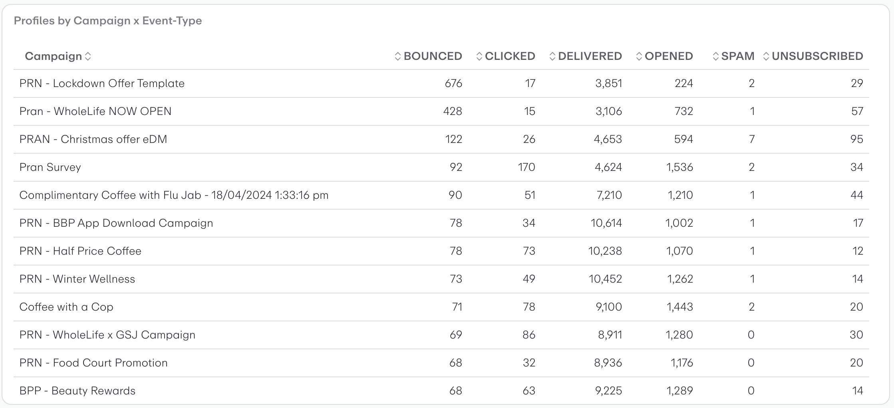

#### Campaign Postcodes
Campaigns and postcodes of the registrations engaging with them
```json
{
  "columnNames": [
    "Campaign",
    "Postcode",
    "Count"
  ],
  "keyAliases": {
    "c0": {
      "entity": "Campaign",
      "ids": [
        "9641",
        "9642",
        "9643"
      ]
    }
  },
  "rowSets": [
    {
      "columns": [
        {
          "dimension": {
            "key": "campaign"
          },
          "sortSpecification": {
            "ascending": true,
            "priority": 1
          }
        },
        {
          "dimension": {
            "key": "postcode"
          },
          "sortSpecification": {
            "ascending": true,
            "priority": 2
          }
        },
        {
          "numericExpression": {
            "metric": "UserProfileCampaigns",
            "value": {
              "counter": "total"
            }
          }
        }
      ]
    }
  ],
  "visualisation": {
    "description": {
      "html": "Campaigns and postcodes of the registrations engaging with them"
    },
    "type": "Table",
    "title": "Campaign Postcodes",
    "tableSettings": {
      "paginate": false,
      "scrollOverflow": true
    }
  }
}
```

#### campaign events
Count campaign events
```json
{
  "keyAliases": {
    "c0": {
      "entity": "Campaign",
      "ids": [
        "9641",
        "9642",
        "9643"
      ]
    }
  },
  "columnNames": [
    "total"
  ],
  "rowSets": [
    {
      "columns": [
        {
          "numericExpression": {
            "metric": "UserProfileCampaigns",
            "value": {
              "counter": "total"
            }
          }
        }
      ]
    }
  ],
  "visualisation": {
    "description": {
      "html": "Count campaign events"
    },
    "type": "Number",
    "title": "campaign events"
  }
}
```

#### Auto Triggered by Venue and Zone
Count the regos that triggered a campaign in a zone
```json
{
  "columnNames": [
    "Venue",
    "Zone",
    "Count"
  ],
  "keyAliases": {},
  "rowSets": [
    {
      "columns": [
        {
          "dimension": {
            "key": "venueId"
          }
        },
        {
          "dimension": {
            "key": "zoneId",
            "missing": true
          }
        },
        {
          "numericExpression": {
            "metric": "UserProfileCampaigns",
            "value": {
              "counter": "total"
            }
          },
          "sortSpecification": {
            "ascending": false,
            "priority": 1
          }
        }
      ]
    }
  ],
  "visualisation": {
    "description": {
      "html": "Count the regos that triggered a campaign in a zone"
    },
    "type": "Table",
    "title": "Auto Triggered by Venue and Zone",
    "tableSettings": {
      "paginate": false,
      "scrollOverflow": true
    }
  }
}
```


**Visualization Preview:** Shows the visualization output representing the queried data in the format specified by the widget configuration.
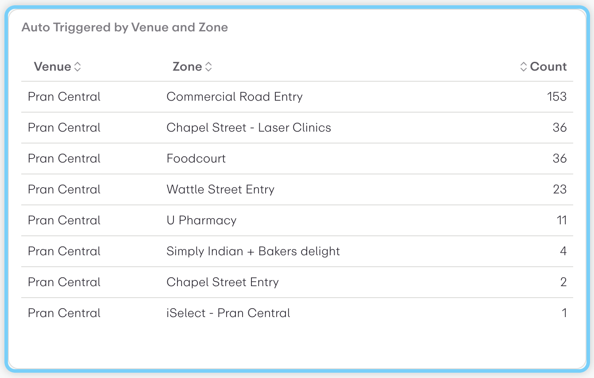

#### campaigns
Widget showing campaigns. Displayed as a Table.
```json
{
  "columnNames": [
    "Campaign",
    "Count"
  ],
  "keyAliases": {
    "c0": {
      "entity": "Campaign",
      "ids": [
        "9641",
        "9642",
        "9643"
      ]
    }
  },
  "rowSets": [
    {
      "columns": [
        {
          "dimension": {
            "key": "campaign"
          }
        },
        {
          "numericExpression": {
            "metric": "UserProfileCampaigns",
            "value": {
              "counter": "total"
            }
          },
          "sortSpecification": {
            "ascending": false,
            "priority": 1
          }
        }
      ]
    }
  ],
  "visualisation": {
    "description": {
      "html": ""
    },
    "type": "Table",
    "title": "campaigns",
    "tableSettings": {
      "paginate": false,
      "scrollOverflow": true
    }
  }
}
```

#### Gender Composition
Percentages of Males and Females
```json
{
  "keyAliases": {
    "c0": {
      "entity": "Campaign",
      "ids": [
        "9641",
        "9642",
        "9643"
      ]
    }
  },
  "columnNames": [
    "gender",
    "percentage"
  ],
  "rowSets": [
    {
      "columns": [
        {
          "dimension": {
            "key": "gender"
          }
        },
        {
          "numericExpression": {
            "$divide": [
              {
                "metric": "UserProfileCampaigns",
                "value": {
                  "counter": "total"
                }
              },
              {
                "metric": "UserProfileCampaigns",
                "value": {
                  "counter": "total"
                },
                "aggregateAcross": [
                  {
                    "key": "gender"
                  }
                ]
              }
            ]
          },
          "unit": "percentage",
          "decimalPlaces": 2
        }
      ]
    }
  ],
  "visualisation": {
    "description": {
      "html": "Percentages of Males and Females"
    },
    "type": "MultiNumber",
    "title": "Gender Composition"
  }
}
```


## UserProfileClicks
#### Campaign Clickers by Gender (postcodes 5000,5082,5085,5066,5067)
Shows clicks  broken down by campaign gender. Displayed as a Table.
```json
{
  "columnNames": [
    "Campaign",
    "Postcode",
    "Count"
  ],
  "keyAliases": {
    "postcode": [
      "5000",
      "5082",
      "5085",
      "5066",
      "5067"
    ]
  },
  "rowSets": [
    {
      "columns": [
        {
          "dimension": {
            "key": "campaign"
          },
          "sortSpecification": {
            "ascending": false,
            "priority": 1
          }
        },
        {
          "dimension": {
            "key": "gender"
          }
        },
        {
          "numericExpression": {
            "metric": "UserProfileClicks",
            "value": {
              "counter": "total"
            }
          },
          "sortSpecification": {
            "ascending": false,
            "priority": 2
          }
        }
      ]
    }
  ],
  "visualisation": {
    "description": {
      "html": ""
    },
    "type": "Table",
    "title": "Campaign Clickers by Gender (postcodes 5000,5082,5085,5066,5067)",
    "tableSettings": {
      "paginate": false,
      "scrollOverflow": true
    }
  }
}
```


**Visualization Preview:** Shows click performance across different campaigns with campaign names and corresponding click volumes, useful for campaign effectiveness analysis.
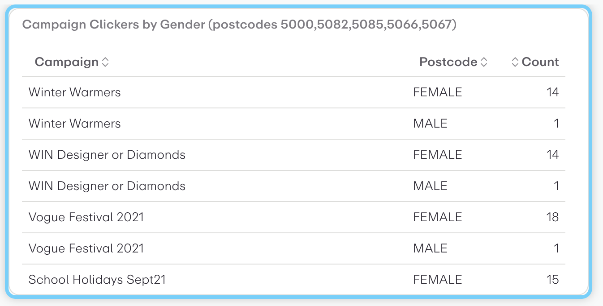

#### Campaign Clicks
Shows clicks  broken down by campaign. Displayed as a Table.
```json
{
  "columnNames": [
    "Campaign",
    "Count"
  ],
  "rowSets": [
    {
      "columns": [
        {
          "dimension": {
            "key": "campaign"
          }
        },
        {
          "numericExpression": {
            "metric": "UserProfileClicks",
            "value": {
              "counter": "total"
            }
          },
          "sortSpecification": {
            "ascending": false,
            "priority": 1
          }
        }
      ]
    }
  ],
  "visualisation": {
    "description": {
      "html": ""
    },
    "type": "Table",
    "title": "Campaign Clicks",
    "tableSettings": {
      "paginate": false,
      "scrollOverflow": true
    }
  }
}
```


**Visualization Preview:** Shows click performance across different campaigns with campaign names and corresponding click volumes, useful for campaign effectiveness analysis.
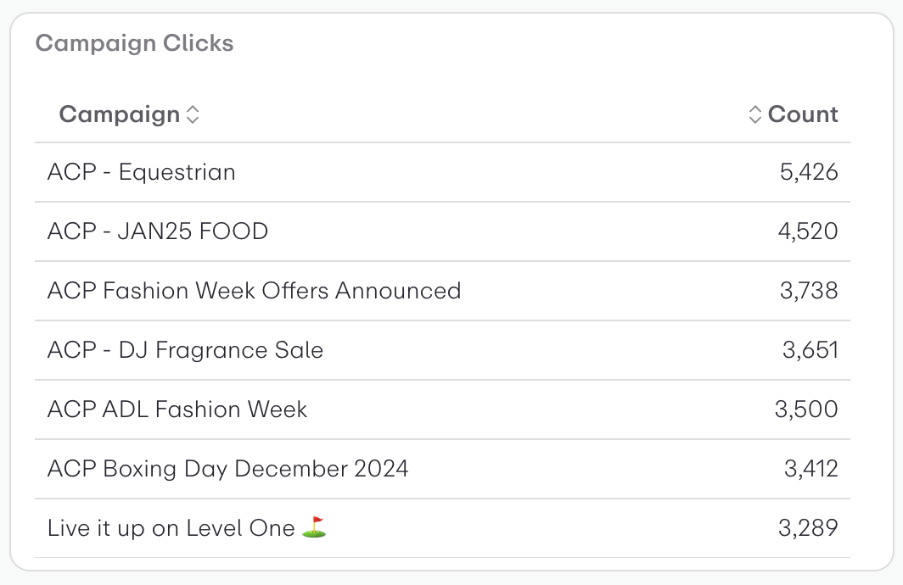

#### Auto Campaign Clicks by PageType
Shows clicks  broken down by pageType. Displayed as a Table.
```json
{
  "columnNames": [
    "Venue",
    "Count"
  ],
  "rowSets": [
    {
      "columns": [
        {
          "dimension": {
            "key": "pageType"
          }
        },
        {
          "numericExpression": {
            "metric": "UserProfileClicks",
            "value": {
              "counter": "total"
            }
          },
          "sortSpecification": {
            "ascending": false,
            "priority": 1
          }
        }
      ]
    }
  ],
  "visualisation": {
    "description": {
      "html": ""
    },
    "type": "Table",
    "title": "Auto Campaign Clicks by PageType",
    "tableSettings": {
      "paginate": false,
      "scrollOverflow": true
    }
  }
}
```

#### Clicks by Portal
Shows clicks  broken down by portal. Displayed as a Table.
```json
{
  "columnNames": [
    "Portal",
    "Count"
  ],
  "rowSets": [
    {
      "columns": [
        {
          "dimension": {
            "key": "portal"
          }
        },
        {
          "numericExpression": {
            "metric": "UserProfileClicks",
            "value": {
              "counter": "total"
            }
          },
          "sortSpecification": {
            "ascending": false,
            "priority": 1
          }
        }
      ]
    }
  ],
  "visualisation": {
    "description": {
      "html": ""
    },
    "type": "Table",
    "title": "Clicks by Portal",
    "tableSettings": {
      "paginate": false,
      "scrollOverflow": true
    }
  }
}
```

#### Clicks by URL
Shows clicks  broken down by url. Displayed as a Table.
```json
{
  "columnNames": [
    "URL",
    "Count"
  ],
  "rowSets": [
    {
      "columns": [
        {
          "dimension": {
            "key": "url"
          },
          "sortSpecification": {
            "ascending": true,
            "priority": 1
          }
        },
        {
          "numericExpression": {
            "metric": "UserProfileClicks",
            "value": {
              "counter": "total"
            }
          }
        }
      ]
    }
  ],
  "visualisation": {
    "description": {
      "html": ""
    },
    "type": "Table",
    "title": "Clicks by URL",
    "tableSettings": {
      "paginate": false,
      "scrollOverflow": true
    }
  }
}
```


**Visualization Preview:** Shows the visualization output representing the queried data in the format specified by the widget configuration.
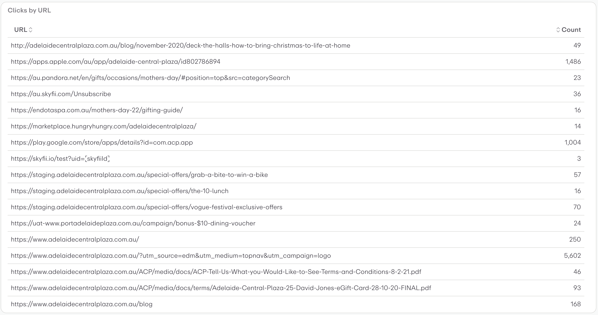

#### Auto Campaign Clicks by Venue
Shows clicks  broken down by venue. Displayed as a Table.
```json
{
  "columnNames": [
    "Venue",
    "Count"
  ],
  "rowSets": [
    {
      "columns": [
        {
          "dimension": {
            "key": "venueId"
          }
        },
        {
          "numericExpression": {
            "metric": "UserProfileClicks",
            "value": {
              "counter": "total"
            }
          },
          "sortSpecification": {
            "ascending": false,
            "priority": 1
          }
        }
      ]
    }
  ],
  "visualisation": {
    "description": {
      "html": ""
    },
    "type": "Table",
    "title": "Auto Campaign Clicks by Venue",
    "tableSettings": {
      "paginate": false,
      "scrollOverflow": true
    }
  }
}
```


## UserProfileVisits
### Histograms
#### Visit Duration (minutes) Histogram Bar Chart
Creates a histogram of user visit durations. The histogram's duration buckets and counts are visualised as a bar chart. The buckets are default dwell times for visits and sessions.
```json
{
  "columnNames": [
    "visit duration",
    "count"
  ],
  "rowSets": [
    {
      "columns": [
        {
          "dimension": {
            "histogram": {
              "metric": "UserProfileVisits",
              "histogram": "duration"
            }
          }
        },
        {
          "numericExpression": {
            "metric": "UserProfileVisits",
            "value": {
              "histogram": "duration"
            }
          }
        }
      ]
    }
  ],
  "visualisation": {
    "description": {
      "html": "Creates a histogram of user visit durations. The histogram's duration buckets and counts are visualised as a bar chart. The buckets are default dwell times for visits and sessions."
    },
    "type": "BarChart",
    "title": "Visit Duration (minutes) Histogram Bar Chart",
    "barChartSettings": {
      "showBarValues": false,
      "columnSettings": {
        "Total Visits": {
          "axis": "left",
          "type": null,
          "showOnChart": true,
          "showOnTooltip": true
        }
      },
      "tooltip": {
        "show": true
      },
      "layout": "vertical",
      "xAxis": {
        "axisLine": {
          "show": false
        },
        "inverse": false,
        "showName": false,
        "splitNumber": 5
      },
      "gridLines": "auto",
      "timeseriesResolutions": false,
      "enableChartSwitching": false,
      "yAxis": {
        "axisLine": {
          "show": false
        },
        "inverse": false,
        "showName": false,
        "splitNumber": 5
      },
      "showLegend": true,
      "hideAxis": false,
      "stackType": "no-stack"
    }
  }
}
```


**Visualization Preview:** Shows visit duration distribution with time buckets on the x-axis and frequency counts on the y-axis, revealing user engagement patterns.
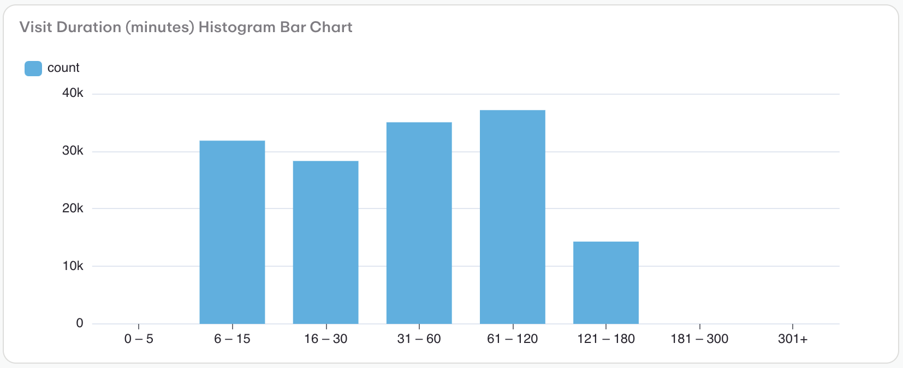

#### Visit Time of Day Histogram Line Chart
Creates a histogram of user visits by time of day. The histogram's hour of day buckets and counts are visualised as a line chart. The default buckets are the hours of the day.
```json
{
  "columnNames": [
    "hour",
    "visits"
  ],
  "rowSets": [
    {
      "columns": [
        {
          "dimension": {
            "histogram": {
              "metric": "UserProfileVisits",
              "histogram": "hourAndMinuteOfDay"
            }
          }
        },
        {
          "numericExpression": {
            "metric": "UserProfileVisits",
            "value": {
              "histogram": "hourAndMinuteOfDay"
            }
          }
        }
      ]
    }
  ],
  "visualisation": {
    "description": {
      "html": "Creates a histogram of user visits by time of day. The histogram's hour of day buckets and counts are visualised as a line chart. The default buckets are the hours of the day."
    },
    "type": "LineChart",
    "title": "Visit Time of Day Histogram Line Chart",
    "lineChartSettings": {
      "showLegend": true,
      "hideAxis": false,
      "gridLines": "auto",
      "stackType": "no-stack",
      "xAxis": {
        "axisLine": {
          "show": false
        },
        "inverse": false,
        "showName": false,
        "splitNumber": 5
      },
      "yAxis": {
        "axisLine": {
          "show": false
        },
        "inverse": false,
        "showName": false,
        "splitNumber": 5
      },
      "enableChartSwitching": false,
      "timeseriesResolutions": false,
      "columnSettings": {},
      "tooltip": {
        "show": true
      }
    }
  }
}
```


**Visualization Preview:** Displays a histogram chart with data distributed across buckets, showing frequency distribution patterns.
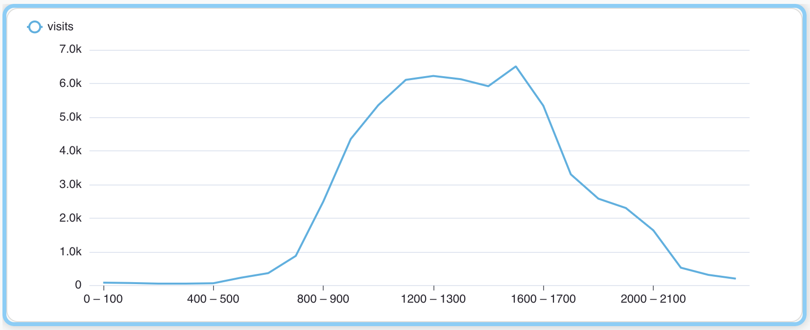

#### Primary Zone Visit Duration (minutes) Histogram Bar Chart
Creates a histogram of user visits to the primary zone, visualised as a bar chart. The histogram's duration buckets and counts are displayed in the chart. The buckets are the default dwell times for visits and sessions.
```json
{
  "columnNames": [
    "primary zone visit duration",
    "count"
  ],
  "rowSets": [
    {
      "columns": [
        {
          "dimension": {
            "histogram": {
              "metric": "UserProfileVisits",
              "histogram": "primaryZoneDuration"
            }
          }
        },
        {
          "numericExpression": {
            "metric": "UserProfileVisits",
            "value": {
              "histogram": "primaryZoneDuration"
            }
          }
        }
      ]
    }
  ],
  "visualisation": {
    "description": {
      "html": "Creates a histogram of user visits to the primary zone, visualised as a bar chart. The histogram's duration buckets and counts are displayed in the chart. The buckets are the default dwell times for visits and sessions."
    },
    "type": "BarChart",
    "title": "Primary Zone Visit Duration (minutes) Histogram Bar Chart",
    "barChartSettings": {
      "showBarValues": false,
      "columnSettings": {
        "Total Visits": {
          "axis": "left",
          "type": null,
          "showOnChart": true,
          "showOnTooltip": true
        }
      },
      "tooltip": {
        "show": true
      },
      "layout": "vertical",
      "xAxis": {
        "axisLine": {
          "show": false
        },
        "inverse": false,
        "showName": false,
        "splitNumber": 5
      },
      "gridLines": "auto",
      "timeseriesResolutions": false,
      "enableChartSwitching": false,
      "yAxis": {
        "axisLine": {
          "show": false
        },
        "inverse": false,
        "showName": false,
        "splitNumber": 5
      },
      "showLegend": true,
      "hideAxis": false,
      "stackType": "no-stack"
    }
  }
}
```


**Visualization Preview:** Displays a histogram chart with data distributed across buckets, showing frequency distribution patterns.
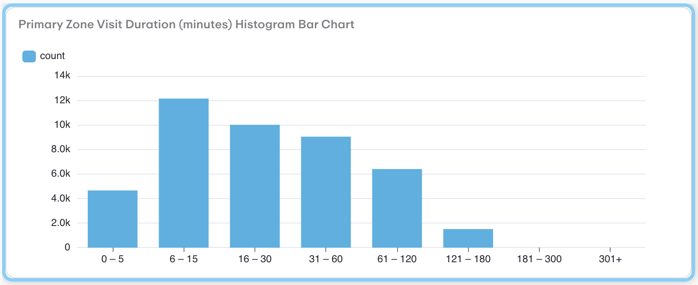


### Main Widgets
#### Gender Visitors
Count visits to a venue by visitor's gender
```json
{
  "columnNames": [
    "Venue",
    {
      "name": "gender",
      "dimension": {
        "key": "gender",
        "missing": true
      }
    }
  ],
  "rowSets": [
    {
      "columns": [
        {
          "dimension": {
            "key": "venueId"
          },
          "sortSpecification": {
            "ascending": true,
            "priority": 1
          }
        },
        {
          "numericExpression": {
            "metric": "UserProfileVisits",
            "value": {
              "counter": "total"
            }
          }
        }
      ]
    }
  ],
  "visualisation": {
    "description": {
      "html": "Count visits to a venue by visitor's gender"
    },
    "type": "Table",
    "title": "Gender Visitors",
    "tableSettings": {
      "paginate": false,
      "scrollOverflow": true
    }
  }
}
```


**Visualization Preview:** Presents gender distribution data in a columnar format, showing demographic breakdowns with missing value handling.


#### visits
Count visits to a venue by visitor's postcode (only top 5 South Australia postcodes)
```json
{
  "columnNames": [
    "Venue",
    "postcode",
    "Count"
  ],
  "keyAliases": {
    "postcode": [
      "5000",
      "5006",
      "5009",
      "5011",
      "5013",
      "5031",
      "5033",
      "5034",
      "5045",
      "5082",
      "5085",
      "5065",
      "5066",
      "5067",
      "5069",
      "5074",
      "5081",
      "5082",
      "5089"
    ]
  },
  "rowSets": [
    {
      "columns": [
        {
          "dimension": {
            "key": "venueId"
          },
          "sortSpecification": {
            "ascending": true,
            "priority": 1
          }
        },
        {
          "dimension": {
            "key": "postcode"
          },
          "sortSpecification": {
            "ascending": true,
            "priority": 2
          }
        },
        {
          "numericExpression": {
            "metric": "UserProfileVisits",
            "value": {
              "counter": "total"
            }
          }
        }
      ]
    }
  ],
  "visualisation": {
    "description": {
      "html": "Count visits to a venue by visitor's postcode (only top 5 South Australia postcodes)"
    },
    "type": "Table",
    "title": "visits",
    "tableSettings": {
      "paginate": false,
      "scrollOverflow": true
    }
  }
}
```


**Visualization Preview:** Displays visit counts by venue location, showing which locations receive the most visitor traffic over the selected time period.


#### Postcode Numeric Histogram Table (inline buckets)
Creates a histogram of user postcodes. The histogram's postcode buckets and counts are visualised as a table. The buckets are defined using inline buckets, covering various regions in South Australia and Victoria.
```json
{
  "columnNames": [
    "postcodeNumeric",
    "count"
  ],
  "rowSets": [
    {
      "columns": [
        {
          "sortSpecification": {
            "ascending": true,
            "priority": 1
          },
          "dimension": {
            "histogram": {
              "buckets": [
                {
                  "key": "SA - Adelaide Metro (5000-5099)",
                  "from": 5000,
                  "to": 5099
                },
                {
                  "key": "SA - Adelaide Hills/Eastern (5100-5199)",
                  "from": 5100,
                  "to": 5199
                },
                {
                  "key": "SA - Southern Adelaide (5200-5299)",
                  "from": 5200,
                  "to": 5299
                },
                {
                  "key": "SA - Barossa/Northern (5300-5399)",
                  "from": 5300,
                  "to": 5399
                },
                {
                  "key": "SA - Riverland/Murray (5400-5499)",
                  "from": 5400,
                  "to": 5499
                },
                {
                  "key": "SA - Mid North/Yorke Peninsula (5500-5599)",
                  "from": 5500,
                  "to": 5599
                },
                {
                  "key": "SA - Eyre Peninsula/West Coast (5600-5699)",
                  "from": 5600,
                  "to": 5699
                },
                {
                  "key": "SA - Far North/Outback (5700-5799)",
                  "from": 5700,
                  "to": 5799
                }
              ]
            }
          }
        },
        {
          "numericExpression": {
            "metric": "UserProfilesNow",
            "value": {
              "histogram": "postcodeNumeric"
            }
          }
        }
      ]
    }
  ],
  "visualisation": {
    "description": {
      "html": "Creates a histogram of user postcodes. The histogram's postcode buckets and counts are visualised as a table. The buckets are defined using inline buckets, covering various regions in South Australia and Victoria."
    },
    "type": "Table",
    "title": "Postcode Numeric Histogram Table (inline buckets)",
    "tableSettings": {
      "paginate": false,
      "scrollOverflow": true
    }
  }
}
```


**Visualization Preview:** Displays visit counts by venue location, showing which locations receive the most visitor traffic over the selected time period.
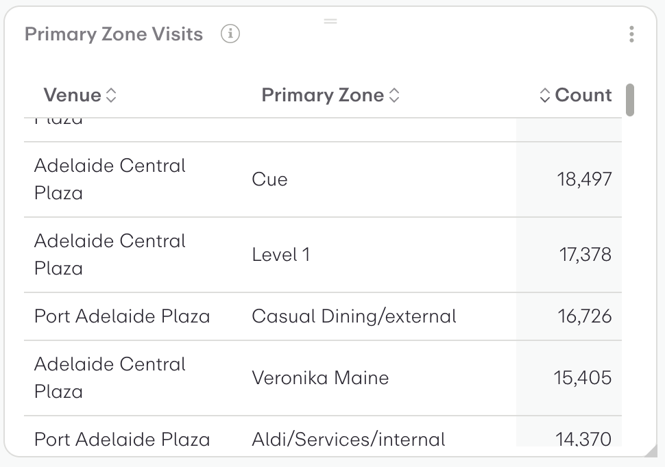

#### visits
Shows visits  broken down by venue. Displayed as a Table.
```json
{
  "columnNames": [
    "Venue",
    "Count"
  ],
  "rowSets": [
    {
      "columns": [
        {
          "dimension": {
            "key": "venueId"
          },
          "sortSpecification": {
            "ascending": true,
            "priority": 1
          }
        },
        {
          "numericExpression": {
            "metric": "UserProfileVisits",
            "value": {
              "counter": "total"
            }
          }
        }
      ]
    }
  ],
  "visualisation": {
    "description": {
      "html": ""
    },
    "type": "Table",
    "title": "visits",
    "tableSettings": {
      "paginate": false,
      "scrollOverflow": true
    }
  }
}
```


**Visualization Preview:** Displays visit counts by venue location, showing which locations receive the most visitor traffic over the selected time period.


#### Primary Zone Visits
Zone visit counts
```json
{
  "columnNames": [
    "Primary Zone",
    "Count"
  ],
  "rowSets": [
    {
      "columns": [
        {
          "dimension": {
            "key": "zoneId",
            "missing": true
          },
          "sortSpecification": {
            "ascending": true,
            "priority": 1
          }
        },
        {
          "numericExpression": {
            "metric": "UserProfileVisits",
            "value": {
              "counter": "total"
            }
          }
        }
      ]
    }
  ],
  "visualisation": {
    "description": {
      "html": "Zone visit counts"
    },
    "type": "Table",
    "title": "Primary Zone Visits",
    "tableSettings": {
      "paginate": false,
      "scrollOverflow": true
    }
  }
}
```


**Visualization Preview:** Displays data segmented by venue zones, showing activity patterns across different areas or sections.
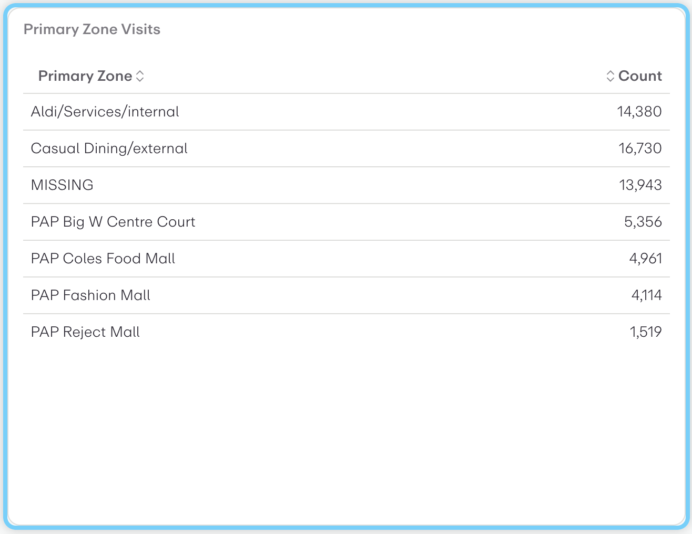

#### Primary Zone Visits
Zone visit counts
```json
{
  "columnNames": [
    "Primary Zone",
    "Count"
  ],
  "rowSets": [
    {
      "columns": [
        {
          "dimension": {
            "key": "zoneId"
          },
          "sortSpecification": {
            "ascending": true,
            "priority": 1
          }
        },
        {
          "numericExpression": {
            "metric": "UserProfileVisits",
            "value": {
              "counter": "total"
            }
          }
        }
      ]
    }
  ],
  "visualisation": {
    "description": {
      "html": "Zone visit counts"
    },
    "type": "Table",
    "title": "Primary Zone Visits",
    "tableSettings": {
      "paginate": false,
      "scrollOverflow": true
    }
  }
}
```


**Visualization Preview:** Displays data segmented by venue zones, showing activity patterns across different areas or sections.
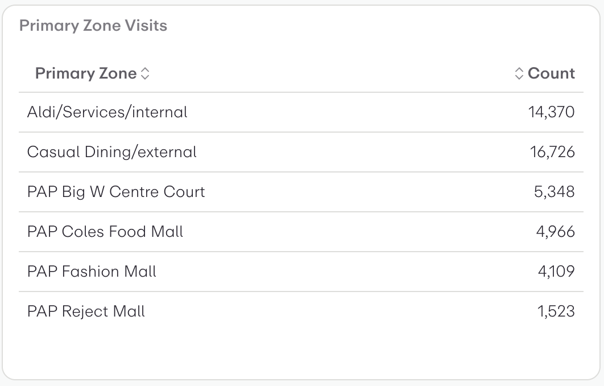


## UserProfileWiFiSessions
### Histograms
#### WiFi Session Data Usage (MB) Histogram Bar Chart
Creates a histogram of user WiFi session dataUsage, visualised as a bar chart. The histogram's data usage buckets and counts are displayed in the chart. The buckets are the default dwell times for visits and sessions.
```json
{
  "columnNames": [
    "session data usage",
    "sessions"
  ],
  "rowSets": [
    {
      "columns": [
        {
          "dimension": {
            "histogram": {
              "metric": "UserProfileWiFiSessions",
              "histogram": "dataUsage"
            }
          }
        },
        {
          "numericExpression": {
            "metric": "UserProfileWiFiSessions",
            "value": {
              "histogram": "dataUsage"
            }
          }
        }
      ]
    }
  ],
  "visualisation": {
    "description": {
      "html": "Creates a histogram of user WiFi session dataUsage, visualised as a bar chart. The histogram's data usage buckets and counts are displayed in the chart. The buckets are the default dwell times for visits and sessions."
    },
    "type": "BarChart",
    "title": "WiFi Session Data Usage (MB) Histogram Bar Chart",
    "barChartSettings": {
      "showBarValues": false,
      "columnSettings": {
        "Total Visits": {
          "axis": "left",
          "type": null,
          "showOnChart": true,
          "showOnTooltip": true
        }
      },
      "tooltip": {
        "show": true
      },
      "layout": "vertical",
      "xAxis": {
        "axisLine": {
          "show": false
        },
        "inverse": false,
        "showName": false,
        "splitNumber": 5
      },
      "gridLines": "auto",
      "timeseriesResolutions": false,
      "enableChartSwitching": false,
      "yAxis": {
        "axisLine": {
          "show": false
        },
        "inverse": false,
        "showName": false,
        "splitNumber": 5
      },
      "showLegend": true,
      "hideAxis": false,
      "stackType": "no-stack"
    }
  }
}
```


**Visualization Preview:** Displays age distribution as a histogram with age ranges on the x-axis and user counts on the y-axis, showing the demographic breakdown of users.
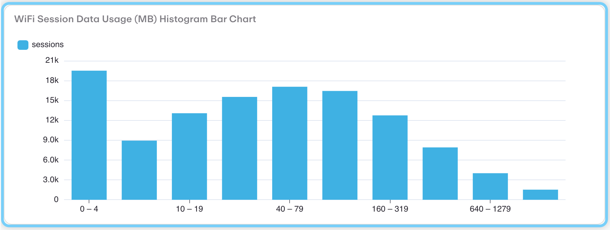

#### WiFi Session Duration (minutes) Histogram Bar Chart
Creates a histogram of user WiFi session durations, visualised as a bar chart. The histogram's duration buckets and counts are displayed in the chart. The buckets are the default dwell times for visits and sessions.
```json
{
  "columnNames": [
    "session duration",
    "sessions"
  ],
  "rowSets": [
    {
      "columns": [
        {
          "dimension": {
            "histogram": {
              "metric": "UserProfileWiFiSessions",
              "histogram": "duration"
            }
          }
        },
        {
          "numericExpression": {
            "metric": "UserProfileWiFiSessions",
            "value": {
              "histogram": "duration"
            }
          }
        }
      ]
    }
  ],
  "visualisation": {
    "description": {
      "html": "Creates a histogram of user WiFi session durations, visualised as a bar chart. The histogram's duration buckets and counts are displayed in the chart. The buckets are the default dwell times for visits and sessions."
    },
    "type": "BarChart",
    "title": "WiFi Session Duration (minutes) Histogram Bar Chart",
    "barChartSettings": {
      "showBarValues": false,
      "columnSettings": {
        "Total Visits": {
          "axis": "left",
          "type": null,
          "showOnChart": true,
          "showOnTooltip": true
        }
      },
      "tooltip": {
        "show": true
      },
      "layout": "vertical",
      "xAxis": {
        "axisLine": {
          "show": false
        },
        "inverse": false,
        "showName": false,
        "splitNumber": 5
      },
      "gridLines": "auto",
      "timeseriesResolutions": false,
      "enableChartSwitching": false,
      "yAxis": {
        "axisLine": {
          "show": false
        },
        "inverse": false,
        "showName": false,
        "splitNumber": 5
      },
      "showLegend": true,
      "hideAxis": false,
      "stackType": "no-stack"
    }
  }
}
```


**Visualization Preview:** Shows visit duration distribution with time buckets on the x-axis and frequency counts on the y-axis, revealing user engagement patterns.


#### WiFi Session Time of Day Histogram Line Chart
Creates a histogram of user WiFi Sessions by time of day. The histogram's hour of day buckets and counts are visualised as a line chart. The default buckets are the hours of the day.
```json
{
  "columnNames": [
    "hour",
    "sessions"
  ],
  "rowSets": [
    {
      "columns": [
        {
          "dimension": {
            "histogram": {
              "metric": "UserProfileWiFiSessions",
              "histogram": "hourAndMinuteOfDay"
            }
          }
        },
        {
          "numericExpression": {
            "metric": "UserProfileWiFiSessions",
            "value": {
              "histogram": "hourAndMinuteOfDay"
            }
          }
        }
      ]
    }
  ],
  "visualisation": {
    "description": {
      "html": "Creates a histogram of user WiFi Sessions by time of day. The histogram's hour of day buckets and counts are visualised as a line chart. The default buckets are the hours of the day."
    },
    "type": "LineChart",
    "title": "WiFi Session Time of Day Histogram Line Chart",
    "lineChartSettings": {
      "showLegend": true,
      "hideAxis": false,
      "gridLines": "auto",
      "stackType": "no-stack",
      "xAxis": {
        "axisLine": {
          "show": false
        },
        "inverse": false,
        "showName": false,
        "splitNumber": 5
      },
      "yAxis": {
        "axisLine": {
          "show": false
        },
        "inverse": false,
        "showName": false,
        "splitNumber": 5
      },
      "enableChartSwitching": false,
      "timeseriesResolutions": false,
      "columnSettings": {},
      "tooltip": {
        "show": true
      }
    }
  }
}
```


**Visualization Preview:** Displays a histogram chart with data distributed across buckets, showing frequency distribution patterns.
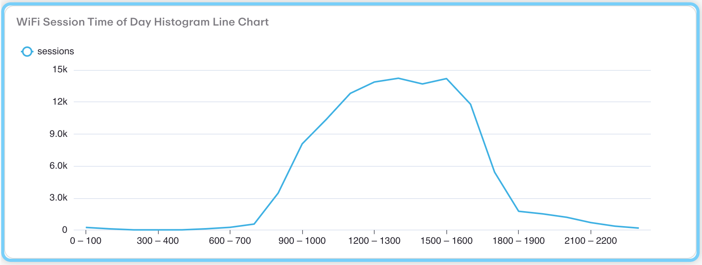


### Main Widgets
#### OS Category (Android & Apple)
OS categories
```json
{
  "columnNames": [
    "Venue",
    {
      "name": "osCategory",
      "dimension": {
        "key": "osCategory"
      }
    }
  ],
  "keyAliases": {
    "osCategory": [
      "Android",
      "IOS_OSX"
    ]
  },
  "rowSets": [
    {
      "columns": [
        {
          "dimension": {
            "key": "venueId"
          },
          "sortSpecification": {
            "ascending": true,
            "priority": 1
          }
        },
        {
          "numericExpression": {
            "metric": "UserProfileWiFiSessions",
            "value": {
              "counter": "total"
            }
          }
        }
      ]
    }
  ],
  "visualisation": {
    "description": {
      "html": "OS categories"
    },
    "type": "Table",
    "title": "OS Category (Android & Apple)",
    "tableSettings": {
      "paginate": false,
      "scrollOverflow": true
    }
  }
}
```


**Visualization Preview:** Shows WiFi session counts by venue, indicating user connectivity patterns and popular locations for digital engagement.


#### Sessions
Shows sessions  broken down by venue. Displayed as a Table.
```json
{
  "columnNames": [
    "Venue",
    "Count"
  ],
  "rowSets": [
    {
      "columns": [
        {
          "dimension": {
            "key": "venueId"
          },
          "sortSpecification": {
            "ascending": true,
            "priority": 1
          }
        },
        {
          "numericExpression": {
            "metric": "UserProfileWiFiSessions",
            "value": {
              "counter": "total"
            }
          }
        }
      ]
    }
  ],
  "visualisation": {
    "description": {
      "html": ""
    },
    "type": "Table",
    "title": "Sessions",
    "tableSettings": {
      "paginate": false,
      "scrollOverflow": true
    }
  }
}
```


**Visualization Preview:** Shows WiFi session counts by venue, indicating user connectivity patterns and popular locations for digital engagement.


## UserProfilesNow
### Histograms
#### Age In Years Histogram Table (default buckets)
Creates a histogram of user ages.  The histogram's age buckets and counts are visualised as a table. The buckets are defaults derived from the histogram's metric and the histogram name.
```json
{
  "columnNames": [
    "ageInYears",
    "count"
  ],
  "rowSets": [
    {
      "columns": [
        {
          "dimension": {
            "histogram": {
              "metric": "UserProfilesNow",
              "histogram": "ageInYears"
            }
          }
        },
        {
          "numericExpression": {
            "metric": "UserProfilesNow",
            "value": {
              "histogram": "ageInYears"
            }
          }
        }
      ]
    }
  ],
  "visualisation": {
    "description": {
      "html": "Creates a histogram of user ages.  The histogram's age buckets and counts are visualised as a table. The buckets are defaults derived from the histogram's metric and the histogram name."
    },
    "type": "Table",
    "title": "Age In Years Histogram Table (default buckets)",
    "tableSettings": {
      "paginate": false,
      "scrollOverflow": true
    }
  }
}
```


**Visualization Preview:** Displays age distribution as a histogram with age ranges on the x-axis and user counts on the y-axis, showing the demographic breakdown of users.
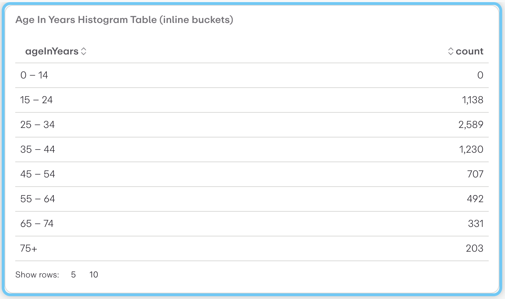

#### Age In Years Histogram Table (inline buckets)
Creates a histogram of user ages. The histogram's age buckets and counts are visualised as a table. The buckets are defined using inline buckets. The first bucket is for ages up to 20, the second bucket is for ages from 20 to 40, and the third bucket is for ages over 40.
```json
{
  "columnNames": [
    "ageInYears",
    "count"
  ],
  "rowSets": [
    {
      "columns": [
        {
          "dimension": {
            "histogram": {
              "buckets": [
                {
                  "to": 20
                },
                {
                  "from": 20,
                  "to": 40
                },
                {
                  "from": 40
                }
              ]
            }
          }
        },
        {
          "numericExpression": {
            "metric": "UserProfilesNow",
            "value": {
              "histogram": "ageInYears"
            }
          }
        }
      ]
    }
  ],
  "visualisation": {
    "description": {
      "html": "Creates a histogram of user ages. The histogram's age buckets and counts are visualised as a table. The buckets are defined using inline buckets. The first bucket is for ages up to 20, the second bucket is for ages from 20 to 40, and the third bucket is for ages over 40."
    },
    "type": "Table",
    "title": "Age In Years Histogram Table (inline buckets)"
  }
}
```


**Visualization Preview:** Displays age distribution as a histogram with age ranges on the x-axis and user counts on the y-axis, showing the demographic breakdown of users.
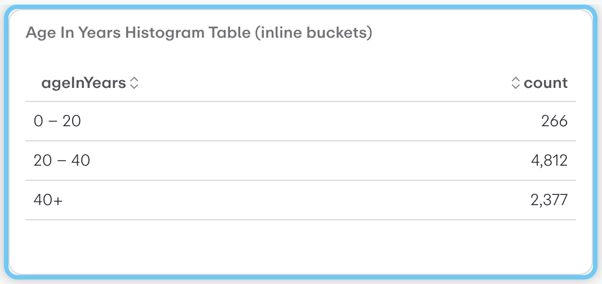

#### 20 to 40 Years Old Count
Count of users aged between 20 and 40 years old.  This uses an inline bucket for the age range. The count is visualised as a number.
```json
{
  "columnNames": [
    "20 to 40"
  ],
  "rowSets": [
    {
      "columns": [
        {
          "numericExpression": {
            "metric": "UserProfilesNow",
            "value": {
              "histogram": "ageInYears",
              "bucket": {
                "from": 20,
                "to": 40
              }
            }
          }
        }
      ]
    }
  ],
  "visualisation": {
    "description": {
      "html": "Count of users aged between 20 and 40 years old.  This uses an inline bucket for the age range. The count is visualised as a number."
    },
    "type": "Number",
    "title": "20 to 40 Years Old Count"
  }
}
```


**Visualization Preview:** Displays age distribution as a histogram with age ranges on the x-axis and user counts on the y-axis, showing the demographic breakdown of users.


#### Country Calling Code Histogram Table (default buckets)
Creates a histogram of user country calling codes. The histogram's country calling code buckets and counts are visualised as a table.
```json
{
  "columnNames": [
    "countryCallingCodeNumeric",
    "count"
  ],
  "rowSets": [
    {
      "columns": [
        {
          "dimension": {
            "histogram": {
              "metric": "UserProfilesNow",
              "histogram": "countryCallingCodeNumeric"
            }
          }
        },
        {
          "numericExpression": {
            "metric": "UserProfilesNow",
            "value": {
              "histogram": "countryCallingCodeNumeric"
            }
          }
        }
      ]
    }
  ],
  "visualisation": {
    "description": {
      "html": "Creates a histogram of user country calling codes. The histogram's country calling code buckets and counts are visualised as a table."
    },
    "type": "Table",
    "title": "Country Calling Code Histogram Table (default buckets)",
    "tableSettings": {
      "paginate": false,
      "scrollOverflow": true
    }
  }
}
```


**Visualization Preview:** Displays a histogram chart with data distributed across buckets, showing frequency distribution patterns.
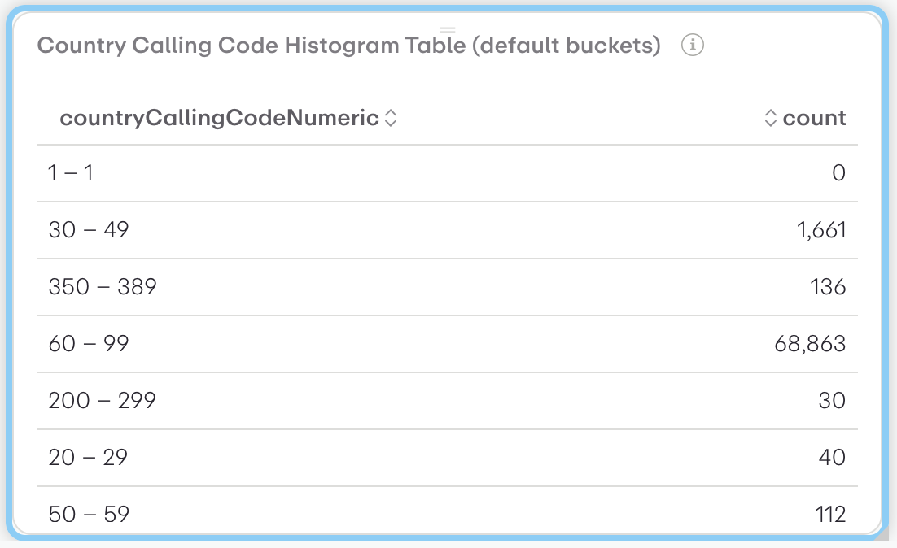

#### Signup Hour Histogram
Creates a histogram of user signup times by hour of the day. The histogram's hour buckets and counts are visualised as a bar chart. The buckets are hour-of-day defaults, derived from the histogram's metric and the histogram name.
```json
{
  "columnNames": [
    "Hour of Day",
    "Count"
  ],
  "rowSets": [
    {
      "columns": [
        {
          "dimension": {
            "histogram": {
              "metric": "UserProfilesNow",
              "histogram": "hourAndMinuteOfDay"
            }
          }
        },
        {
          "numericExpression": {
            "metric": "UserProfilesNow",
            "value": {
              "histogram": "hourAndMinuteOfDay"
            }
          }
        }
      ]
    }
  ],
  "visualisation": {
    "imageFile": "",
    "description": {
      "html": "Creates a histogram of user signup times by hour of the day. The histogram's hour buckets and counts are visualised as a bar chart. The buckets are hour-of-day defaults, derived from the histogram's metric and the histogram name."
    },
    "barChartSettings": {
      "showBarValues": false,
      "columnSettings": {
        "Total Visits": {
          "axis": "left",
          "type": null,
          "showOnChart": true,
          "showOnTooltip": true
        }
      },
      "tooltip": {
        "show": true
      },
      "layout": "vertical",
      "xAxis": {
        "axisLine": {
          "show": false
        },
        "inverse": false,
        "showName": false,
        "splitNumber": 5
      },
      "gridLines": "auto",
      "timeseriesResolutions": false,
      "enableChartSwitching": false,
      "yAxis": {
        "axisLine": {
          "show": false
        },
        "inverse": false,
        "showName": false,
        "splitNumber": 5
      },
      "showLegend": true,
      "hideAxis": false,
      "stackType": "no-stack"
    },
    "title": "Signup Hour Histogram",
    "type": "BarChart"
  }
}
```


**Visualization Preview:** Displays a histogram chart with data distributed across buckets, showing frequency distribution patterns.
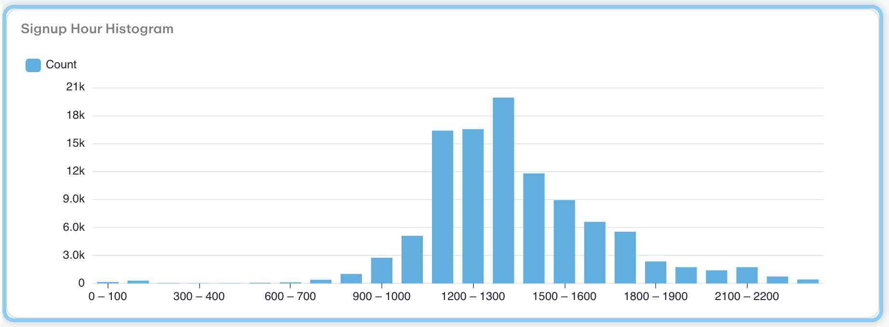

#### Postcode Numeric Histogram Table (inline buckets)
Creates a histogram of user postcodes. The histogram's postcode buckets and counts are visualised as a table. The buckets are defined using inline buckets, covering various regions in South Australia and Victoria.
```json
{
  "columnNames": [
    "postcodeNumeric",
    "count"
  ],
  "rowSets": [
    {
      "columns": [
        {
          "dimension": {
            "histogram": {
              "buckets": [
                {
                  "key": "SA - Adelaide Metro (5000-5099)",
                  "from": 5000,
                  "to": 5099
                },
                {
                  "key": "SA - Adelaide Hills/Eastern (5100-5199)",
                  "from": 5100,
                  "to": 5199
                },
                {
                  "key": "SA - Southern Adelaide (5200-5299)",
                  "from": 5200,
                  "to": 5299
                },
                {
                  "key": "SA - Barossa/Northern (5300-5399)",
                  "from": 5300,
                  "to": 5399
                },
                {
                  "key": "SA - Riverland/Murray (5400-5499)",
                  "from": 5400,
                  "to": 5499
                },
                {
                  "key": "SA - Mid North/Yorke Peninsula (5500-5599)",
                  "from": 5500,
                  "to": 5599
                },
                {
                  "key": "SA - Eyre Peninsula/West Coast (5600-5699)",
                  "from": 5600,
                  "to": 5699
                },
                {
                  "key": "SA - Far North/Outback (5700-5799)",
                  "from": 5700,
                  "to": 5799
                },
                {
                  "key": "VIC - Melbourne CBD/Inner (3000-3099)",
                  "from": 3000,
                  "to": 3099
                },
                {
                  "key": "VIC - Melbourne Eastern (3100-3199)",
                  "from": 3100,
                  "to": 3199
                },
                {
                  "key": "VIC - Melbourne Western (3200-3299)",
                  "from": 3200,
                  "to": 3299
                },
                {
                  "key": "VIC - Melbourne Northern (3300-3399)",
                  "from": 3300,
                  "to": 3399
                },
                {
                  "key": "VIC - Geelong/Western Districts (3400-3499)",
                  "from": 3400,
                  "to": 3499
                },
                {
                  "key": "VIC - Central Highlands/Ballarat (3500-3599)",
                  "from": 3500,
                  "to": 3599
                },
                {
                  "key": "VIC - Gippsland/Eastern (3600-3699)",
                  "from": 3600,
                  "to": 3699
                },
                {
                  "key": "VIC - Murray River/North (3700-3799)",
                  "from": 3700,
                  "to": 3799
                },
                {
                  "key": "VIC - Wimmera/Mallee (3800-3899)",
                  "from": 3800,
                  "to": 3899
                },
                {
                  "key": "VIC - Far East/Alpine (3900-3999)",
                  "from": 3900,
                  "to": 3999
                },
                {
                  "key": "VIC - Special Addresses (8000-8999)",
                  "from": 8000,
                  "to": 8999
                }
              ]
            }
          }
        },
        {
          "numericExpression": {
            "metric": "UserProfilesNow",
            "value": {
              "histogram": "postcodeNumeric"
            }
          }
        }
      ]
    }
  ],
  "visualisation": {
    "description": {
      "html": "Creates a histogram of user postcodes. The histogram's postcode buckets and counts are visualised as a table. The buckets are defined using inline buckets, covering various regions in South Australia and Victoria."
    },
    "type": "Table",
    "title": "Postcode Numeric Histogram Table (inline buckets)",
    "tableSettings": {
      "paginate": false,
      "scrollOverflow": true
    }
  }
}
```


**Visualization Preview:** Presents postcode distribution as a histogram with postal code ranges and their corresponding user counts.
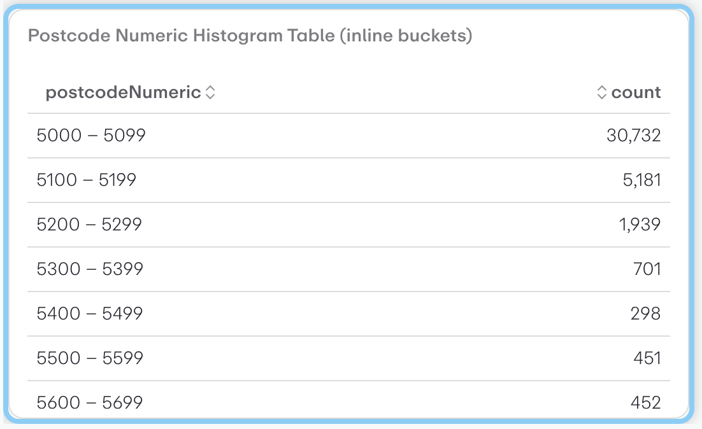

#### Year of Birth Histogram Table (inline buckets)
Creates a histogram of user year of birth. The histogram's buckets and counts are visualised as a table. The buckets are defined using inline buckets. The three buckets are for years up to 1975, from 1975 to 2000, and from 2000 onwards.
```json
{
  "columnNames": [
    "yearOfBirth",
    "count"
  ],
  "rowSets": [
    {
      "columns": [
        {
          "dimension": {
            "histogram": {
              "buckets": [
                {
                  "to": 1975
                },
                {
                  "from": 1975,
                  "to": 2000
                },
                {
                  "from": 2000
                }
              ]
            }
          }
        },
        {
          "numericExpression": {
            "metric": "UserProfilesNow",
            "value": {
              "histogram": "yearOfBirth"
            }
          }
        }
      ]
    }
  ],
  "visualisation": {
    "description": {
      "html": "Creates a histogram of user year of birth. The histogram's buckets and counts are visualised as a table. The buckets are defined using inline buckets. The three buckets are for years up to 1975, from 1975 to 2000, and from 2000 onwards."
    },
    "type": "Table",
    "title": "Year of Birth Histogram Table (inline buckets)"
  }
}
```


**Visualization Preview:** Displays a histogram chart with data distributed across buckets, showing frequency distribution patterns.


### Main Widgets
#### Age in Years
Age in Years
```json
{
  "columnNames": [
    "Age in Years",
    "Count"
  ],
  "rowSets": [
    {
      "columns": [
        {
          "dimension": {
            "key": "ageInYears"
          },
          "sortSpecification": {
            "ascending": true,
            "priority": 1
          }
        },
        {
          "numericExpression": {
            "metric": "UserProfilesNow",
            "value": {
              "counter": "total"
            }
          }
        }
      ]
    }
  ],
  "visualisation": {
    "description": {
      "html": "Age in Years"
    },
    "type": "BarChart",
    "title": "Age in Years",
    "tableSettings": {
      "paginate": true,
      "scrollOverflow": true
    }
  }
}
```


**Visualization Preview:** Shows the visualization output representing the queried data in the format specified by the widget configuration.


#### Country And State
Count registrations by country and state
```json
{
  "columnNames": [
    "Country",
    "State",
    "Count"
  ],
  "keyAliases": {
    "country": [
      "Australia",
      "United States"
    ]
  },
  "rowSets": [
    {
      "columns": [
        {
          "dimension": {
            "key": "country"
          },
          "sortSpecification": {
            "ascending": true,
            "priority": 1
          }
        },
        {
          "dimension": {
            "key": "state"
          },
          "sortSpecification": {
            "ascending": true,
            "priority": 2
          }
        },
        {
          "numericExpression": {
            "metric": "UserProfilesNow",
            "value": {
              "counter": "total"
            }
          }
        }
      ]
    }
  ],
  "visualisation": {
    "description": {
      "html": "Count registrations by country and state"
    },
    "type": "Table",
    "tableSettings": {
      "paginate": false,
      "scrollOverflow": true
    }
  }
}
```

#### Country Calling Codes
Count registrations by County Calling Code
```json
{
  "columnNames": [
    "Country",
    "Calling Code",
    "Count"
  ],
  "keyAliases2": {
    "country": [
      "Australia"
    ],
    "state": [
      "new south wales"
    ]
  },
  "rowSets": [
    {
      "columns": [
        {
          "dimension": {
            "key": "country"
          }
        },
        {
          "dimension": {
            "key": "countryCallingCode"
          }
        },
        {
          "numericExpression": {
            "metric": "UserProfilesNow",
            "value": {
              "counter": "total"
            }
          },
          "sortSpecification": {
            "ascending": false,
            "priority": 1
          }
        }
      ]
    }
  ],
  "visualisation": {
    "description": {
      "html": "Count registrations by County Calling Code"
    },
    "type": "Table",
    "title": "Country Calling Codes",
    "tableSettings": {
      "paginate": false,
      "scrollOverflow": true
    }
  }
}
```

#### Device Category
Device categories
```json
{
  "columnNames": [
    "Device Category",
    "Count"
  ],
  "keyAliases": {
    "country": [
      "Australia",
      "United States"
    ]
  },
  "rowSets": [
    {
      "columns": [
        {
          "dimension": {
            "key": "deviceCategory"
          },
          "sortSpecification": {
            "ascending": true,
            "priority": 1
          }
        },
        {
          "numericExpression": {
            "metric": "UserProfilesNow",
            "value": {
              "counter": "total"
            }
          }
        }
      ]
    }
  ],
  "visualisation": {
    "description": {
      "html": "Device categories"
    },
    "type": "PieChart",
    "title": "Device Category"
  }
}
```

#### Email
Subscribed registrations with Email
```json
{
  "keyAliases": {
    "hasEmail": [
      "true"
    ],
    "status": [
      "subscribed"
    ]
  },
  "columnNames": [
    "Email"
  ],
  "rowSets": [
    {
      "columns": [
        {
          "numericExpression": {
            "metric": "UserProfilesNow",
            "value": {
              "counter": "total"
            }
          }
        }
      ]
    }
  ],
  "visualisation": {
    "description": {
      "html": "Subscribed registrations with Email"
    },
    "type": "Number",
    "title": "Email"
  }
}
```

#### ACP - Visitor AND Gender:MALE AND postcode:5000
Group registrations by Single Choice Extended Attribute answers
```json
{
  "columnNames": [
    "Count"
  ],
  "keyAliases": {
    "extendedAttribute:551": [
      "ACP - Visitor"
    ],
    "gender": [
      "MALE"
    ],
    "postcode": [
      "5000"
    ]
  },
  "rowSets": [
    {
      "columns": [
        {
          "numericExpression": {
            "metric": "UserProfilesNow",
            "value": {
              "counter": "total"
            }
          },
          "sortSpecification": {
            "ascending": false,
            "priority": 1
          }
        }
      ]
    }
  ],
  "visualisation": {
    "description": {
      "html": "Group registrations by Single Choice Extended Attribute answers"
    },
    "type": "Number",
    "title": "ACP - Visitor AND Gender:MALE AND postcode:5000",
    "tableSettings": {
      "paginate": false,
      "scrollOverflow": true
    }
  }
}
```

#### Single Choice Attribute
Group registrations by Single Choice Extended Attribute answers
```json
{
  "columnNames": [
    "Answer",
    "Gender",
    "Count"
  ],
  "keyAliases": {
    "extendedAttribute:551": [
      "ACP Local Resident"
    ]
  },
  "rowSets": [
    {
      "columns": [
        {
          "dimension": {
            "key": "extendedAttribute:551"
          }
        },
        {
          "dimension": {
            "key": "country"
          }
        },
        {
          "numericExpression": {
            "metric": "UserProfilesNow",
            "value": {
              "counter": "total"
            }
          },
          "sortSpecification": {
            "ascending": false,
            "priority": 1
          }
        }
      ]
    }
  ],
  "visualisation": {
    "description": {
      "html": "Group registrations by Single Choice Extended Attribute answers"
    },
    "type": "Table",
    "title": "Single Choice Attribute",
    "tableSettings": {
      "paginate": false,
      "scrollOverflow": true
    }
  }
}
```

#### Gender Distribution (columns, missing values)
Demo grouping gender into columns.  Missing values are included.
```json
{
  "visualisation": {
    "type": "Table",
    "title": "Gender Distribution (columns, missing values)",
    "description": {
      "html": "Demo grouping gender into columns.  Missing values are included."
    },
    "imageFile": "",
    "tableSettings": {
      "columnSettings": {},
      "paginate": false,
      "scrollOverflow": true
    }
  },
  "columnNames": [
    {
      "name": "gender",
      "dimension": {
        "key": "gender",
        "missing": true
      }
    }
  ],
  "rowSets": [
    {
      "columns": [
        {
          "numericExpression": {
            "metric": "UserProfilesNow",
            "value": {
              "counter": "total"
            }
          }
        }
      ]
    }
  ]
}
```


**Visualization Preview:** Presents gender distribution data in a columnar format, showing demographic breakdowns with missing value handling.


#### Gender Composition
Percentages of Males and Females
```json
{
  "keyAliases": {
    "gender": [
      "MALE",
      "FEMALE"
    ]
  },
  "columnNames": [
    "gender",
    "percentage"
  ],
  "rowSets": [
    {
      "columns": [
        {
          "dimension": {
            "key": "gender"
          }
        },
        {
          "numericExpression": {
            "$divide": [
              {
                "metric": "UserProfilesNow",
                "value": {
                  "counter": "total"
                }
              },
              {
                "metric": "UserProfilesNow",
                "value": {
                  "counter": "total"
                },
                "aggregateAcross": [
                  {
                    "key": "gender"
                  }
                ]
              }
            ]
          },
          "unit": "percentage",
          "decimalPlaces": 2
        }
      ]
    }
  ],
  "visualisation": {
    "description": {
      "html": "Percentages of Males and Females"
    },
    "type": "MultiNumber",
    "title": "Gender Composition"
  }
}
```

#### M
Count Male registrations
```json
{
  "keyAliases": {
    "gender": [
      "MALE"
    ]
  },
  "columnNames": [
    "Males"
  ],
  "rowSets": [
    {
      "columns": [
        {
          "numericExpression": {
            "metric": "UserProfilesNow",
            "value": {
              "counter": "total"
            }
          }
        }
      ]
    }
  ],
  "visualisation": {
    "description": {
      "html": "Count Male registrations"
    },
    "type": "Number",
    "title": "M"
  }
}
```

#### Gender Stats
Count registrations
```json
{
  "columnNames": [
    "gender",
    "count",
    "total",
    "percentage"
  ],
  "rowSets": [
    {
      "columns": [
        {
          "dimension": {
            "key": "gender"
          }
        },
        {
          "numericExpression": {
            "metric": "UserProfilesNow",
            "value": {
              "counter": "total"
            }
          }
        },
        {
          "numericExpression": {
            "metric": "UserProfilesNow",
            "value": {
              "counter": "total"
            },
            "aggregateAcross": [
              {
                "key": "gender"
              }
            ]
          }
        },
        {
          "numericExpression": {
            "$divide": [
              {
                "metric": "UserProfilesNow",
                "value": {
                  "counter": "total"
                }
              },
              {
                "metric": "UserProfilesNow",
                "value": {
                  "counter": "total"
                },
                "aggregateAcross": [
                  {
                    "key": "gender"
                  }
                ]
              }
            ]
          },
          "unit": "percentage",
          "decimalPlaces": 2
        }
      ]
    }
  ],
  "visualisation": {
    "description": {
      "html": "Count registrations"
    },
    "type": "Table",
    "title": "Gender Stats"
  }
}
```

#### Non-English Languages
Top 5 non-english languages
```json
{
  "columnNames": [
    "Language",
    "Count"
  ],
  "keyAliases": {
    "language": [
      "zh",
      "de",
      "fr",
      "nl",
      "it"
    ]
  },
  "rowSets": [
    {
      "columns": [
        {
          "dimension": {
            "key": "language"
          }
        },
        {
          "numericExpression": {
            "metric": "UserProfilesNow",
            "value": {
              "counter": "total"
            }
          },
          "sortSpecification": {
            "ascending": false,
            "priority": 1
          }
        }
      ]
    }
  ],
  "visualisation": {
    "description": {
      "html": "Top 5 non-english languages"
    },
    "type": "PieChart",
    "title": "Non-English Languages"
  }
}
```

#### List Size
Subscribed and Unsubscribed users by Marketing List (and registration status is subscribed)
```json
{
  "columnNames": [
    "Status",
    "Count"
  ],
  "keyAliases": {
    "status": [
      "subscribed",
      "unsubscribed"
    ]
  },
  "rowSets": [
    {
      "columns": [
        {
          "dimension": {
            "key": "ml"
          }
        },
        {
          "numericExpression": {
            "metric": "UserProfilesNow",
            "value": {
              "counter": "total"
            }
          },
          "sortSpecification": {
            "ascending": false,
            "priority": 1
          }
        }
      ]
    }
  ],
  "visualisation": {
    "description": {
      "html": "Subscribed and Unsubscribed users by Marketing List (and registration status is subscribed)"
    },
    "type": "Table",
    "title": "List Size",
    "tableSettings": {
      "paginate": false,
      "scrollOverflow": true
    }
  }
}
```

#### Non-English Languages
Top 5 non-english locale
```json
{
  "columnNames": [
    "Locale",
    "Count"
  ],
  "keyAliases": {
    "language": [
      "zh",
      "de",
      "fr",
      "nl",
      "it"
    ]
  },
  "rowSets": [
    {
      "columns": [
        {
          "dimension": {
            "key": "locale"
          }
        },
        {
          "numericExpression": {
            "metric": "UserProfilesNow",
            "value": {
              "counter": "total"
            }
          },
          "sortSpecification": {
            "ascending": false,
            "priority": 1
          }
        }
      ]
    }
  ],
  "visualisation": {
    "description": {
      "html": "Top 5 non-english locale"
    },
    "type": "PieChart",
    "title": "Non-English Languages"
  }
}
```

#### OS Category (Android & Apple)
OS categories
```json
{
  "columnNames": [
    "OS",
    "Count"
  ],
  "keyAliases": {
    "osCategory": [
      "Android",
      "IOS_OSX"
    ]
  },
  "rowSets": [
    {
      "columns": [
        {
          "dimension": {
            "key": "osCategory"
          },
          "sortSpecification": {
            "ascending": true,
            "priority": 1
          }
        },
        {
          "numericExpression": {
            "metric": "UserProfilesNow",
            "value": {
              "counter": "total"
            }
          }
        }
      ]
    }
  ],
  "visualisation": {
    "description": {
      "html": "OS categories"
    },
    "type": "Table",
    "title": "OS Category (Android & Apple)"
  }
}
```


**Visualization Preview:** Displays operating system usage statistics showing the distribution of different OS types among users.


#### Postcodes
Postcode 
```json
{
  "columnNames": [
    "Postcode",
    "Count",
    "total",
    "ratio"
  ],
  "keyAliases": {
    "country": [
      "Australia"
    ],
    "postcode": [
      "5000",
      "5082",
      "5066",
      "5067",
      "5085",
      "5006",
      "5072",
      "5065",
      "5063",
      "5070",
      "5073",
      "5068",
      "5061",
      "5062",
      "5081",
      "5069",
      "5008",
      "5064",
      "5031",
      "5022"
    ]
  },
  "rowSets": [
    {
      "columns": [
        {
          "dimension": {
            "key": "postcode"
          }
        },
        {
          "numericExpression": {
            "metric": "UserProfilesNow",
            "value": {
              "counter": "total"
            },
            "aggregateAcross": [
              {
                "key": "postcode"
              }
            ]
          }
        },
        {
          "numericExpression": {
            "metric": "UserProfilesNow",
            "value": {
              "counter": "total"
            }
          },
          "sortSpecification": {
            "ascending": false,
            "priority": 1
          }
        },
        {
          "numericExpression": {
            "$divide": [
              {
                "metric": "UserProfilesNow",
                "value": {
                  "counter": "total"
                }
              },
              {
                "metric": "UserProfilesNow",
                "value": {
                  "counter": "total"
                },
                "aggregateAcross": [
                  {
                    "key": "postcode"
                  }
                ]
              }
            ]
          },
          "unit": "percentage",
          "decimalPlaces": 2
        }
      ]
    }
  ],
  "visualisation": {
    "description": {
      "html": "Postcode "
    },
    "type": "Table",
    "title": "Postcodes",
    "tableSettings": {
      "paginate": false,
      "scrollOverflow": true
    }
  }
}
```

#### Postcodes
Count registrations by NSW Postcodes
```json
{
  "columnNames": [
    "Postcode",
    "Count"
  ],
  "keyAliases": {
    "country": [
      "Australia"
    ]
  },
  "rowSets": [
    {
      "columns": [
        {
          "dimension": {
            "key": "postcode"
          }
        },
        {
          "numericExpression": {
            "metric": "UserProfilesNow",
            "value": {
              "counter": "total"
            }
          },
          "sortSpecification": {
            "ascending": false,
            "priority": 1
          }
        }
      ]
    }
  ],
  "visualisation": {
    "description": {
      "html": "Count registrations by NSW Postcodes"
    },
    "type": "Table",
    "title": "Postcodes",
    "tableSettings": {
      "paginate": false,
      "scrollOverflow": true
    }
  }
}
```

#### Single Choice Attribute
Group registrations by Single Choice Extended Attribute answers
```json
{
  "columnNames": [
    "Answer",
    "Count"
  ],
  "rowSets": [
    {
      "columns": [
        {
          "dimension": {
            "key": "extendedAttribute:551"
          }
        },
        {
          "numericExpression": {
            "metric": "UserProfilesNow",
            "value": {
              "counter": "total"
            }
          },
          "sortSpecification": {
            "ascending": false,
            "priority": 1
          }
        }
      ]
    }
  ],
  "visualisation": {
    "description": {
      "html": "Group registrations by Single Choice Extended Attribute answers"
    },
    "type": "Table",
    "title": "Single Choice Attribute",
    "tableSettings": {
      "paginate": false,
      "scrollOverflow": true
    }
  }
}
```

#### Registration Status
Registration Status
```json
{
  "columnNames": [
    "Status",
    "Count"
  ],
  "rowSets": [
    {
      "columns": [
        {
          "dimension": {
            "key": "status"
          }
        },
        {
          "numericExpression": {
            "metric": "UserProfilesNow",
            "value": {
              "counter": "total"
            }
          },
          "sortSpecification": {
            "ascending": false,
            "priority": 1
          }
        }
      ]
    }
  ],
  "visualisation": {
    "description": {
      "html": "Registration Status"
    },
    "type": "PieChart",
    "title": "Registration Status",
    "tableSettings": {
      "paginate": false,
      "scrollOverflow": true
    }
  }
}
```

#### Subscribers
Opted-in Subscribers by Marketing List (and registration status is subscribed)
```json
{
  "columnNames": [
    "Status",
    "Count"
  ],
  "keyAliases": {
    "status": [
      "subscribed"
    ]
  },
  "rowSets": [
    {
      "columns": [
        {
          "dimension": {
            "key": "mlSub"
          }
        },
        {
          "numericExpression": {
            "metric": "UserProfilesNow",
            "value": {
              "counter": "total"
            }
          },
          "sortSpecification": {
            "ascending": false,
            "priority": 1
          }
        }
      ]
    }
  ],
  "visualisation": {
    "description": {
      "html": "Opted-in Subscribers by Marketing List (and registration status is subscribed)"
    },
    "type": "Table",
    "title": "Subscribers",
    "tableSettings": {
      "paginate": false,
      "scrollOverflow": true
    }
  }
}
```

#### Suburbs
Count registrations by Australian Suburbs
```json
{
  "columnNames": [
    "Suburbs",
    "Count"
  ],
  "keyAliases": {
    "country": [
      "Australia"
    ]
  },
  "rowSets": [
    {
      "columns": [
        {
          "dimension": {
            "key": "suburb"
          },
          "sortSpecification": {
            "ascending": true,
            "priority": 1
          }
        },
        {
          "numericExpression": {
            "metric": "UserProfilesNow",
            "value": {
              "counter": "total"
            }
          }
        }
      ]
    }
  ],
  "visualisation": {
    "description": {
      "html": "Count registrations by Australian Suburbs"
    },
    "type": "PieChart",
    "title": "Suburbs",
    "tableSettings": {
      "paginate": false,
      "scrollOverflow": true
    }
  }
}
```

#### Year of Birth
Year of Birth
```json
{
  "columnNames": [
    "Year",
    "Count"
  ],
  "rowSets": [
    {
      "columns": [
        {
          "dimension": {
            "key": "yearOfBirth"
          },
          "sortSpecification": {
            "ascending": false,
            "priority": 1
          }
        },
        {
          "numericExpression": {
            "metric": "UserProfilesNow",
            "value": {
              "counter": "total"
            }
          }
        }
      ]
    }
  ],
  "visualisation": {
    "description": {
      "html": "Year of Birth"
    },
    "type": "Table",
    "title": "Year of Birth",
    "tableSettings": {
      "paginate": true,
      "scrollOverflow": true
    }
  }
}
```


## UserProfilesRegistrationGroup
#### Table
A table
```json
{
  "visualisation": {
    "type": "Table",
    "title": "Table",
    "description": {
      "html": "A table"
    },
    "imageFile": "",
    "tableSettings": {
      "columnSettings": {},
      "paginate": false,
      "scrollOverflow": true
    }
  },
  "columnNames": [
    {
      "name": "AGE",
      "dimension": {
        "segment": "AGE"
      }
    }
  ],
  "rowSets": [
    {
      "columns": [
        {
          "numericExpression": {
            "metric": "UserProfilesRegistrationGroup",
            "value": {
              "counter": "total"
            }
          }
        }
      ]
    }
  ]
}
```


